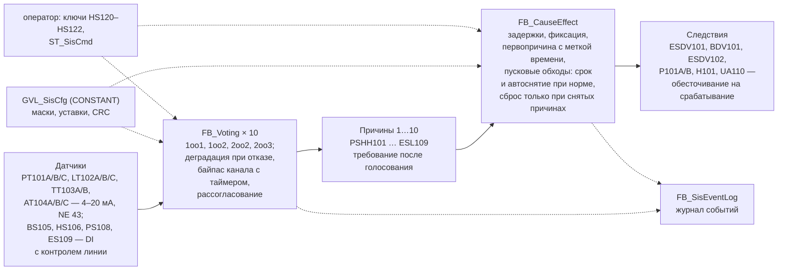
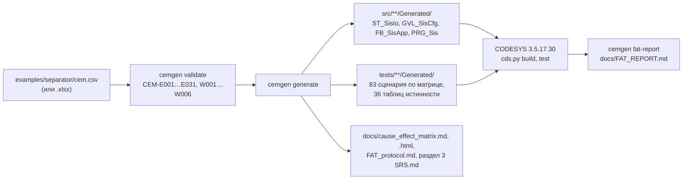

# sis-interlock-demo

[](https://github.com/<GITHUB_USER>/sis-interlock-demo/actions/workflows/ci.yml)

> **Внимание.** Код демонстрационный и не предназначен для систем безопасности. Реальная ПАЗ
> требует определения SIL, сертифицированных аппаратных и программных средств и валидации по
> ГОСТ Р МЭК 61511.

Логика противоаварийной защиты (ПАЗ) на ST для CODESYS V3.5: голосование MooN с деградацией при
отказе каналов, исполнитель матрицы причин и следствий с задержками, первопричиной, пусковыми
обходами (срок и автоматическое снятие после подтверждения нормы) и ручным сбросом. Конфигурация
ПЛК, тесты по матрице, таблица матрицы для документации, протокол испытаний в стиле FAT и раздел
функций безопасности SRS генерируются из одного файла — матрицы причин и следствий вымышленного
сепаратора V-101. Всё собрано в CODESYS 3.5.17.30, 255 тестов coUnit пройдены в CODESYS Control Win V3.

## Демонстрация

> **Плейсхолдеры — будет добавлено:**
>
> 1. `docs/media/cause-effect-matrix.png` — матрица причин и следствий V-101
>    ([cause_effect_matrix.html](docs/cause_effect_matrix.html), печать на A3): 10 причин, 7 следствий, маски, CRC.
> 2. `docs/media/cds-test.gif` — терминал: `python -m cemgen generate examples/separator/cem.csv` и
>    `python tools/codesys/cds.py test` (19 наборов, 255 тестов в Control Win).

Пока картинок нет — текстом. Строка матрицы ([examples/separator/cem.csv](examples/separator/cem.csv)):
причина 1 — давление выше 0,90 МПа по двум из трёх датчиков в течение 2 с закрывает ESDV101,
отключает нагреватель H101 и включает сигнализацию UA110.

```text
no;tag;description;signal;source;vote;policy;trip_on;setpoint;hyst;units;…;delay;bypass_max;bypass_time;override;…
1;PSHH101;Давление в V-101 аварийно высокое;ai;PT101A,PT101B,PT101C;2oo3;vote_trip;high;0.90;0.02;МПа;…;2s;1;8h;no;…;;X;;;;;X;X
```

Тест, который `cemgen` построил по этой строке (ожидаемые значения — от эталонной модели на
Python, а не от кода ПЛК), фрагмент `tests/POUs/Generated/FB_CemGen01_Test/`:

```text
fbH001.stIo.rPT101A_mA := 13.2;   // 13,20 мА = 0,920 МПа
fbH001.stIo.rPT101B_mA := 13.2;
fbH001.stIo.rPT101C_mA := 13.2;
fbH001.Cycle();                                       // t0
fbH001.Run(tDuration := T#2S, tStep := T#100MS);      // t0 + 2 с
AssertFalse(Condition := fbH001.stIo.xQESDV101, Message := 'PSHH101: ESDV101 must be tripped');
AssertTrue(Condition := fbH001.stIo.xQBDV101, Message := 'PSHH101: BDV101 must stay energized');
AssertEquals_UINT(Expected := GVL_SisCfg.CAUSE_PSHH101, Actual := fbH001.fbApp.stCemSts.uiFirstOut, …);
```

Прогон в CODESYS (вывод `cds.py test`, 19.10.2026):

```text
[cds] import: OK (создано 0, обновлено 0, удалено 0, перемещено 0, без изменений 85, 27.9 с)
[cds] build: OK (ошибок 0, предупреждений 0, 1.9 с)
[cds] test: OK (наборов 19, тестов 255, пройдено 255, упало 0, пропущено 0, 65.6 с)
```

## Архитектура

Во время работы ПЛК — от датчиков до исполнительных механизмов:



Из одного файла матрицы — всё, что от неё зависит:



- **Общий код** (`src/POUs/Sis/`) ничего не знает об объекте: `FB_Voting`, `F_VoteEval`,
  `FB_CauseEffect`, `FB_SisEventLog`, общий узел `FB_SisUnit`, функции CRC, битов и NE 43.
  **Объектный код** (`src/**/Generated/`) генерирует `cemgen`: образ ввода-вывода, конфигурацию и
  привязку тегов к группам голосования.
- **Безопасное состояние** — по умолчанию: ФБ до первого вызова, ошибка конфигурации или CRC, старт
  ПЛК дают срабатывание, а не «норму»; обрыв канала — недостоверность и деградация по политике
  функции (при VoteTrip канал голосует «на останов», при DegradeSafe и DegradeAvailable исключается,
  функция работает по оставшимся каналам). «Время назад» у источника времени снимает байпасы и
  обходы и завершает идущие задержки (D-19). Все выходы — разрешения: срабатывание обесточивает.
- **Время** — только через `PL.I_TimeSource` и `PL.FB_Delay` из
  [plc-process-lib](https://github.com/<GITHUB_USER>/plc-process-lib): тесты подменяют часы `PL.FB_FakeTime` и проверяют задержки и
  сроки байпасов «ровно на пороге» за один цикл. `PL.FB_Alarm` сознательно не используется:
  срабатывание ПАЗ — не технологическая тревога ISA-18.2 с квитированием и подавлением (D-01).
- **Эталонная модель** `cemgen/refmodel.py` — перенос нормативного псевдокода контракта на Python
  (REAL как float32, время в наносекундах). ST и модель написаны по [DESIGN.md](docs/DESIGN.md)
  независимо; расхождение ловят тесты. Ошибку самого контракта модель повторит вместе с ST — такие
  места закрывают граничные тесты по утверждениям контракта.

Подробно — [docs/ARCHITECTURE.md](docs/ARCHITECTURE.md), контракт ФБ и формата матрицы —
[docs/DESIGN.md](docs/DESIGN.md).

## Демо-объект: сепаратор V-101

Вымышленный трёхфазный сепаратор на площадке подготовки нефти: 10 причин (давление, уровень,
температура, загазованность, пожар, кнопки останова, воздух КИП, питание), 7 следствий. Схемы и
политики подобраны так, чтобы показать все варианты логики, а не по результатам анализа рисков.

| № | Причина | Схема, политика | Уставка | Задержка | Обход |
|---|---|---|---|---|---|
| 1 | PSHH101 давление аварийно высокое | 2oo3, VoteTrip | ≥ 0,90 МПа | 2 с | — |
| 2 | PSLL101 давление аварийно низкое | 2oo3, VoteTrip | ≤ 0,15 МПа | 5 с | 15 мин |
| 3 | LSHH102 уровень аварийно высокий | 2oo3, DegradeAvailable | ≥ 1,80 м | 3 с | — |
| 4 | LSLL102 уровень аварийно низкий | 2oo3, DegradeAvailable | ≤ 0,50 м | 5 с | 30 мин |
| 5 | TSHH103 температура аварийно высокая | 1oo2, DegradeSafe | ≥ 85 °C | 5 с | — |
| 6 | ASHH104 загазованность | 2oo3, DegradeSafe | ≥ 50 % НКПР | 2 с | — |
| 7 | BSH105 пожар | 1oo2, DegradeSafe | размыкание | 0 | — |
| 8 | HS106 аварийный останов кнопкой | 1oo2, VoteTrip | размыкание | 0 | — |
| 9 | PSLL108 давление воздуха КИП | 2oo2, DegradeSafe | размыкание | 10 с | 10 мин |
| 10 | ESL109 потеря напряжения 0,4 кВ | 1oo1, VoteTrip | размыкание | 2 с | — |

Матрица целиком (маски, безопасные состояния, байпасы, каналы, CRC `16#CD40`) —
[docs/cause_effect_matrix.md](docs/cause_effect_matrix.md); как ведут себя политики при отказе
каналов — [docs/truth_tables/VOTING.md](docs/truth_tables/VOTING.md).

## Быстрый старт без железа

Нужен Python 3.11+ (в CI — 3.12). CODESYS не нужен.

```bash
python -m pip install -r requirements-dev.txt

python -m cemgen validate examples/separator/cem.csv --strict    # проверка матрицы: строка, колонка, подсказка
python -m cemgen generate examples/separator/cem.csv --check     # сгенерированное совпадает с матрицей
python -m cemgen generate examples/separator/cem.csv             # перегенерировать после правки матрицы
python -m cemgen convert examples/separator/cem.csv build/cem.xlsx   # та же матрица в Excel

python -m pytest                                   # генератор, модель, соглашения, инструменты
python tools/check/st_lint.py --strict             # линтер ST
python tools/check/run_iec_checker.py --tests      # статанализ (iec_checker v0.4: --binary или IEC_CHECKER)
python tools/check/run_rusty.py                    # необязательно: RuSTy plc --check
```

Ошибка в матрице выглядит так (файл не пишется, код выхода 1):

```text
cem.csv:28:F: CEM-E016 vote «3oo3» не из списка. Как исправить: впишите 1oo1, 1oo2, 2oo2 или 2oo3.
```

После `python -m pip install -e .` доступна команда `cemgen`. Генератор — [docs/CEMGEN.md](docs/CEMGEN.md).

## CODESYS: сборка и тесты

Нужны Windows, CODESYS 3.5.17.30, Python 3.11+ и соседний репозиторий
[plc-process-lib](https://github.com/<GITHUB_USER>/plc-process-lib) (`../plc-process-lib` или переменная `PL_REPO`): `cds.py` сам
соберёт и установит библиотеку `PL`, если её нет в репозитории библиотек CODESYS. Тесты идут в
CODESYS Control Win V3, запущенном пользовательским процессом (без прав администратора).

```bat
python tools\codesys\cds.py build --tests      &:: импорт src/ и tests/, сборка
python tools\codesys\cds.py check --tests      &:: компиляция всех объектов, в том числе без вызовов
python tools\codesys\cds.py test               &:: прогон coUnit в Control Win
python tools\codesys\cds.py roundtrip          &:: импорт → экспорт без диффа
python tools\codesys\cds.py report             &:: итоги → docs/TEST_REPORT.md
python -m cemgen fat-report examples/separator/cem.csv --results build/test-results.json
```

Итог 19.10.2026: `build` и `build --tests` — 0 ошибок, 0 предупреждений; `check --tests` — 81
объект без ошибок; `test` — 255 из 255; `roundtrip` — 747 файлов побайтно, повторный импорт без
изменений; протокол FAT — 55 шагов из 55 «соответствует». Установка CODESYS, coUnit и рантайма, работа
в IDE — [docs/MANUAL_STEPS.md](docs/MANUAL_STEPS.md).

## Тесты и проверки

| Что | Сколько | Как |
|---|---:|---|
| Граничные случаи ФБ, написанные вручную: уставки и гистерезис, NaN, задержки «до и ровно», байпасы, обходы (срок, автоснятие ровно по подтверждению нормы, дребезг требования), сброс, первопричина, события, ошибки конфигурации, «время назад» (неисправность источника времени) | 100 тестов, 7 наборов | coUnit, `tests/POUs/Suites/` |
| Таблицы истинности `F_VoteEval` и `FB_Voting`: все сочетания «требование × достоверность × байпас» по каждому каналу, для 4 схем, 3 политик, DI и AI — 4188 строк | 36 тестов | coUnit, эталонная модель `cemgen` |
| Те же таблицы по второй, независимой модели (`tools_project/vote_model.py`) | 36 тестов, 8 наборов | coUnit |
| Сценарии по матрице: каждая причина отключает ровно свои следствия; задержки; обходы — срок, автоснятие при норме, перезапуск подтверждения, срок как верхняя граница; сброс; отказ канала; байпас; первопричина; старт ПЛК | 83 теста | coUnit, генерируются `cemgen` |
| Генератор: каждое правило проверки (срабатывание и тишина), эталонная модель против таблиц 5.3 и диаграммы 6.11 контракта, детерминизм, CSV = XLSX, эталонные файлы, SRS | 210 | pytest `pytests/` |
| Соглашения: дисклеймер в каждом объекте ST, имена тестов, регистрация наборов; генератор второй модели | 120 | pytest `tools/project_checks/`, `tools_project/` |
| Инструменты шаблона: раскладка, сборка, линтер, iec_checker, RuSTy, `cds.py` | 528 | pytest `tools/tests/` |
| Статанализ и линтер | 0 необоснованных находок | `st_lint --strict`, iec_checker 0.4 — [docs/STATIC_ANALYSIS.md](docs/STATIC_ANALYSIS.md) |

Тесты проверены на чувствительность мутациями: 16 правдоподобных ошибок в `FB_Voting` и
`FB_CauseEffect` по одной в копии репозитория — байпас как «принудительная норма», байпас без ключа,
превышение предела байпасов, продление байпаса без действия оператора, сброс во время задержки,
потеря первопричины, обход без ключа и без срока, выходы под напряжением после старта или ошибки
конфигурации и другие; тесты поймали 16 из 16 (docs/ASSUMPTIONS.md, R-08; раньше — A-12). Мутации
автоснятия пускового обхода — 6 из 6 (там же, R-12).

CI (GitHub Actions) — всё, что не требует CODESYS: ruff, mypy, pytest, `cemgen validate` и
`generate --check`, `gen_voting_tests.py --check`, сборка ST, линтер, iec_checker; необязательно —
RuSTy и iec_checker nightly. Сборка и тесты в CODESYS — на Windows локально, итог —
[docs/TEST_REPORT.md](docs/TEST_REPORT.md).

## Документация

| Документ | Что внутри |
|---|---|
| [SRS.md](docs/SRS.md) | структура спецификации требований безопасности (демонстрационная); раздел функций безопасности — из матрицы |
| [cause_effect_matrix.md](docs/cause_effect_matrix.md), [.html](docs/cause_effect_matrix.html) | матрица причин и следствий (генерируется) |
| [FAT_protocol.md](docs/FAT_protocol.md), [FAT_REPORT.md](docs/FAT_REPORT.md) | протокол испытаний в стиле FAT с пустой графой «Результат» и отчёт по последнему прогону |
| [truth_tables/VOTING.md](docs/truth_tables/VOTING.md) | таблицы деградации и полные таблицы истинности голосования |
| [DESIGN.md](docs/DESIGN.md) | контракт: типы, алгоритмы ФБ, формат матрицы, генератор, тестирование, решения |
| [ARCHITECTURE.md](docs/ARCHITECTURE.md), [CEMGEN.md](docs/CEMGEN.md) | как устроены код ПЛК и генератор |
| [ASSUMPTIONS.md](docs/ASSUMPTIONS.md) | допущения, отступления от контракта, что проверить |
| [TEST_REPORT.md](docs/TEST_REPORT.md), [STATIC_ANALYSIS.md](docs/STATIC_ANALYSIS.md) | отчёты о прогонах |
| [MANUAL_STEPS.md](docs/MANUAL_STEPS.md) | установка, сборка, демо в IDE, изменение матрицы |
| [LAYOUT.md](docs/LAYOUT.md), [CONTRIBUTING.md](CONTRIBUTING.md) | раскладка исходников ST и правила кода |

## Ограничения и дальнейшие шаги

- **Это не SIL-система.** Нет анализа опасностей, LOPA и определения SIL, расчёта PFDavg и
  интервалов проверочных испытаний; ПЛК общего назначения не сертифицирован для функций
  безопасности. В SRS эти поля — явные заглушки.
- Демо работает без ввода-вывода (`GVL_Const.DEMO_IO_SIMULATION`): привязки к модулям ПЛК210,
  HMI/WebVisu, обмена со SCADA (Modbus, OPC UA) и оповещения оператора нет.
- Тесты — в CODESYS Control Win V3 с подменным временем; на ПЛК210 тестовое приложение в нынешнем
  виде, вероятно, не поместится (глобальные данные — 154 МБ, docs/ASSUMPTIONS.md, I-07).
- Не больше 16 причин и 16 следствий (маски `WORD`), до 3 каналов в группе голосования.
- CRC в ПЛК охватывает только число причин и следствий и маски матрицы: ручную правку задержек,
  обходов, уставок и схем голосования в `GVL_SisCfg` ловит только `cemgen generate --check` в CI
  (DESIGN.md, 6.8). Остановившийся источник времени программа не обнаруживает (DESIGN.md, 3.3).
- Пусковой обход снимается сам, когда требования причины нет непрерывно время подтверждения нормы
  (`override_clear`), срок остаётся верхней границей (DESIGN.md, 6.4, D-20). Время подтверждения в
  демо (30 с, 1 мин) выбрано по вымышленной динамике процесса; в реальном проекте — по анализу
  опасностей и требованиям к обходам (сверить, S-06).
- Требования стандартов пересказаны и помечены «сверить»: состав SRS, обозначения приборов, пороги
  NE 43, уставки загазованности, практика деградации 2oo3 (DESIGN.md, 15.2).
- Дальше: оповещение оператора отдельной программой поверх статусов ПАЗ (без влияния на логику),
  HMI с матрицей и первопричиной, привязка к ПЛК210, медиа для этого README.

## Summary (EN)

A demonstration of safety instrumented system (SIS) logic in IEC 61131-3 Structured Text for
CODESYS V3.5 — explicitly **not** a SIL-rated system. `FB_Voting` implements MooN voting (1oo1, 1oo2,
2oo2, 2oo3) for discrete and 4–20 mA channels with configurable degradation on channel failure,
analog discrepancy alarms and time-limited channel bypasses; `FB_CauseEffect` executes a
cause-and-effect matrix with trip delays, de-energise-to-trip outputs, first-out capture, startup
overrides that clear automatically once the cause has stayed healthy for a confirmation time (the
override timer remains the upper bound) and manual reset only after causes clear. The Python tool `cemgen` turns one CSV/XLSX
matrix (a fictional three-phase separator, 10 causes, 7 effects) into the PLC configuration, coUnit
tests whose expectations come from an independent Python reference model, exhaustive voting truth
tables, the matrix document, a FAT-style test protocol and the SIF section of a demo SRS. 255 tests
pass in CODESYS 3.5.17.30 / Control Win V3; mutation runs show they catch injected logic faults.
Docs are in Russian.

## Лицензия

[MIT](LICENSE) © 2026 <ИМЯ ФАМИЛИЯ>
