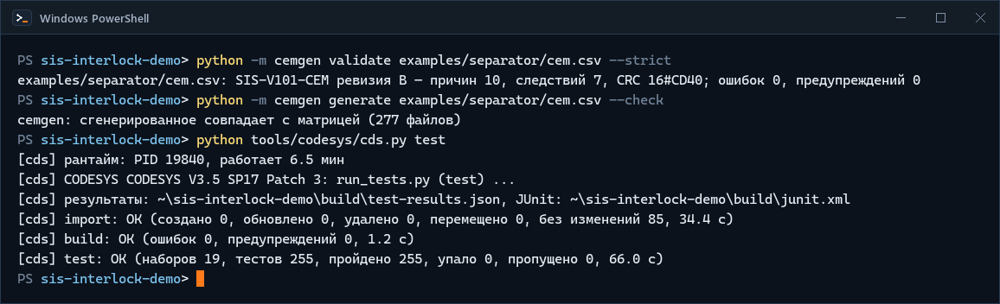
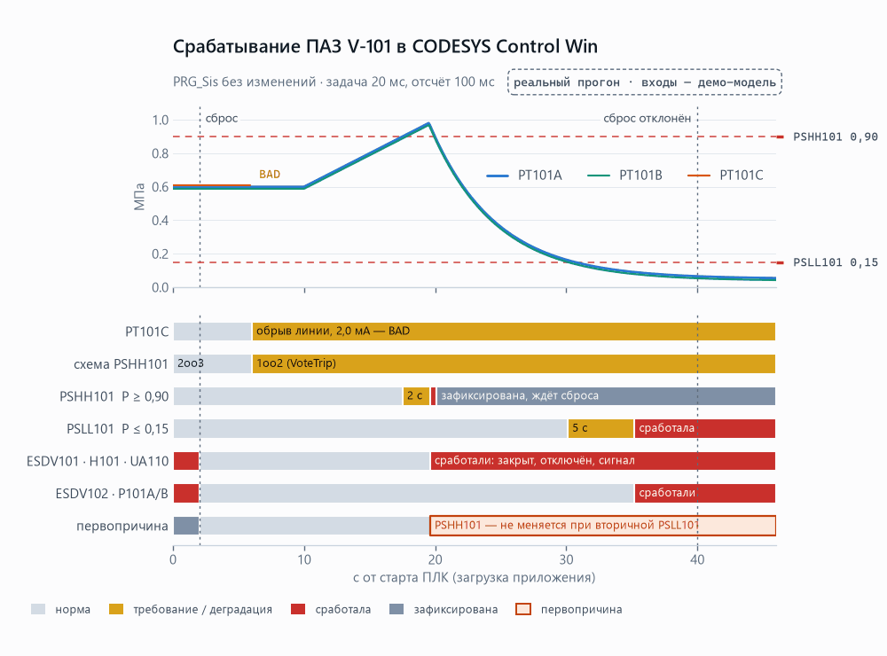
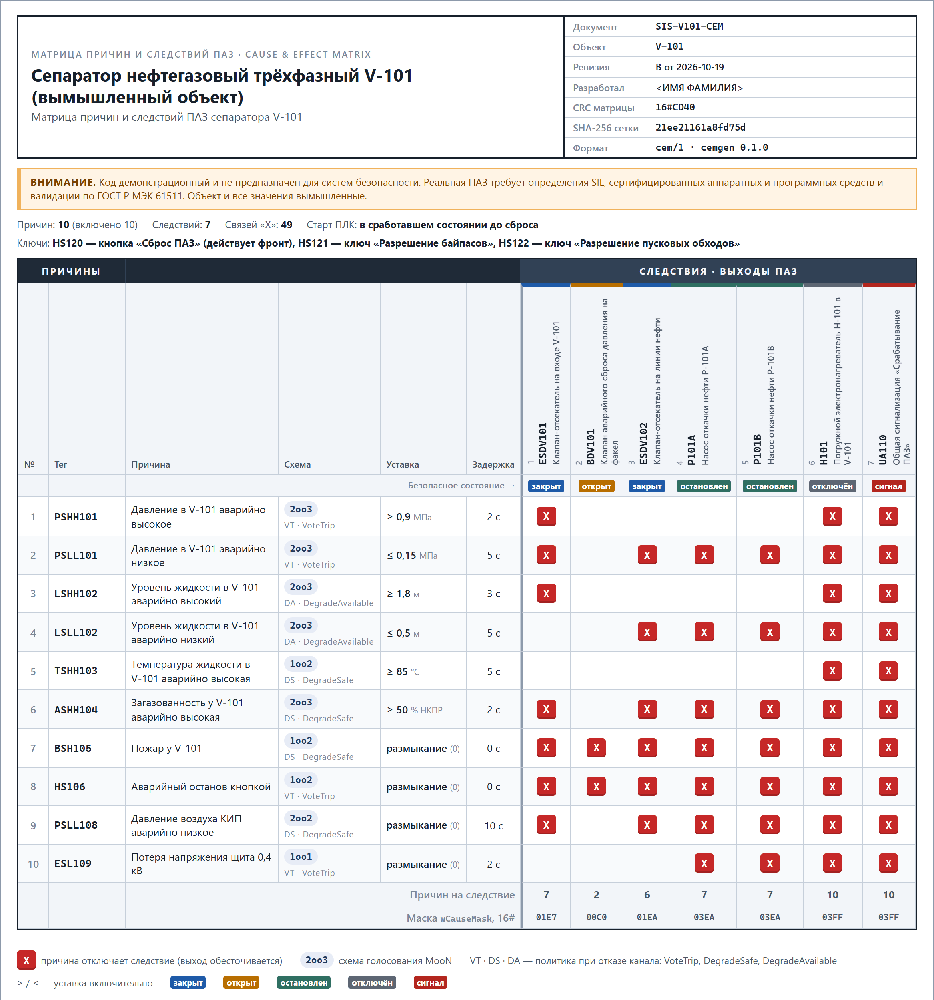
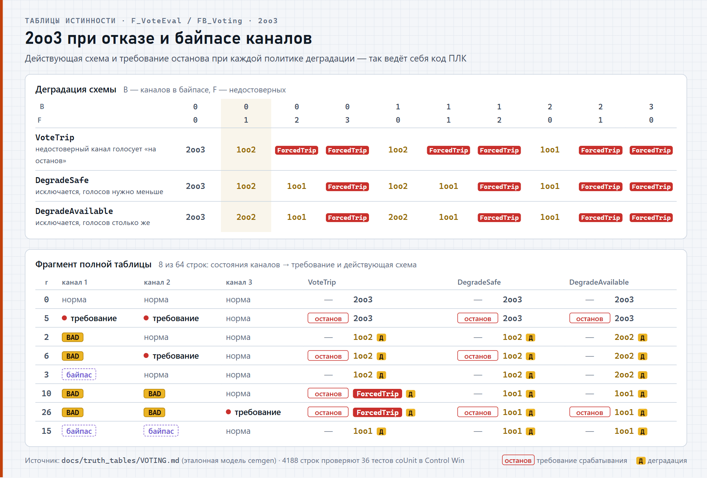
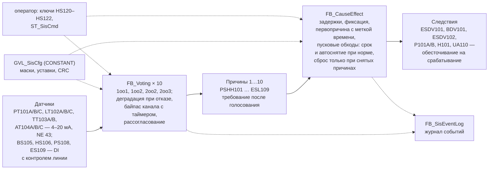
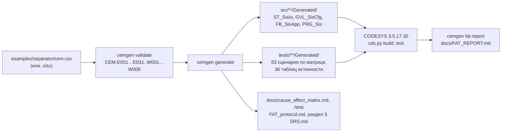

<p align="center">
  <picture>
    <source media="(prefers-color-scheme: dark)" srcset="docs/media/banner-dark.svg">
    <source media="(prefers-color-scheme: light)" srcset="docs/media/banner-light.svg">
    
  </picture>
</p>

<p align="center">
  <a href="https://github.com/kr0nsch/sis-interlock-demo/actions/workflows/ci.yml"></a> <a href="https://github.com/kr0nsch/sis-interlock-demo/releases/latest"></a> <a href="LICENSE"></a>
     
  <a href="#тесты-и-качество"></a> 
</p>

> **Внимание.** Код демонстрационный и не предназначен для систем безопасности. Реальная ПАЗ
> требует определения SIL, сертифицированных аппаратных и программных средств и валидации по
> ГОСТ Р МЭК 61511.

<p align="center"><a href="#что-это-и-зачем">Что это</a> · <a href="#как-это-выглядит">Как выглядит</a> · <a href="#быстрый-старт">Быстрый старт</a> · <a href="#как-использовать-в-своём-проекте">Работа с матрицей</a> · <a href="#как-устроено">Как устроено</a> · <a href="#документация">Документация</a> · <a href="#summary-en">Summary (EN)</a></p>

**Логика ПАЗ на ST для CODESYS V3.5 и генератор `cemgen`: из одной матрицы причин и следствий
(CSV или XLSX) — конфигурация ПЛК, тесты, лист матрицы и протокол испытаний в стиле FAT.** Обычно
матрица живёт в Excel, а код ПЛК, тесты и протокол FAT пишут по ней вручную: после каждой ревизии
они расходятся, и сверяют их глазами. Здесь всё это генерируется из матрицы, ожидаемые значения
тестов даёт независимая эталонная модель, а CI падает при любом расхождении. Для инженеров ПАЗ и
АСУ ТП и техлидов у интеграторов и машиностроителей. Демонстрация подхода, не SIL-система.

## Что это и зачем

Две части. **Логика ПАЗ на ST** — библиотека CODESYS `sis-interlock-demo` (пространство имён
`SIS`): голосование MooN по 1–3 каналам с деградацией при отказе канала и байпасами (`FB_Voting`),
исполнитель матрицы причин и следствий с задержками, фиксацией до сброса, первопричиной и пусковыми
обходами (`FB_CauseEffect`), журнал событий. **Генератор `cemgen`** — утилита командной строки на
Python: проверяет матрицу и строит из неё всё, что зависит от объекта. Демо-объект — вымышленный
трёхфазный сепаратор V-101: 10 причин, 7 следствий.

| Что генерируется из матрицы | Где |
|---|---|
| образ ввода-вывода, конфигурация (маски «X», уставки, задержки, CRC), привязка тегов к группам голосования | `src/**/Generated/` |
| 83 сценарных теста по матрице и 36 тестов таблиц истинности голосования (4188 строк) | `tests/**/Generated/` |
| лист матрицы для документации и печати на A3 | `docs/cause_effect_matrix.md`, `.html` |
| протокол испытаний в стиле FAT и отчёт по результатам тестов | `docs/FAT_protocol.md`, `docs/FAT_REPORT.md` |
| раздел функций безопасности (SIF) спецификации требований SRS | `docs/SRS.md`, раздел 3 |

**Что даёт:**

- Матрица, код ПЛК, тесты и документы не расходятся: их обновляет одна команда `cemgen generate`, а
  `generate --check` в CI не пропустит ручную правку сгенерированного файла или забытую генерацию.
- Ошибки матрицы видны до ПЛК: 31 правило ошибок и 6 предупреждений, с номером строки и колонкой,
  как в Excel, и подсказкой «Как исправить».
- Ожидаемые значения тестов вычисляет эталонная модель на Python, написанная по контракту
  независимо от ST, — тесты не «сняты» с кода ПЛК.
- Отчёт FAT заполняется из результатов тестов: шаг «соответствует», только если прошли все его
  автотесты.
- Безопасное поведение по умолчанию: обесточивание на срабатывание; старт ПЛК, ошибка конфигурации
  или CRC — срабатывание, обрыв канала 4–20 мА — деградация по политике, а не «норма».
- Проверено в CODESYS 3.5.17.30: 255 тестов coUnit в программном ПЛК CODESYS Control Win V3.

**Для кого.** Инженеры ПАЗ и АСУ ТП, техлиды у интеграторов, машиностроителей и вендоров ПЛК —
как пример того, как связать матрицу причин и следствий с кодом, тестами и протоколом испытаний и
как тестировать логику ПАЗ в CODESYS без железа. Общая логика от объекта не зависит: генератор
можно направить на свою матрицу ([как](#своя-матрица)).

**Чем не является.** Это не SIL-система и не инструмент для проектов ПАЗ с SIL: нет анализа
опасностей, определения SIL, расчёта PFDavg, сертифицированных ПЛК и средств разработки. Что нужно
для настоящей спецификации — [SRS.md, раздел 9](docs/SRS.md#9-что-нужно-для-реальной-srs).

<details>
<summary>Термины: ПАЗ, матрица причин и следствий, MooN, деградация, байпас, пусковой обход, первопричина, FAT, SRS, NE 43, coUnit</summary>

| Термин | Что это |
|---|---|
| ПАЗ (SIS) | противоаварийная защита: переводит процесс в безопасное состояние при аварийном отклонении |
| матрица причин и следствий (C&E) | таблица: какие причины (датчики, кнопки) какие следствия (клапаны, насосы, нагреватели) переводят в безопасное состояние |
| MooN, 2oo3 | голосование «M из N»: 2oo3 — срабатывание, когда требование есть у двух из трёх каналов |
| политика деградации | как меняется схема при отказе канала: `VoteTrip` — отказавший канал голосует «на останов»; `DegradeSafe` и `DegradeAvailable` — канал исключается, функция работает по оставшимся |
| байпас канала | временный вывод одного канала из голосования ключом, со сроком |
| пусковой обход | временное подавление причины на пуске (например, низкое давление при наборе); снимается сам после подтверждения нормы или по сроку |
| первопричина (first-out) | причина, сработавшая первой; сохраняется, когда за ней срабатывают другие |
| FAT | заводские приёмочные испытания (Factory Acceptance Test); здесь — испытания в стиле FAT на программном ПЛК |
| SRS, SIF | спецификация требований безопасности и функция безопасности (ГОСТ Р МЭК 61511) |
| NE 43 | NAMUR NE 43 — контроль достоверности 4–20 мА; здесь ток ≤ 3,6 мА или ≥ 21,0 мА — канал недостоверен |
| coUnit (CfUnit) | фреймворк юнит-тестов для CODESYS (MIT), версия 1.2.0.0 |
| CODESYS Control Win V3 | программный ПЛК CODESYS для Windows; без лицензии работает 2 ч |

</details>

## Как это выглядит

Снято с реальных прогонов 19.10.2026 на Windows 11: CODESYS 3.5.17.30, CODESYS Control Win V3,
coUnit 1.2.0.0. Картинки документов — снимки сгенерированных файлов из `docs/`.

**От матрицы до тестов в рантайме.** Проверка матрицы, сверка сгенерированного кода с ней и прогон
всех тестов coUnit в CODESYS Control Win:

<p align="center">
  
</p>
<p align="center"><sub>Реальный прогон, Windows PowerShell, снято term2gif.py; ожидание CODESYS (108 с) сокращено, путь к каталогу укорочен</sub></p>

**Срабатывание в рантайме.** 46 секунд работы ПАЗ в CODESYS Control Win, задача 20 мс: обрыв
датчика переводит 2oo3 в 1oo2, высокое давление закрывает отсекатель, первопричина сохраняется,
сброс при действующей причине отклонён. Логика — та же `PRG_Sis`, что в приложении; входы задаёт
демо-программа с простой моделью давления ([tools_project/demo](tools_project/demo/README.md)):

<p align="center">
  <picture>
    <source media="(prefers-color-scheme: dark)" srcset="docs/media/demo-trip-replay-dark.gif">
    <source media="(prefers-color-scheme: light)" srcset="docs/media/demo-trip-replay-light.gif">
    
  </picture>
</p>
<p align="center"><sub>Трассировка реального прогона, отсчёт 100 мс (моменты ниже — по отсчётам): <a href="docs/media/data/trip-trace.csv">trip-trace.csv</a> · статичный график: <a href="docs/media/chart-trip-first-out-dark.png">тёмный</a>, <a href="docs/media/chart-trip-first-out-light.png">светлый</a></sub></p>

<details>
<summary>Что происходит по секундам</summary>

- **0–2 с** — старт ПЛК: все следствия в безопасном состоянии, первопричина «старт ПЛК»; сброс
  кнопкой HS120 принят, потому что причин нет.
- **6 с** — обрыв линии PT101C (2,0 мА, ниже порога NE 43): канал недостоверен, при политике VoteTrip
  он голосует «на останов», и 2oo3 работает как 1oo2.
- **17,5 → 19,6 с** — PT101A достиг 0,90 МПа, через 2 с задержки PSHH101 закрыла ESDV101, отключила
  H101 и включила UA110. Первопричина — PSHH101.
- **30,1 → 35,2 с** — после закрытия входного клапана давление упало до PSLL101: сработали ещё ESDV102 и
  насосы P101A/B, а первопричина осталась PSHH101 — оператор видит исходное событие, а не следствие.
- **40 с** — сброс отклонён: требование PSLL101 ещё есть.

</details>

**Матрица причин и следствий** — тот же файл `cem.csv`, из которого генерируются конфигурация ПЛК и
тесты, в виде листа для печати:

<p align="center">
  <picture>
    <source media="(prefers-color-scheme: dark)" srcset="docs/media/shot-cause-effect-compact-dark.png">
    <source media="(prefers-color-scheme: light)" srcset="docs/media/shot-cause-effect-compact-light.png">
    
  </picture>
</p>
<p align="center"><sub>Снимок сгенерированного <a href="docs/cause_effect_matrix.html">docs/cause_effect_matrix.html</a> (cemgen 1.0.0, ревизия B) в компактном виде: без столбцов «Каналы», «Байпас», «Пусковой обход» и «Σ». GitHub показывает HTML исходным текстом — для печати скачайте файл и откройте в браузере. Лист A3 целиком: <a href="docs/media/shot-cause-effect-matrix-dark.png">тёмный</a>, <a href="docs/media/shot-cause-effect-matrix-light.png">светлый</a></sub></p>

**Голосование при отказах** — как 2oo3 деградирует при каждой политике; эти таблицы целиком
проверяются тестами на настоящих `F_VoteEval` и `FB_Voting`:

<p align="center">
  <picture>
    <source media="(prefers-color-scheme: dark)" srcset="docs/media/shot-truth-table-2oo3-dark.png">
    <source media="(prefers-color-scheme: light)" srcset="docs/media/shot-truth-table-2oo3-light.png">
    
  </picture>
</p>
<p align="center"><sub>Данные — <a href="docs/truth_tables/VOTING.md">docs/truth_tables/VOTING.md</a> (эталонная модель cemgen); 4188 строк проверяют 36 тестов coUnit в Control Win</sub></p>

<details>
<summary><b>Как строка матрицы превращается в тест</b></summary>

Строка матрицы ([examples/separator/cem.csv](examples/separator/cem.csv)): причина 1 — давление
выше 0,90 МПа по двум из трёх датчиков в течение 2 с закрывает ESDV101, отключает нагреватель H101 и
включает сигнализацию UA110.

```text
no;tag;description;signal;source;vote;policy;trip_on;setpoint;hyst;units;…;delay;bypass_max;bypass_time;override;…
1;PSHH101;Давление в V-101 аварийно высокое;ai;PT101A,PT101B,PT101C;2oo3;vote_trip;high;0.90;0.02;МПа;…;2s;1;8h;no;…;;X;;;;;X;X
```

Тест, который `cemgen` построил по этой строке (ожидаемые значения — от эталонной модели на
Python, а не от кода ПЛК), фрагмент `tests/POUs/Generated/FB_CemGen01_Test/`:

```text
fbH001.stIo.rPT101A_mA := 13.2;   // 13,20 мА = 0,920 МПа
fbH001.stIo.rPT101B_mA := 13.2;
fbH001.stIo.rPT101C_mA := 13.2;
fbH001.Cycle();                                       // t0
fbH001.Run(tDuration := T#2S, tStep := T#100MS);      // t0 + 2 с
AssertFalse(Condition := fbH001.stIo.xQESDV101, Message := 'PSHH101: ESDV101 must be tripped');
AssertTrue(Condition := fbH001.stIo.xQBDV101, Message := 'PSHH101: BDV101 must stay energized');
AssertEquals_UINT(Expected := GVL_SisCfg.CAUSE_PSHH101, Actual := fbH001.fbApp.stCemSts.uiFirstOut, …);
```

</details>

<details>
<summary><b>Демо-объект: сепаратор V-101, 10 причин</b></summary>

Вымышленный трёхфазный сепаратор на площадке подготовки нефти: 10 причин (давление, уровень,
температура, загазованность, пожар, кнопки останова, воздух КИП, питание), 7 следствий. Схемы и
политики подобраны так, чтобы показать все варианты логики, а не по результатам анализа рисков.

| № | Причина | Схема, политика | Уставка | Задержка | Обход |
|---|---|---|---|---|---|
| 1 | PSHH101 давление аварийно высокое | 2oo3, VoteTrip | ≥ 0,90 МПа | 2 с | — |
| 2 | PSLL101 давление аварийно низкое | 2oo3, VoteTrip | ≤ 0,15 МПа | 5 с | 15 мин |
| 3 | LSHH102 уровень аварийно высокий | 2oo3, DegradeAvailable | ≥ 1,80 м | 3 с | — |
| 4 | LSLL102 уровень аварийно низкий | 2oo3, DegradeAvailable | ≤ 0,50 м | 5 с | 30 мин |
| 5 | TSHH103 температура аварийно высокая | 1oo2, DegradeSafe | ≥ 85 °C | 5 с | — |
| 6 | ASHH104 загазованность | 2oo3, DegradeSafe | ≥ 50 % НКПР | 2 с | — |
| 7 | BSH105 пожар | 1oo2, DegradeSafe | размыкание | 0 | — |
| 8 | HS106 аварийный останов кнопкой | 1oo2, VoteTrip | размыкание | 0 | — |
| 9 | PSLL108 давление воздуха КИП | 2oo2, DegradeSafe | размыкание | 10 с | 10 мин |
| 10 | ESL109 потеря напряжения 0,4 кВ | 1oo1, VoteTrip | размыкание | 2 с | — |

Матрица целиком (маски, безопасные состояния, байпасы, каналы, CRC `16#CD40`) —
[docs/cause_effect_matrix.md](docs/cause_effect_matrix.md).

</details>

## Быстрый старт

### Без CODESYS: генератор и тесты на Python

Нужны Python 3.11+ (в CI — 3.12) и git; Windows или Linux. CODESYS и ПЛК не нужны.

1. Клонировать репозиторий и установить зависимости (ruff, mypy, pytest, hypothesis, openpyxl):

   ```bash
   git clone https://github.com/kr0nsch/sis-interlock-demo.git
   cd sis-interlock-demo
   python -m pip install -r requirements-dev.txt
   ```

   Чтобы не ставить пакеты в системный Python (на Debian и Ubuntu `pip` без окружения отказывает
   с `externally-managed-environment`), вместо последней команды создайте виртуальное окружение; на
   Linux команда может называться `python3`:

   ```bash
   python3 -m venv .venv
   . .venv/bin/activate
   python -m pip install -r requirements-dev.txt
   ```

   На Windows окружение создаётся и включается так: `python -m venv .venv`, `.venv\Scripts\activate`
   (cmd). В активном окружении команды ниже пишутся с `python`.

   На Windows клонируйте в короткий путь, например `C:\src\`. Самый длинный путь в репозитории —
   112 символов; если путь к клону длиннее 146 символов, а длинные пути в Windows не включены,
   `git clone` завершится ошибкой `Filename too long` (с `core.longpaths=true` клон пройдёт, но
   Python не увидит часть эталонных файлов тестов).

2. Проверить матрицу демо-объекта:

   ```bash
   python -m cemgen validate examples/separator/cem.csv --strict
   ```

   Увидите: `examples/separator/cem.csv: SIS-V101-CEM ревизия B — причин 10, следствий 7, CRC 16#CD40; ошибок 0, предупреждений 0`.

3. Сверить сгенерированный код и документы с матрицей (то же делает CI):

   ```bash
   python -m cemgen generate examples/separator/cem.csv --check
   ```

   Увидите: `cemgen: сгенерированное совпадает с матрицей (277 файлов)`.

4. Прогнать тесты генератора, эталонной модели, соглашений и инструментов:

   ```bash
   python -m pytest
   ```

   Увидите: `853 passed, 11 skipped` примерно за минуту. Пропущены интеграционные тесты, которым
   нужны iec_checker и RuSTy (10 тестов; где взять — ниже, в «Проверках разработчика») и пакет
   iolistgen (1 тест: установленный или клон рядом, `../iolistgen`; iolistgen готовится к
   публикации).

Ошибка в матрице выглядит так (файлы не пишутся, код выхода 1):

```text
examples/separator/cem.csv:28:F: CEM-E016 vote «3oo3» не из списка. Как исправить: впишите 1oo1, 1oo2, 2oo2 или 2oo3.
```

После `python -m pip install -e .` те же команды доступны как `cemgen validate …`. Справка по
генератору — [docs/CEMGEN.md](docs/CEMGEN.md).

<details>
<summary><b>Проверки разработчика: сборка ST, линтер, iec_checker, RuSTy</b></summary>

| Команда | Что делает | Увидите |
|---|---|---|
| `python tools/assemble.py --tests` | склеивает исходники ST в `build/assembled/` для внешних анализаторов | `assemble: 81 объектов (iec), записано в …` |
| `python tools/check/st_lint.py --strict` | линтер ST: раскладка, заголовки, имена, «магические числа» | `st_lint: файлов 747, ошибок 0, предупреждений 0` |
| `python tools/check/run_iec_checker.py --tests` | статанализ iec_checker v0.4 с файлом обоснований | `run_iec_checker (v0.4): файлов 81; необоснованных 0, обоснованных 2195, …` |
| `python tools/check/run_rusty.py` | проверка синтаксиса и типов компилятором RuSTy (`plc --check`) | `run_rusty: проверено файлов 47, исключено 35, без ошибок` |
| `python tools_project/gen_voting_tests.py --check` | вторая модель таблиц истинности совпадает с тестами в репозитории | `gen_voting_tests: совпадает (наборов 8, тестов 36, ассертов 4188)` |

iec_checker и RuSTy в репозиторий не входят:

- iec_checker v0.4 — файл `iec_checker_Windows_x86_64.exe` или `iec_checker_Linux_x86_64` из
  [релиза v0.4](https://github.com/iec-checker/iec-checker/releases/tag/v0.4); путь — в `--binary`,
  переменной `IEC_CHECKER` или каталоге `~/.local/plc-tools/iec-checker/`.
- RuSTy v1.0.6 — `plc.exe` или `plc-linux-x86_64` и `stdlib-1.0.6.tar.gz` из
  [релиза v1.0.6](https://github.com/PLC-lang/rusty/releases/tag/v1.0.6); пути — в переменных
  `RUSTY_PLC` и `RUSTY_STDLIB_INCLUDE` или `--plc` и `--stdlib`.

Без инструмента команда завершается с кодом 1 и подсказкой; ключ `--optional` превращает это в
предупреждение с кодом 0. Подробно — [tools/README.md](tools/README.md#checkrun_iec_checkerpy--статанализ).

</details>

### С CODESYS: сборка и тесты в программном ПЛК

| Что нужно | Версия | Где взять |
|---|---|---|
| Windows | проверено на Windows 11 | — |
| CODESYS с CODESYS Control Win V3 | 3.5.17.30 (V3.5 SP17 Patch 3) | [MANUAL_STEPS.md, раздел 1](docs/MANUAL_STEPS.md#1-установка-codesys-351730) |
| coUnit | 1.2.0.0 | [MANUAL_STEPS.md, раздел 2](docs/MANUAL_STEPS.md#2-counit-cfunit-1200) |
| Python | 3.11+ | сторонние пакеты для `cds.py` не нужны |
| plc-process-lib | 1.0.0.0, тег `v1.0.0` | клон рядом с этим репозиторием (шаг 1) |

1. Положить библиотеку plc-process-lib рядом (`../plc-process-lib`, другой путь — в переменной
   `PL_REPO`). Если версии 1.0.0.0 ещё нет в репозитории библиотек CODESYS, первый `build` или
   `test` соберёт и установит её из этого клона; клон другой версии `cds.py` для сборки не примет
   (версия закреплена в `tools/codesys/config.json`).

   ```bash
   git clone --branch v1.0.0 https://github.com/kr0nsch/plc-process-lib.git ../plc-process-lib
   ```

2. Один раз подготовить рантайм — CODESYS Control Win V3 в пользовательском процессе, без прав
   администратора ([MANUAL_STEPS.md, раздел 4](docs/MANUAL_STEPS.md#4-рантайм-codesys-control-win-v3-без-прав-администратора)):

   ```bat
   python tools\codesys\cds.py runtime init
   ```

3. Собрать и прогнать тесты. Каждая команда запускает CODESYS без окна; журналы — в `build/`.

   | Команда | Что делает | Увидите (прогон 19.10.2026) |
   |---|---|---|
   | `python tools\codesys\cds.py build --tests` | импорт `src/` и `tests/` в проект, сборка | 0 ошибок, 0 предупреждений |
   | `python tools\codesys\cds.py check --tests` | компиляция всех объектов, в том числе не вызванных из задач | 81 объект без ошибок |
   | `python tools\codesys\cds.py test` | сборка, загрузка в Control Win, прогон coUnit (около 2 мин; дольше, если рантайм занят другим проектом) | 255 из 255; `build/test-results.json`, `build/junit.xml` |
   | `python tools\codesys\cds.py roundtrip` | импорт → экспорт → сравнение с `src/` и `tests/` | 747 файлов совпадают побайтно, повторный импорт без изменений |
   | `python -m cemgen fat-report examples/separator/cem.csv --results build/test-results.json` | отчёт FAT по результатам тестов → `docs/FAT_REPORT.md` | `тестов 255, пройдено 255, упало 0`; 55 шагов из 55 «соответствует» |

   Ещё: `python tools\codesys\cds.py report` — итоги в [docs/TEST_REPORT.md](docs/TEST_REPORT.md);
   `python tools_project\demo\trip_trace.py` — демо-сценарий срабатывания в Control Win → CSV.
   Работа в IDE, экспорт правок и коды выхода — [docs/MANUAL_STEPS.md](docs/MANUAL_STEPS.md).

Готовые файлы — в [релизе v1.0.0](https://github.com/kr0nsch/sis-interlock-demo/releases/tag/v1.0.0):
`sis-interlock-demo.project` и библиотека `sis-interlock-demo.library` / `.compiled-library`
(`sis-interlock-demo, 1.0.0.0 (plc-portfolio)`, пространство имён `SIS`, зависит от plc-process-lib
1.0.0.0). В git проекты CODESYS не хранятся: они собираются из текстов в `src/` и `tests/`.

## Как использовать в своём проекте

**Сценарий — копия или форк репозитория под свой объект.** Замените `examples/separator/cem.csv`
своей матрицей и не меняйте путь: на него завязаны CI (`.github/workflows/ci.yml`) и pytest. Общий
код `src/POUs/Sis/` остаётся как есть, `cemgen generate` перестраивает объектную часть, тесты и
документы; что пересмотреть вручную — [«Своя матрица»](#своя-матрица).

**В приложение для ПЛК** результат попадает проектом `build/<имя>.project` из `cds.py build`
(MainTask 20 мс → `PRG_Main` → `PRG_Sis`) или библиотекой, собранной в форке командой `cds.py library`
(`src/` без `PRG_Main`, пространство имён `SIS`; подключение —
[MANUAL_STEPS.md, 7.3](docs/MANUAL_STEPS.md#73-проект-который-использует-библиотеку-портфолио)).
Устройство ПЛК, модули ввода-вывода и их привязку к образу `GVL_SisIo.stIo` делают в IDE: генератор
их не строит ([USAGE.md, раздел 7](docs/USAGE.md#7-своя-матрица-вместо-v-101)). На контроллере ни
один из путей не проверялся. Библиотека из релиза собрана с матрицей V-101 — под свою её пересобирают.

Цикл изменения матрицы — ниже; подробно, со шпаргалкой формата и разбором ошибок, —
[docs/USAGE.md](docs/USAGE.md).

1. **Править матрицу.** Источник — `examples/separator/cem.csv` (UTF-8, разделитель `;`).
   `examples/separator/cem.xlsx` — копия для Excel: правка в Excel и обратно в CSV —
   `python -m cemgen convert examples/separator/cem.xlsx examples/separator/cem.csv`; после правки
   CSV — `convert` в обратную сторону, чтобы копии совпадали (это проверяют CI и pytest). Поднять
   `revision` в `[header]`. Колонки матрицы — [шпаргалка](docs/USAGE.md#5-формат-матрицы-шпаргалка).
2. **Проверить:** `python -m cemgen validate examples/separator/cem.csv --strict`.
3. **Сгенерировать:** `python -m cemgen generate examples/separator/cem.csv` — печатает новые,
   изменённые и удалённые файлы и число тестов по матрице.
4. **Посмотреть дифф** без фрагментов, где поменялся только заголовок (ревизия, дата, SHA-256):
   `git diff --stat -I "SHA-256|[0-9]{4}-[0-9]{2}-[0-9]{2}|rev [A-Z]"`.
5. **Прогнать тесты в CODESYS:** `python tools\codesys\cds.py test`.
6. **Заполнить отчёт FAT:**
   `python -m cemgen fat-report examples/separator/cem.csv --results build/test-results.json`.
7. **Прочитать** `docs/FAT_REPORT.md` и закоммитить матрицу, сгенерированные файлы и отчёт вместе.

**Пример: уставка PSHH101 0,90 → 0,95 МПа.** В строке 28 `cem.csv` поменять `0.90` на `0.95` в
колонке `setpoint`, ревизию B — на C:

```text
1;PSHH101;Давление в V-101 аварийно высокое;ai;PT101A,PT101B,PT101C;2oo3;vote_trip;high;0.95;0.02;МПа;…
```

`generate` печатает `cemgen: файлов 277 — новых 0, изменено 277, удалено 0, без изменений 0; тестов
по матрице 83`: ревизия есть в заголовке каждого файла. Дифф из шага 4 сужает это до 15 файлов:

| Файл | Что изменилось |
|---|---|
| `src/GVLs/Generated/GVL_SisCfg.gvl.st` | `rTripLimit_eu := 0.9` → `0.95`; CRC осталась `16#CD40` |
| 9 файлов сценарных тестов с участием PSHH101 в `tests/POUs/Generated/` | стимул требования 13,2 → 13,7 мА (0,92 → 0,97 МПа) |
| `docs/FAT_protocol.md`, `docs/SRS.md`, `docs/cause_effect_matrix.md`, `.html` | уставка ≥ 0,95 МПа в шаге FAT-03-01, функции SIF-01 и листе матрицы |
| `examples/separator/cem.csv` | сама правка |

Новая связь «X» (PSHH101 закрывает ещё и BDV101) меняет маску следствия `16#00C0` → `16#00C1` и CRC
`16#CD40` → `16#C45F`, а сценарные тесты PSHH101 начинают ожидать, что BDV101 обесточен. CRC в ПЛК
охватывает только число причин и следствий и маски: правку уставок, задержек и схем голосования
в обход матрицы ловит только `generate --check` в CI.

### Как читать отчёт FAT

[docs/FAT_REPORT.md](docs/FAT_REPORT.md) — протокол [docs/FAT_protocol.md](docs/FAT_protocol.md) с
заполненными графами. Таблица «Итог» — сколько шагов «соответствует», «не соответствует» и «не
выполнялся». Шаг «соответствует», если по **каждому** шаблону в графе «Автотест» есть результаты и
все пройдены; в «Отметке» — число тестов или имя и сообщение первого упавшего; «не выполнялся» —
по шаблону нет ни одного результата. Раздел 8 (замечания и подписи) заполняется вручную.

| Шаг | Проверка: воздействие → ожидаемый результат (сокращённо) | Автотест | Результат | Отметка |
|---|---|---|---|---|
| FAT-03-01 | PSHH101: 13,20 мА на трёх каналах → через 2 с ESDV101 закрыт, H101 отключён, UA110 — сигнал, первопричина PSHH101 | `Matrix_PSHH101Demand_*`<br>`Matrix_PSHH101Delay_*` | соответствует | тестов 2 |
| FAT-07-03 | FB_CauseEffect: задержки, фиксация, обходы, сброс, события | `Cem_*` | соответствует | тестов 42 |

Это проверка в стиле FAT на программном ПЛК с подменным временем, а не FAT шкафа с ПЛК210 и
модулями ввода-вывода. Подробно — [docs/USAGE.md, раздел 4](docs/USAGE.md#4-как-читать-отчёт-fat).

### Своя матрица

Общий код в `src/POUs/Sis/` об объекте не знает: другой объект — другая матрица и
`cemgen generate`, без правок ST. Проверено на учебной матрице `pytests/fixtures/mini.csv`
(3 причины, 2 следствия): 155 файлов, 24 сценарных теста, линтер и RuSTy без ошибок. Под V-101
написаны рукописные разделы `docs/SRS.md`, обоснования iec_checker и демо-сценарий — их придётся
пересмотреть ([docs/USAGE.md, раздел 7](docs/USAGE.md#7-своя-матрица-вместо-v-101)). Одна матрица
на репозиторий; до 16 причин, 16 следствий и 3 каналов в группе голосования.

## Как устроено

Во время работы ПЛК — от датчиков до исполнительных механизмов:



Из одного файла матрицы — всё, что от неё зависит:



- **Безопасное состояние по умолчанию:** ФБ до первого вызова, ошибка конфигурации или CRC и старт
  ПЛК дают срабатывание; «время назад» у часов снимает байпасы и обходы и завершает идущие задержки;
  все выходы — разрешения, срабатывание обесточивает.
- **Время** — только через `PL.I_TimeSource` из plc-process-lib: тесты подменяют часы
  `PL.FB_FakeTime` и проверяют задержки и сроки «ровно на пороге» за один цикл.
- **Эталонная модель** `cemgen/refmodel.py` написана по контракту [DESIGN.md](docs/DESIGN.md)
  независимо от ST; ошибки самого контракта закрывают граничные тесты, написанные вручную.

| Каталог | Что внутри | Кто пишет |
|---|---|---|
| `src/POUs/Sis/`, `src/DUTs/Sis/`, `src/Interfaces/`, `src/GVLs/GVL_Const.gvl.st` | общая логика ПАЗ: `F_VoteEval`, `FB_Voting`, `FB_CauseEffect`, `FB_SisEventLog`, `FB_SisUnit`; типы, константы, CRC, NE 43 | вручную |
| `src/**/Generated/` | объектная часть по матрице: образ ввода-вывода, конфигурация, привязка тегов, `PRG_Sis` | `cemgen` |
| `tests/POUs/Suites/`, `tests/POUs/Helpers/` | граничные тесты ФБ, стенд сценарных тестов `FB_SisHarness` | вручную |
| `tests/**/Generated/` | сценарии по матрице, таблицы истинности по эталонной модели | `cemgen` |
| `tests/POUs/TruthTables/` | те же таблицы по второй модели | `tools_project/gen_voting_tests.py` |
| `cemgen/`, `pytests/` | генератор, эталонная модель и их тесты | вручную |
| `examples/separator/` | матрица демо-объекта: CSV — источник, XLSX — копия | вручную |
| `tools_project/` | вторая модель голосования, демо-сценарий срабатывания | вручную |
| `tools/` | инструменты из [plc-repo-template](https://github.com/kr0nsch/plc-repo-template): `cds.py`, `assemble`, `st_lint`, обёртки iec_checker и RuSTy | шаблон |
| `docs/` | контракт, SRS, матрица, протокол и отчёт FAT, отчёты о проверках | вручную и `cemgen` |

Подробно — [docs/ARCHITECTURE.md](docs/ARCHITECTURE.md); контракт ФБ и формата матрицы —
[docs/DESIGN.md](docs/DESIGN.md).

## Тесты и качество

| Что проверяется | Сколько | Где |
|---|---:|---|
| граничные случаи ФБ, написанные вручную: уставки, NaN, задержки «до и ровно», байпасы, обходы, сброс, первопричина, ошибки конфигурации, «время назад» | 100 тестов, 7 наборов | coUnit, `tests/POUs/Suites/` |
| таблицы истинности `F_VoteEval` и `FB_Voting` по эталонной модели: 4 схемы, 3 политики, DI и AI, все сочетания состояний каналов — 4188 строк | 36 тестов | coUnit, `tests/POUs/Generated/` |
| те же таблицы по второй, независимой модели | 36 тестов, 8 наборов | coUnit, `tests/POUs/TruthTables/` |
| сценарии по матрице: каждая причина отключает ровно свои следствия, задержки, обходы, сброс, отказ канала, байпас, первопричина, старт ПЛК | 83 теста | coUnit, `tests/POUs/Generated/` |
| генератор: каждое правило проверки, эталонная модель против таблиц контракта, детерминизм, CSV = XLSX, эталонные файлы | 210 | pytest, `pytests/` |
| соглашения проекта (дисклеймер в каждом объекте ST, имена и регистрация тестов) и вторая модель | 120 | pytest, `tools/project_checks/`, `tools_project/` |
| инструменты из plc-repo-template: раскладка, сборка, линтер, iec_checker, RuSTy, `cds.py` | 534 | pytest, `tools/tests/` |
| линтер и статанализ | 0 необоснованных находок | `st_lint`, iec_checker 0.4, RuSTy 1.0.6 — [STATIC_ANALYSIS.md](docs/STATIC_ANALYSIS.md) |

Что где выполнялось:

- **CODESYS 3.5.17.30, CODESYS Control Win V3**, Windows 11, 19.10.2026: сборки без ошибок и
  предупреждений, 255 тестов coUnit из 255, roundtrip без диффа, протокол FAT — 55 шагов из 55
  ([TEST_REPORT.md](docs/TEST_REPORT.md)).
- **ПЛК210 и модули ввода-вывода** — не проверялось; тестовое приложение в нынешнем виде на
  контроллер, вероятно, не поместится (глобальные данные — не меньше 154 МБ, замер 16.10.2026).
- **CI GitHub Actions** (Linux) — всё, что не требует CODESYS: ruff, mypy, pytest, `cemgen validate`
  (CSV и XLSX) и `generate --check`, `gen_voting_tests.py --check`, сборка ST, линтер, iec_checker;
  необязательные задания — RuSTy и iec_checker nightly.

Чувствительность тестов проверена мутациями: 16 правдоподобных ошибок в `FB_Voting` и
`FB_CauseEffect` и 6 ошибок автоснятия пускового обхода, по одной в копии репозитория, — тесты
поймали все ([ASSUMPTIONS.md](docs/ASSUMPTIONS.md#мутации-r-08)).

Проверки Python перед коммитом (команды — по одной, работают в cmd, PowerShell и bash):

```bash
python -m ruff check .
python -m ruff format --check .
python -m mypy
python -m pytest
```

Полная проверка вместе с CODESYS — [MANUAL_STEPS.md, раздел 5](docs/MANUAL_STEPS.md#5-импорт-сборка-тесты).

## Документация

| Документ | На какой вопрос отвечает |
|---|---|
| [docs/USAGE.md](docs/USAGE.md) | как изменить матрицу, перегенерировать, прогнать тесты и прочитать отчёт FAT; шпаргалка формата, частые ошибки, своя матрица |
| [docs/CEMGEN.md](docs/CEMGEN.md) | какие команды у `cemgen`, что он генерирует и как устроен |
| [docs/DESIGN.md](docs/DESIGN.md) | как именно должны работать ФБ и формат матрицы: нормативный контракт — типы, алгоритмы, правила проверки, решения |
| [docs/ARCHITECTURE.md](docs/ARCHITECTURE.md) | как связаны слои ПЛК, генерация и независимые проверки |
| [docs/cause_effect_matrix.md](docs/cause_effect_matrix.md), [.html](docs/cause_effect_matrix.html) | какая матрица сейчас в коде (генерируется; HTML — лист A3, открывать локально в браузере) |
| [docs/truth_tables/VOTING.md](docs/truth_tables/VOTING.md) | как ведёт себя голосование при отказе и байпасе каналов |
| [docs/FAT_protocol.md](docs/FAT_protocol.md), [docs/FAT_REPORT.md](docs/FAT_REPORT.md) | что проверяется на испытаниях и чем закончился последний прогон |
| [docs/SRS.md](docs/SRS.md) | как выглядит спецификация требований безопасности (демонстрационная структура) и чего не хватает для настоящей |
| [docs/TEST_REPORT.md](docs/TEST_REPORT.md) | что прогнано в CODESYS и без него, с какими итогами |
| [docs/STATIC_ANALYSIS.md](docs/STATIC_ANALYSIS.md) | какие находки статанализа обоснованы и почему |
| [docs/ASSUMPTIONS.md](docs/ASSUMPTIONS.md) | какие допущения приняты, что проверено мутациями, что ещё сверить |
| [docs/MANUAL_STEPS.md](docs/MANUAL_STEPS.md) | как установить CODESYS, coUnit и рантайм, собрать проект, работать в IDE, выпустить релиз |
| [tools/README.md](tools/README.md) | справочник по `cds.py`, `assemble`, `st_lint`, обёрткам iec_checker и RuSTy, переменным окружения |
| [docs/LAYOUT.md](docs/LAYOUT.md), [CONTRIBUTING.md](CONTRIBUTING.md) | как разложены исходники ST в git и какие правила кода |
| [docs/BUILD_ERRORS.md](docs/BUILD_ERRORS.md) | куда записывать сообщения CODESYS из IDE для разбора |
| [tools_project/demo](tools_project/demo/README.md) | как устроен демо-сценарий срабатывания в Control Win |
| [CHANGELOG.md](CHANGELOG.md) | что изменилось между версиями |
| [docs/TZ_template.md](docs/TZ_template.md), [docs/PMI_template.md](docs/PMI_template.md) | бланки ТЗ и таблицы ПМИ из plc-repo-template; в этом проекте не заполнялись — испытания описывает протокол FAT |
| [docs/media/](docs/media/) | баннеры, GIF и снимки этого README; [data/trip-trace.csv](docs/media/data/trip-trace.csv) — данные графика срабатывания |

## Ограничения и планы

- **Это не SIL-система.** Нет анализа опасностей, LOPA и определения SIL, расчёта PFDavg и
  интервалов проверочных испытаний; ПЛК общего назначения не сертифицирован для функций
  безопасности. В SRS эти поля — явные заглушки; что нужно для настоящей SRS —
  [SRS.md, раздел 9](docs/SRS.md#9-что-нужно-для-реальной-srs).
- Демо работает без ввода-вывода (`GVL_Const.DEMO_IO_SIMULATION`): привязки к модулям ПЛК210,
  HMI/WebVisu, обмена со SCADA (Modbus, OPC UA) и оповещения оператора нет.
- Тесты — в CODESYS Control Win V3 с подменным временем; на ПЛК210 тестовое приложение в нынешнем
  виде, вероятно, не поместится (глобальные данные — не меньше 154 МБ, замер 16.10.2026).
- Одна матрица на репозиторий; не больше 16 причин и 16 следствий (маски `WORD`), до 3 каналов в
  группе голосования.
- CRC в ПЛК охватывает только число причин и следствий и маски матрицы: ручную правку задержек,
  обходов, уставок и схем голосования в `GVL_SisCfg` ловит только `cemgen generate --check` в CI
  ([DESIGN.md, 6.8](docs/DESIGN.md#68-конфигурация-и-crc)). Остановившийся источник времени
  программа не обнаруживает ([DESIGN.md, 3.3](docs/DESIGN.md#33-время)).
- Пусковой обход снимается сам, когда требования причины нет непрерывно время подтверждения нормы
  (`override_clear`), срок остаётся верхней границей ([DESIGN.md, 6.4](docs/DESIGN.md#64-пусковые-обходы)).
  Время подтверждения в демо (30 с, 1 мин) выбрано по вымышленной динамике процесса; в реальном
  проекте — по анализу опасностей и требованиям к обходам.
- Требования стандартов пересказаны и помечены «сверить»: состав SRS, обозначения приборов, пороги
  NE 43, уставки загазованности, практика деградации 2oo3
  ([DESIGN.md, 15.2](docs/DESIGN.md#152-сверить-с-источником)).
- Демо-сценарий срабатывания (`tools_project/demo`) задаёт входы простой моделью давления: это
  проверка поведения логики в рантайме, а не модель сепаратора.
- Дальше: оповещение оператора отдельной программой поверх статусов ПАЗ (без влияния на логику),
  HMI с матрицей и первопричиной, привязка к ПЛК210.

## Связанные проекты

Репозиторий — часть портфолио АСУ ТП (таблица ниже). Время и константы NE 43 берёт из библиотеки
[plc-process-lib](https://github.com/kr0nsch/plc-process-lib) (`PL.I_TimeSource`, `PL.FB_Delay`,
`PL.FB_FakeTime` для тестов), раскладку ST в git и инструменты `tools/` — из шаблона
[plc-repo-template](https://github.com/kr0nsch/plc-repo-template); общий CI для таких репозиториев —
[plc-ci-toolkit](https://github.com/kr0nsch/plc-ci-toolkit), здесь пока свой `ci.yml`. Необязательный
адаптер `cemgen` для генератора по перечню сигналов iolistgen подключается, если тот установлен
(iolistgen готовится к публикации).

## Summary (EN)

A demonstration of safety instrumented system (SIS) logic in IEC 61131-3 Structured Text for CODESYS
V3.5 — explicitly **not** a SIL-rated system. `FB_Voting` implements MooN voting (1oo1…2oo3) with
degradation on channel failure and timed bypasses; `FB_CauseEffect` runs a cause-and-effect matrix with
trip delays, de-energise-to-trip outputs, first-out, auto-clearing startup overrides and manual reset.
The Python CLI `cemgen` turns one CSV/XLSX matrix into the PLC configuration, coUnit tests with
expectations from an independent reference model, the matrix sheet, a FAT-style protocol and report and
the SIF section of a demo SRS; CI fails on any drift. 255 tests pass in CODESYS 3.5.17.30 / Control Win
V3. For SIS and PLC engineers at integrators and machine builders. Docs are in Russian.

## Лицензия

[MIT](LICENSE) © 2026 kr0nsch

---

<p align="center"><b>Портфолио АСУ ТП</b></p>
<table>
<tr><td width="33%"><a href="https://github.com/kr0nsch/plc-repo-template">01 · plc-repo-template</a><br><sub>ST в git, сборка проекта скриптом, CI</sub></td><td width="33%"><a href="https://github.com/kr0nsch/plc-process-lib">02 · plc-process-lib</a><br><sub>ФБ: AI, двигатель, ПЧ, задвижка, ПИД, тревоги</sub></td><td width="33%"><span data-repo="kns-pump-station">03 · kns-pump-station</span> <sub>(готовится)</sub><br><sub>флагман: КНС, три насоса с ПЧ, модель, HMI</sub></td></tr>
<tr><td width="33%"><span data-repo="kns-port-domestic">04 · kns-port-domestic</span> <sub>(готовится)</sub><br><sub>перенос на Astra.IDE / MasterSCADA 4D</sub></td><td width="33%"><span data-repo="plc-iiot-stack">05 · plc-iiot-stack</span> <sub>(готовится)</sub><br><sub>OPC UA / MQTT → InfluxDB → Grafana</sub></td><td width="33%"><a href="https://github.com/kr0nsch/iolistgen">06 · iolistgen</a><br><sub>перечень сигналов → ST, карты Modbus, SCADA</sub></td></tr>
<tr><td width="33%"><a href="https://github.com/kr0nsch/plc-ci-toolkit">07 · plc-ci-toolkit</a><br><sub>линтеры, сборка CODESYS, тесты, JUnit</sub></td><td width="33%"><a href="https://github.com/kr0nsch/s7-to-codesys">08 · s7-to-codesys</a><br><sub>конвертер SCL → ST с отчётом о переносе</sub></td><td width="33%"><a href="https://github.com/kr0nsch/sis-interlock-demo"><b>09 · sis-interlock-demo</b></a><br><sub>ПАЗ: MooN, матрица причин и следствий</sub></td></tr>
</table>
