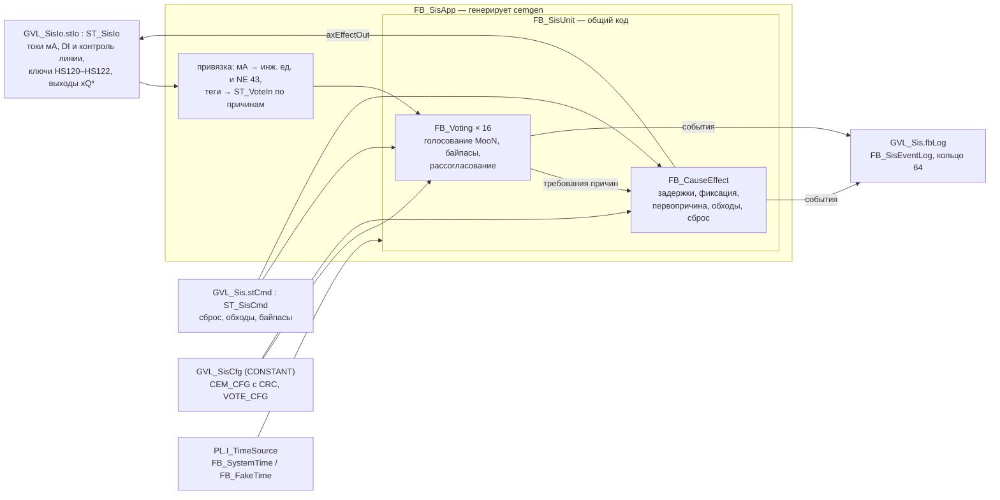
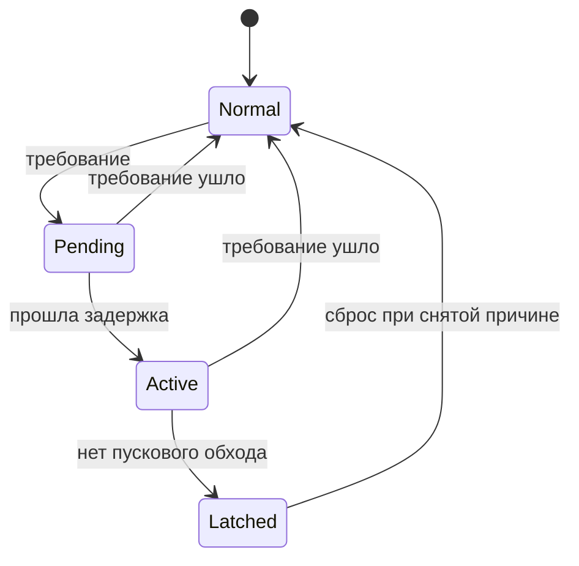
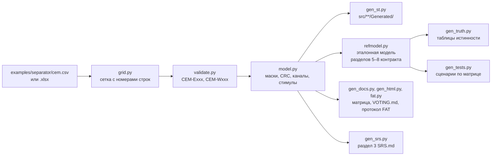
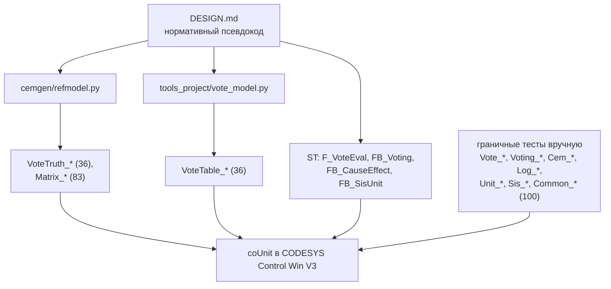

# Архитектура

> **Внимание.** Код демонстрационный и не предназначен для систем безопасности. Реальная ПАЗ
> требует определения SIL, сертифицированных аппаратных и программных средств и валидации по
> ГОСТ Р МЭК 61511.

Проект — логика ПАЗ на ST (CODESYS V3.5) и генератор `cemgen` на Python. Источник истины — тексты:
рукописный ST в `src/` и `tests/`, матрица причин и следствий `examples/separator/cem.csv` и код
генераторов; всё, что зависит от матрицы, воспроизводится командой
`python -m cemgen generate examples/separator/cem.csv` и проверяется в CI (`--check`). Нормативное
описание типов, алгоритмов и формата матрицы — [DESIGN.md](DESIGN.md); здесь — как части связаны.

## Слои во время работы ПЛК

Цикл: `MainTask` (20 мс) → `PRG_Main` → `PRG_Sis` → `GVL_Sis.fbApp(...)`. Внутри вызова — привязка
входов, группы голосования по возрастанию номера причины, исполнитель матрицы, выходы; в том же
порядке события попадают в журнал. В демо без ввода-вывода `PRG_Main` в первом цикле ставит
нормальные значения входов (`F_SisIoNormal`), и приложение стартует в сработавшем состоянии до
сброса оператором.

| Объект | Где | Что делает |
|---|---|---|
| `F_VoteEval` | `src/POUs/Sis/` | чистая функция голосования: состояния каналов (норма, требование, недостоверен, байпас) и политика деградации → требование, действующая схема, признак деградации |
| `FB_Voting` | `src/POUs/Sis/` | группа голосования одной причины: уставка с гистерезисом или дискретный вход, достоверность, байпас канала со сроком и пределом числа, рассогласование аналоговых каналов, события |
| `FB_CauseEffect` | `src/POUs/Sis/` | исполнитель матрицы: задержки причин, фиксация до сброса, первопричина с меткой времени, пусковые обходы (срок и автоснятие после подтверждения нормы), сброс только при снятых причинах, следствия с обесточиванием на срабатывание, проверка конфигурации и CRC |
| `FB_SisEventLog` | `src/POUs/Sis/` | кольцевой журнал на 64 события с монотонным номером (`I_SisEventSink.AddEvent`) |
| `FB_SisUnit` | `src/POUs/Sis/` | общий узел: один источник времени на вызов, группы голосования → `FB_CauseEffect` |
| `FB_SisApp`, `PRG_Sis`, `GVL_Sis*`, `ST_SisIo` | `src/**/Generated/` | объектная часть по матрице: образ ввода-вывода, конфигурация, привязка тегов, экземпляры |
| `PRG_Main` | `src/POUs/PRG_Main/` | точка входа приложения; в библиотеку не входит |

Общий код ничего не знает о сепараторе: другой объект — другая матрица и `cemgen generate`, без
правок `src/POUs/Sis/`.

### Жизненный цикл причины

Пусковой обход не даёт перейти в `Latched`, но задержка идёт и во время обхода: когда обход
истекает при активной причине, срабатывание — в том же цикле. Когда требования причины нет непрерывно
время подтверждения нормы (`tOverrideClear`, в демо 30 с – 1 мин), обход снимается сам
(`OverrideCleared`): защита возвращается, как только процесс вышел в норму, а не в конце срока;
дребезг требования перезапускает подтверждение, и тогда обход снимает срок (DESIGN.md, 6.4, D-20). Сброс сравнивает сырое требование (до
задержки), поэтому нельзя «сбросить» причину, которая через секунду сработает снова.

### Безопасное состояние по умолчанию

| Ситуация | Результат |
|---|---|
| ФБ ещё не вызывался | `xTrip = TRUE`, выходы `FALSE` |
| ошибка конфигурации группы голосования | срабатывает только эта причина |
| ошибка конфигурации матрицы, несовпадение CRC (CRC — только число причин и следствий и маски, DESIGN.md, 6.8) | все следствия обесточены, сброс запрещён |
| старт ПЛК | все следствия обесточены до сброса оператором |
| ток ≤ 3,6 мА или ≥ 21,0 мА, NaN, ±Inf; контроль линии `FALSE` | канал недостоверен → политика деградации |
| источник времени пошёл назад | `TimeFault`; байпасы и пусковые обходы сняты, причины с идущей задержкой срабатывают (D-19) |
| источник времени остановился | программой не обнаруживается — диагностика платформы ПЛК (DESIGN.md, 3.3) |

## Генерация из матрицы

- Всё строится в памяти и пишется целиком или никак; каталоги `*/Generated/` принадлежат
  генератору (лишние `*.st` удаляются). В рукописном `docs/SRS.md` генератор меняет только блок
  между маркерами `cemgen:sif`.
- Сценарный тест выполняется на стенде эталонной модели и одновременно записывается строками ST:
  ожидаемые значения ассертов — состояние модели в этой точке, а не результат кода ПЛК.
- Заголовок сгенерированного файла — документ, ревизия и SHA-256 сетки матрицы, без дат: повторный
  запуск ничего не меняет, CSV и XLSX одной матрицы дают одинаковые файлы.

Подробно — [CEMGEN.md](CEMGEN.md).

## Проверка: независимые реализации

Код ПЛК и две модели на Python написаны по тексту контракта независимо друг от друга, но от одного
текста: ошибку или неточность самого контракта все три реализации могут повторить вместе, и тесты по
моделям её не поймают (так было со сроком повторного пускового обхода — R-02 в
[ASSUMPTIONS.md](ASSUMPTIONS.md)). Такие места закрывают граничные тесты, написанные по утверждениям
контракта; что тесты вообще замечают ошибки логики, показывает мутационная проверка (R-08). pytest проверяет модели
против нормативных таблиц деградации (5.3) и временной диаграммы (6.11) контракта и друг против
друга (4188 строк); прогон в CODESYS проверяет ST против моделей. Стенд сценарных тестов
`FB_SisHarness` (`tests/POUs/Helpers/`) — настоящие `FB_SisApp`, `GVL_SisCfg` и `ST_SisIo` с
подменными часами `PL.FB_FakeTime`: от тегов на входе до тегов на выходе, как на FAT.

## Каталоги

| Каталог | Что | Кто пишет |
|---|---|---|
| `src/DUTs/Sis/`, `src/GVLs/GVL_Const.gvl.st`, `src/Interfaces/` | перечисления, структуры, константы, интерфейс журнала | вручную |
| `src/POUs/Sis/` | общая логика ПАЗ | вручную |
| `src/**/Generated/` | объектная часть по матрице | `cemgen` |
| `tests/POUs/Suites/`, `tests/POUs/Helpers/` | граничные тесты, стенды | вручную |
| `tests/POUs/Generated/`, `tests/GVLs/Generated/` | сценарии по матрице, таблицы истинности | `cemgen` |
| `tests/POUs/TruthTables/`, `tests/GVLs/GVL_TestsTruthTables.gvl.st` | таблицы истинности второй модели | `tools_project/gen_voting_tests.py` |
| `cemgen/`, `pytests/` | генератор и его тесты | вручную |
| `tools_project/` | вторая модель голосования, генератор её таблиц, pytest | вручную |
| `tools/` | инструменты шаблона: раскладка, сборка, линтер, iec_checker, RuSTy, `cds.py` | шаблон, не правятся |
| `tools/project_checks/` | pytest соглашений проекта: дисклеймер, имена тестов, регистрация наборов | вручную |
| `examples/separator/` | матрица демо-объекта (CSV — источник, XLSX — `cemgen convert`) | вручную |
| `docs/` | контракт, SRS, матрица, протокол и отчёт FAT, отчёты | вручную и `cemgen` |

Раскладка исходников ST (один объект CODESYS — один файл или папка) — [LAYOUT.md](LAYOUT.md);
проект CODESYS собирается из неё командой `tools/codesys/cds.py` и в git не хранится.

## Зависимости

- **plc-process-lib** (пространство имён `PL`, соседний репозиторий): только `I_TimeSource`,
  `FB_SystemTime`, `FB_FakeTime` (тесты), `FB_Delay`, `F_IsFinite` и константы NE 43. ФБ устройств и
  `FB_Alarm` логика ПАЗ не использует (D-01, D-17). `cds.py build` собирает и устанавливает
  библиотеку из `../plc-process-lib` (или `PL_REPO`), если её нет; версия — новейшая установленная
  (`"*"` в `tools/codesys/config.json`).
- **coUnit 1.2.0.0** (CfUnit, MIT) — только тестовый проект.
- **Python**: стандартная библиотека и `openpyxl` (только XLSX); ruff, mypy, pytest, hypothesis — для
  разработки.
- **iolistgen** (проект 07) — необязательно: адаптер `cemgen/iolistgen_plugin.py` подключается, если
  пакет установлен в том же окружении (D-04).
