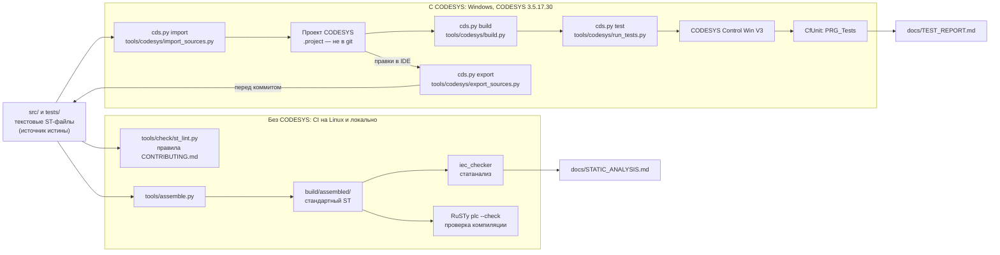

# Архитектура шаблона

Источник истины — текстовые файлы ST в `src/` и `tests/` (раскладка — [LAYOUT.md](LAYOUT.md)).
Проект CODESYS (`.project`) бинарный, поэтому в git его нет: он собирается из текстов скриптом
и после правок в IDE экспортируется обратно в тексты.

## Два контура проверок

| Контур | Где работает | Что ловит | Чего не ловит |
|---|---|---|---|
| Без CODESYS | CI (GitHub Actions, Ubuntu) и любой ПК с Python 3.12 | нарушения раскладки и правил именования, «магические числа», синтаксис и типы (RuSTy), находки статанализа (iec_checker) | особенности компилятора CODESYS, поведение в рантайме |
| С CODESYS | Windows с установленным CODESYS (переменные `CODESYS_EXE`, `CODESYS_PROFILE`) | ошибки компиляции CODESYS, результаты юнит-тестов CfUnit в Control Win | — |

Собранный текст в `build/assembled/` нужен только анализаторам: в CODESYS он не импортируется.
Варианты сборки (`iec`, `rusty`, `iec-checker`) описаны в [LAYOUT.md](LAYOUT.md#собранный-текст-buildassembled).

## Каталоги

| Каталог | Содержимое |
|---|---|
| `src/` | исходники приложения: DUT, GVL, интерфейсы, POU с методами и свойствами |
| `tests/` | наборы тестов CfUnit (coUnit 1.2.0.0, пространство имён `coUnit`) и `PRG_Tests` в той же раскладке; при импорте попадают в папку проекта `Tests` |
| `tools/` | `assemble.py`, `check/` (линтер, запуск iec_checker и RuSTy), `codesys/` (`cds.py` — командная строка CODESYS на Python 3; скрипты CODESYS Scripting, IronPython 2.7; `config.json`) |
| `docs/` | документация, отчёты проверок, шаблоны ТЗ и ПМИ |
| `build/` | артефакты сборки и проверок, в git не хранится |

## Пример в src/

Минимальный, но законченный пример показывает все виды объектов раскладки. Объект вымышленный:
насос подкачки, который поддерживает уровень в баке.

| Объект | Вид | Роль |
|---|---|---|
| `E_DeviceMode` | перечисление | режимы устройства: `Auto`, `Manual`, `Local`, `OutOfService` |
| `ST_ExampleCmd`, `ST_ExampleSts` | структуры | обмен с HMI/SCADA: команды и состояние |
| `GVL_Const` | GVL, константы | диапазоны уставки и гистерезиса, предел счётчика |
| `I_Resettable` | интерфейс | метод `Reset` — сброс любого объекта одним кодом |
| `F_Clamp` | функция | ограничение значения отрезком; семантика — в [ASSUMPTIONS.md](ASSUMPTIONS.md#семантика-f_clamp) |
| `FB_Example` | ФБ, `IMPLEMENTS I_Resettable` | двухпозиционный регулятор с гистерезисом; методы `Reset`, `Acknowledge`, свойство `Count` (только чтение) |
| `PRG_Main` | программа | однократные команды HMI, вызов `FB_Example`, состояние для HMI |
| `FB_F_Clamp_Test`, `FB_Example_Test`, `PRG_Tests` | тесты (`tests/`) | наборы тестов CfUnit для `F_Clamp` (границы, порядок границ) и `FB_Example` (пороги, гистерезис, отказ и квитирование, режимы, счётчик, сброс) и программа запуска |

### Поведение FB_Example

| Режим | Выход `xOut` |
|---|---|
| `Auto` | включается при `rValue_pct <= уставка - гистерезис`, отключается при `rValue_pct >= уставка`, в зоне между ними сохраняет состояние. При недостоверном измерении (`xValueValid = FALSE`) фиксируется отказ `xFault` и выход отключается до квитирования |
| `Manual` | повторяет команду оператора `xManualOn` |
| `Local` | `FALSE`: устройством управляют с местного поста, команда ПЛК снимается |
| `OutOfService` и любое другое значение | `FALSE` — безопасное состояние |

- Уставка и гистерезис ограничиваются диапазонами из `GVL_Const` через `F_Clamp`.
- `Acknowledge()` снимает отказ, только если измерение снова достоверно.
- `Reset()` отключает выход, сбрасывает отказ и счётчик включений.
- `Count` — число включений выхода (передний фронт) с последнего `Reset()`; на пределе UDINT
  счётчик не переполняется.
- Пример не использует время. В реальных устройствах выдержки делаются таймерами (`TON`) или по
  источнику времени, а не счётом циклов (правило из `CONTRIBUTING.md`).

### Чего в примере нет (сознательно)

Диагностики по NAMUR NE 107, проверки 4–20 мА по NAMUR NE 43, минимального времени работы и паузы
насоса. Это задачи библиотеки устройств следующих проектов портфолио; шаблон показывает только
каркас и инструменты.
