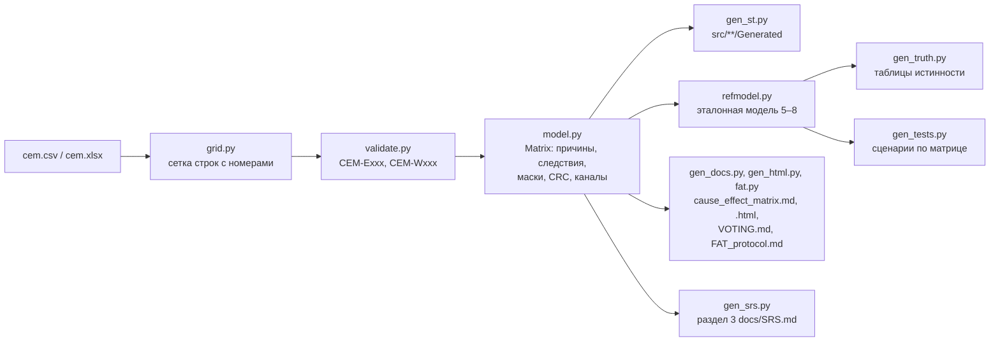

# Генератор `cemgen`

> **Внимание.** Код демонстрационный и не предназначен для систем безопасности. Реальная ПАЗ
> требует определения SIL, сертифицированных аппаратных и программных средств и валидации по
> ГОСТ Р МЭК 61511.

`cemgen` превращает матрицу причин и следствий (формат `cem/1`, CSV или XLSX) в конфигурацию ST,
привязку демо-объекта, тесты coUnit, таблицы истинности голосования и документы. Матрица —
единственный источник: код и документация не расходятся, CI проверяет это командой
`generate --check`. Нормативное описание формата и выходов — [DESIGN.md](DESIGN.md), разделы 9–12;
здесь — как пользоваться и как генератор устроен.

## Установка и запуск

Python 3.11+, стандартная библиотека и `openpyxl` (только для XLSX).

```
python -m pip install -r requirements-dev.txt      # ruff, mypy, pytest, openpyxl
python -m cemgen validate examples/separator/cem.csv
python -m cemgen generate examples/separator/cem.csv
```

Установка пакета (`python -m pip install -e .`) добавляет команду `cemgen` — та же точка входа.

| Команда | Что делает |
|---|---|
| `validate MATRIX [--strict] [--json]` | проверка по правилам CEM-E001…E030 и CEM-W001…W006; `--json` — результат для скриптов |
| `generate MATRIX [--root .] [--check] [--strict]` | все файлы раздела 10.2 — целиком или ничего; лишние `*.st` в `*/Generated/` удаляются; `--check` ничего не пишет и печатает «изменён / новый / лишний» |
| `convert SRC DST` | CSV ↔ XLSX: лист `CEM`, все ячейки текстом, строка в строку |
| `fat-report MATRIX --results build/test-results.json [--out docs/FAT_REPORT.md]` | отчёт FAT по результатам `cds.py test` |

Коды выхода: 0 — успех; 1 — ошибки матрицы (с `--strict` — и предупреждения), расхождения
`--check`, упавшие тесты в `fat-report`; 2 — аргументы, файл, ввод-вывод.

Сообщение проверки — строка и колонка файла (как в Excel) и подсказка:

```
m.csv:28:F: CEM-E016 vote «3oo3» не из списка. Как исправить: впишите 1oo1, 1oo2, 2oo2 или 2oo3.
```

## Что генерируется

| Путь | Что |
|---|---|
| `src/DUTs/Generated/ST_SisIo.dut.st` | образ ввода-вывода: токи 4–20 мА, дискретные входы с контролем линии, ключи, выходы-разрешения `xQ*` |
| `src/GVLs/Generated/GVL_SisCfg.gvl.st` | `CAUSE_*`, `EFFECT_*`, шкалы датчиков, `CEM_CFG` с CRC, `VOTE_CFG` — `VAR_GLOBAL CONSTANT` |
| `src/GVLs/Generated/GVL_SisIo.gvl.st`, `GVL_Sis.gvl.st` | образ ввода-вывода; время, журнал, приложение, команды HMI |
| `src/POUs/Generated/FB_SisApp/` | привязка: мА → инж. ед. и NE 43, входы → группы голосования, `FB_SisUnit`, выходы |
| `src/POUs/Generated/PRG_Sis/`, `F_SisIoNormal/`, `F_SisIoKeys/` | цикл ПАЗ; нормальные значения входов; ключи и кнопка |
| `tests/GVLs/Generated/GVL_VoteTruthTable.gvl.st` | 36 таблиц истинности (4188 строк) — ожидаемые байты от эталонной модели |
| `tests/POUs/Generated/FB_VoteTruth_Test/` | 36 тестов: `F_VoteEval` и `FB_Voting` по всем схемам, политикам и видам входа |
| `tests/POUs/Generated/FB_CemGenNN_Test/` | сценарии по матрице, не больше 40 тестов в наборе (для демо — 71: наборы 01 и 02) |
| `tests/GVLs/Generated/GVL_TestsGenerated.gvl.st` | экземпляры наборов, `{attribute 'linkalways'}` |
| `docs/cause_effect_matrix.md`, `docs/cause_effect_matrix.html` | матрица, причины, следствия, голосование, каналы, CRC; HTML — для печати на A3 |
| `docs/truth_tables/VOTING.md` | таблицы деградации 5.3 и полные таблицы `F_VoteEval` |
| `docs/FAT_protocol.md` | протокол испытаний в стиле FAT с пустыми графами «Результат» и «Отметка» |
| `docs/SRS.md`, раздел 3 | только блок между `<!-- cemgen:sif:begin -->` и `<!-- cemgen:sif:end -->`: сводка функций безопасности и подраздел на каждую причину; остальной текст SRS пишется вручную |

Каждый сгенерированный ST-файл начинается заголовком «AUTO-GENERATED by cemgen — не
редактировать» с документом, ревизией и SHA-256 сетки матрицы; у объявлений — ещё назначение,
автор, версия, ссылка на документ и дисклеймер (DESIGN.md, 3.1 и 10.3). Путь к файлу матрицы в
выход не попадает: CSV и XLSX одной матрицы дают одинаковые файлы. Дат генерации и случайных
значений нет — повторный запуск ничего не меняет.

Стенд сценарных тестов `FB_SisHarness` (`tests/POUs/Helpers/FB_SisHarness/`) не генерируется: он
общий для любой матрицы. Тест пишет `stIo` и `stCmd` стенда (они во `VAR_INPUT`: запись в `VAR`
экземпляра извне CODESYS запрещает, ошибка C0037) и читает `fbApp`, `fbLog`.

## Как устроен



| Модуль | Назначение |
|---|---|
| `grid.py` | CSV (UTF-8, `;`, RFC 4180) и XLSX (лист `CEM`, числа текстом, формулы — сохранённое значение) → сетка; SHA-256 сетки |
| `validate.py` | разделы `[header]` и `[matrix]`, правила 9.4 без каскадов ошибок; модель — только без ошибок |
| `model.py`, `sisdefs.py`, `limits.py` | модель матрицы; коды перечислений и имена ST; пределы `GVL_Const` (pytest сверяет их с текстом GVL) |
| `refmodel.py` | эталонная модель: `PL.FB_Delay`, `F_VoteEval`, `FB_Voting`, `FB_CauseEffect`, `FB_SisUnit`, привязка `FB_SisApp`, стенд; время — наносекунды, REAL — float32 |
| `gen_tests.py` | сценарий выполняется на стенде модели и одновременно записывается строками ST: ожидаемые значения ассертов — состояние модели в этой точке |
| `gen_srs.py` | блок функций безопасности в рукописном `docs/SRS.md`: заменяется только текст между маркерами; нет маркеров — ошибка генерации, нет файла — блок не пишется |
| `generate.py` | всё в памяти, затем запись или `--check` |
| `iolistgen_plugin.py` | необязательный адаптер для iolistgen (ниже) |

Эталонная модель написана по тексту контракта независимо от ST. Её независимо проверяют:
таблицы 5.3 и временная диаграмма 6.11 (pytest), таблицы истинности команды A из её собственной
модели (`tools_project/vote_model.py`) — совпадают во всех 4188 строках, — и прогон сгенерированных
тестов на настоящих ФБ в CODESYS Control Win V3 ([TEST_REPORT.md](TEST_REPORT.md)).

## Протокол FAT и отчёт

`docs/FAT_protocol.md` — шаги по разделам DESIGN.md, 12.7 с графой «Автотест» (имя теста coUnit или
шаблон с `*`). Таблицы истинности — шаги `FAT-04-91` … `FAT-04-94` по схемам: каждый ссылается на
оба независимых набора, `VoteTruth_*` (модель `cemgen`) и `VoteTable_*` (модель
`tools_project/vote_model.py`). `cemgen fat-report` заполняет графы по `build/test-results.json`:
«соответствует» — только если по **каждому** шаблону шага есть результаты и все они пройдены;
шаблон без результатов (набор не собран или переименован) даёт «не выполнялся» с этим шаблоном в
отметке.

## Сценарии по матрице (DESIGN.md, 12.4)

На каждую включённую причину: требование отключает свои следствия; задержка «до и ровно»;
пусковой обход истекает и даёт срабатывание (или запрос отклонён); сброс только после снятия
причины; отказ канала по политике деградации; байпас истекает и канал возвращается в голосование
(или байпас запрещён). Общие: первопричина для каждой пары соседних причин, одновременная
фиксация, старт ПЛК, проверка сгенерированной конфигурации. Переход к моменту `T − Δ` — шагами не
крупнее `T/50`, затем один шаг `Δ` (`test_step` матрицы); не больше 100 итераций на вызов `Run`.

Генератор проверяет и предпосылки сценария: если модель говорит, что причина не срабатывает
(матрица или изменённый контракт сделали сценарий бессмысленным), генерация останавливается с
сообщением, а файлы не пишутся.

## Плагин iolistgen

Проект 07 (iolistgen) генерирует код по перечню сигналов, а матрица причин и следствий — другой
исходный документ, поэтому `cemgen` — отдельный пакет (решение D-04). Для тех, кто держит перечень
в iolistgen, есть тонкий адаптер: точка входа `sis-cem` в группе `iolistgen.generators`
(`pyproject.toml`). Если `sis-interlock-demo` установлен в одном окружении с iolistgen:

```
iolistgen generate io_list.csv --only sis-cem --set sis-cem.cem=examples/separator/cem.csv
```

Адаптер проверяет матрицу теми же правилами, сверяет теги каналов и ключей с перечнем сигналов
(`ident` или `tag`, без учёта регистра; отсутствующий тег — предупреждение, с
`--set sis-cem.strict_tags=true` — ошибка) и пишет те же файлы через контекст iolistgen. Лишние
`*.st` в `*/Generated/` он не удаляет — для этого `python -m cemgen generate`. iolistgen импортируется
лениво: без него `cemgen` работает как обычно.

## Разработка

```
python -m ruff check . && python -m ruff format --check . && python -m mypy && python -m pytest
python -m cemgen generate examples/separator/cem.csv --check
CEMGEN_UPDATE_GOLDEN=1 python -m pytest pytests/test_generate.py -k golden   # обновить эталон
```

Тесты — `pytests/`: значения и загрузка CSV/XLSX, каждое правило проверки (срабатывание и тишина),
эталонная модель (таблицы 5.3, диаграмма 6.11, CRC, примеры 12.4), состав и формат выходов,
детерминизм, CSV = XLSX, эталонные файлы мини-матрицы (`pytests/golden/mini/`), совпадение
сгенерированного с репозиторием, командная строка, отчёт FAT, HTML, адаптер iolistgen (если
iolistgen доступен). Эталонные файлы пересоздаются только переменной `CEMGEN_UPDATE_GOLDEN=1`.

## Ограничения

- Не больше 16 причин и 16 следствий (маски `WORD`, решение D-12), до 3 каналов в группе.
- Тексты (описания, примечания) в ПЛК не попадают — только индексы и маски (D-18); они остаются в
  документах и комментариях.
- `examples/separator/cem.xlsx` получен командой `convert` и коммитится вручную: байты XLSX
  недетерминированы, поэтому pytest сравнивает модели CSV и XLSX, а не файлы.
