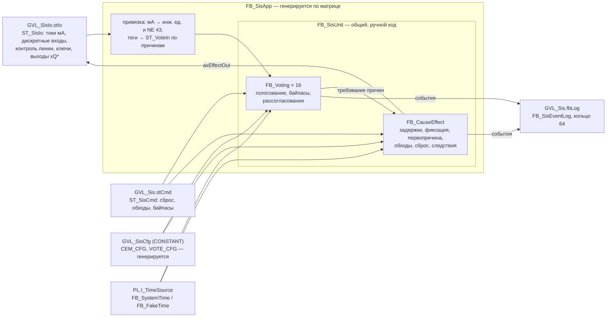
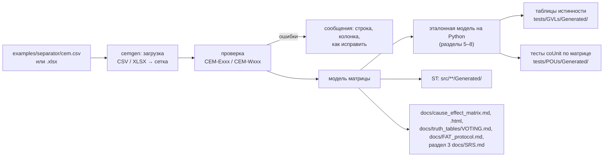
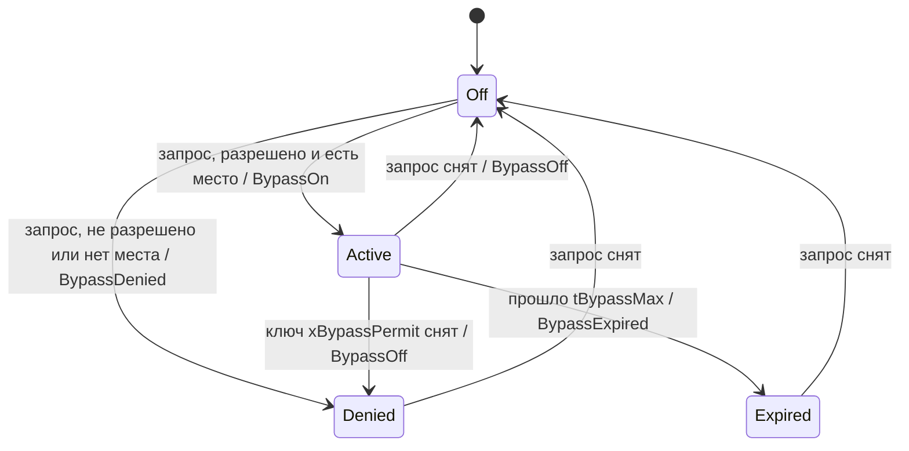
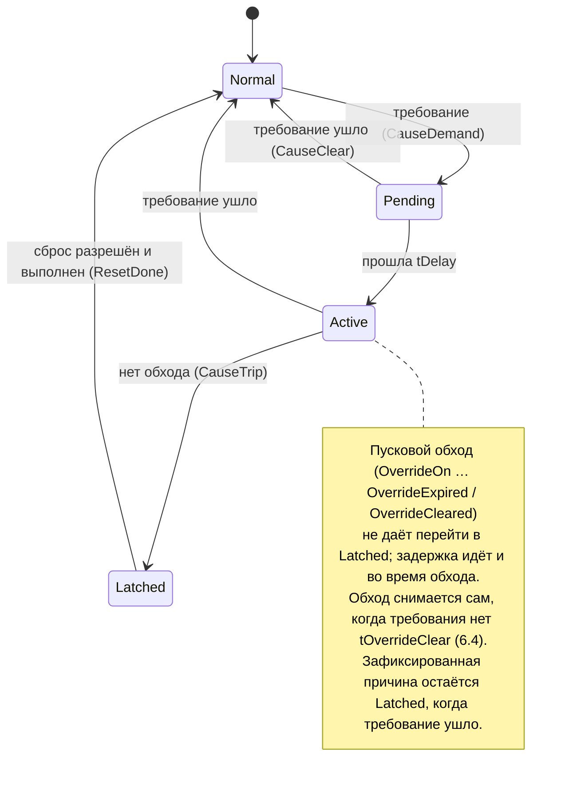
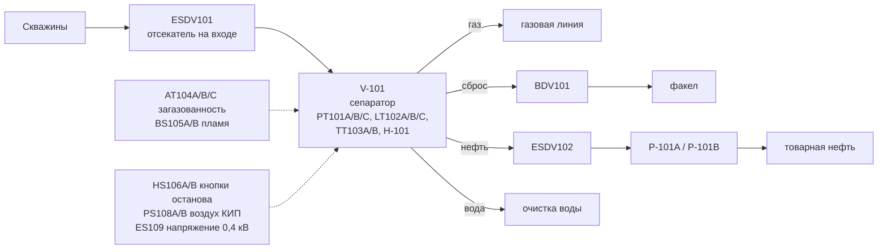

# sis-interlock-demo — контракт проекта v1.0

| | |
|---|---|
| Статус | **Контракт, реализован** (v1.2.0, критерии приёмки 13.5 выполнены; изменения v1.1.0–v1.2.0 — по итогам ревизии функциональной безопасности, раздел 16). Две команды писали код параллельно и опирались только на этот документ: команда A — логика ПАЗ на ST, команда B — генератор `cemgen`, сгенерированный код, тесты по матрице и документы. Изменения — через PR в этот файл с записью в журнал (раздел 16) |
| Версия | 1.2.0, 2026-10-19 |
| Платформа | CODESYS V3.5 SP17 Patch 3 (3.5.17.30), CODESYS Control Win V3 (32 бит) в пользовательском процессе; целевой ПЛК — ОВЕН ПЛК210 (версию таргет-файла сверить с прошивкой) |
| Тесты ST | coUnit 1.2.0.0 (namespace `coUnit`), прогон `python tools/codesys/cds.py test` |
| Библиотека | plc-process-lib (namespace `PL`): `I_TimeSource`, `FB_SystemTime`, `FB_FakeTime`, `FB_Delay`, `F_IsFinite`, константы NE 43 (контракт библиотеки, разделы 4–8, 21.2) |
| Основание | спецификация проекта 10 «ПАЗ и блокировки», правила [CONTRIBUTING.md](../CONTRIBUTING.md), раскладка [LAYOUT.md](LAYOUT.md), инструменты [tools/README.md](../tools/README.md) |
| Демо-матрица | [examples/separator/cem.csv](../examples/separator/cem.csv) — единственный источник конфигурации, тестов по матрице и таблиц документации |

> **Обязательный дисклеймер.** Код демонстрационный и не предназначен для систем безопасности.
> Реальная ПАЗ требует определения SIL, сертифицированных аппаратных и программных средств и
> валидации по ГОСТ Р МЭК 61511.

Обозначения:
- **ДОЛЖЕН** / **НЕ ДОЛЖЕН** — нормативное требование; реализация, которая его нарушает, не принимается.
- «Проверить в CODESYS» — поведение компилятора или рантайма, которое нужно подтвердить первой сборкой (раздел 15.1).
- «Сверить с источником» — требование стандарта или справочное значение, которое нужно сверить с первоисточником (раздел 15.2).
- Индексы причин `i` и следствий `j` — с единицы. Бит маски для индекса `i` — бит `i − 1` (причина 1 — бит 0).
- «Команда A», «команда B» — исполнители; владельцы файлов — раздел 13.

---

## 1. Назначение и границы

Проект показывает логику противоаварийной защиты (ПАЗ) нефтегазового объекта на ST:

1. **Голосование** `FB_Voting` по схемам MooN (1oo1, 1oo2, 2oo2, 2oo3) для дискретных и аналоговых каналов: недостоверный канал — по политике деградации, тревога рассогласования аналоговых каналов, байпас канала с таймером, журналом и ограничением числа.
2. **Исполнитель матрицы причин и следствий** `FB_CauseEffect`: задержки причин, следствия с обесточиванием на срабатывание, фиксация первопричины с меткой времени, сброс только вручную и только при снятых причинах, пусковые обходы с таймерами и автоматическим снятием после подтверждения нормы, срабатывание при ошибке конфигурации.
3. **Генератор** `cemgen` (Python): матрица в CSV или XLSX → конфигурация ST и привязка демо-объекта, тесты coUnit по матрице, исчерпывающие таблицы истинности голосования, таблицы и HTML-представление матрицы, протокол испытаний в стиле FAT.
4. **Демо-объект**: вымышленный трёхфазный сепаратор V-101 — 10 причин, 7 следствий (раздел 11).

Вне объёма v1 (раздел 14 — почему): HMI/WebVisu, обмен с SCADA по Modbus/OPC UA, оповещение оператора через `PL.FB_Alarm`, перенос на ПЛК210, расчёт SIL и PFD.

Текст дисклеймера (раздел 3.1) **ДОЛЖЕН** стоять в README (в начале, цитатой) и в заголовке каждого объекта ST: POU, DUT, GVL, интерфейса — и в сгенерированных файлах тоже.

---

## 2. Архитектура

### 2.1 Слои во время выполнения



- `FB_Voting`, `FB_CauseEffect`, `FB_SisEventLog`, `FB_SisUnit` и функции раздела 8 — **общий код** (команда A). Он ничего не знает о демо-объекте.
- Всё, что зависит от объекта (`ST_SisIo`, `GVL_SisCfg`, `GVL_SisIo`, `GVL_Sis`, `FB_SisApp`, `PRG_Sis`, `F_SisIoNormal`, `F_SisIoKeys`), **генерирует** `cemgen` (команда B).
- Логика ПАЗ **НЕ ДОЛЖНА** зависеть от ФБ устройств plc-process-lib (`FB_AnalogInput`, `FB_Motor` и др.) и от `FB_Alarm` (контракт PL, 21.2; решения D-01, D-17).

### 2.2 Поток генерации



Ожидаемые значения сгенерированных тестов считает **эталонная модель** — прямой перенос нормативного псевдокода разделов 5–8 на Python. ST и модель пишутся по этому документу независимо; расхождение ловят тесты, спор решает текст контракта.

### 2.3 Цикл ПЛК

`MainTask` (20 мс, `config.json`) → `PRG_Main` → `PRG_Sis` → `GVL_Sis.fbApp(...)`. Внутри вызова: привязка входов → группы голосования по возрастанию индекса причины → `FB_CauseEffect` → выходы. Порядок событий в журнале — тот же.

---

## 3. Общие правила

### 3.1 Заголовок объекта ST (нормативно)

Каждый POU, DUT, GVL и интерфейс начинается с комментария (правило STL001 и дисклеймер):

```st
// Назначение: <что делает объект>
// Автор:      kr0nsch
// Версия:     0.1.0
// Документ:   docs/DESIGN.md, раздел «<номер и название>»
// ВНИМАНИЕ:   код демонстрационный и не предназначен для систем безопасности. Реальная ПАЗ
//             требует определения SIL, сертифицированных аппаратных и программных средств
//             и валидации по ГОСТ Р МЭК 61511.
```

Проверка `tools/project_checks/test_disclaimer.py` (команда A): в каждом файле объявления объекта (`*.decl.st` POU, `*.dut.st`, `*.gvl.st`, `*.itf.st`) в `src/` и `tests/` комментарий до первой строки кода (после удаления `//`, `(*`, `*)` и схлопывания пробелов) содержит дословно:
`код демонстрационный и не предназначен для систем безопасности. Реальная ПАЗ требует определения SIL, сертифицированных аппаратных и программных средств и валидации по ГОСТ Р МЭК 61511.`
Регистр первой буквы не проверяется. Заголовок сгенерированных файлов — раздел 10.3.

### 3.2 Именование и язык

- По `CONTRIBUTING.md` и `tools/check/st_lint.toml`: идентификаторы ASCII, по-английски, префиксы типов (`x`, `ui`, `r`, `t`, `lt`, `w`, `b`, `e`, `st`, `a`, `fb`, `itf`); составные префиксы массивов (`axDi`, `arAi_eu`, `aeChState`, `astCause`, `afbVote`, `atBypassRemain`); константы — UPPER_SNAKE_CASE.
- Комментарии и документы — по-русски. Строковые литералы (`coUnit.TEST`, сообщения ассертов) — ASCII.
- В ПЛК нет строк с тегами и текстами: только индексы, маски и коды событий (D-18).
- Имена, которые iec_checker 0.4 считает ключевыми словами (`Priority`, `Interval`, `On`, `Single`, `Ref`, `Task`, …), не используются.
- Числа в логике — только 0, 1, 2; остальное — константы `GVL_Const` (STL008). В тестах числа допустимы.

### 3.3 Время

- Время — только через `PL.I_TimeSource.Now() : LTIME`. Вход `itfTime = 0` — встроенный `PL.FB_SystemTime` экземпляра.
- Единственный таймер — `PL.FB_Delay` (задержки причин, таймеры байпасов и обходов, задержка рассогласования). `TON`, `TOF`, `TP` и счёт циклов **запрещены**.
- `FB_SisUnit` определяет действующий источник один раз за вызов и передаёт его всем вложенным ФБ (так тест с `PL.FB_FakeTime` детерминирован).
- Семантика `PL.FB_Delay` (контракт PL, 7.4) — нормативная часть этого контракта: отметка ставится при каждой смене `xIn` и в первом вызове; выход меняется, когда `ltNow − отметка >= задержка`; задержка `T#0S` — в том же вызове; «время назад» перезапускает отсчёт. `tRemaining` — остаток.
- **Неисправность источника времени** (D-19). `FB_Voting` и `FB_CauseEffect` помнят время прошлого вызова `ltPrev` (начальное `LTIME#0S`); `xTimeBack := ltNow < ltPrev` — «время назад». Перезапуск отсчёта в `PL.FB_Delay` продлил бы байпасы и пусковые обходы сверх разрешённого срока и отложил бы срабатывание, поэтому в таком вызове: событие `TimeFault`; действующие байпасы заканчиваются (`Expired`, 5.7), действующие пусковые обходы снимаются (`OverrideExpired`, 6.4); причины с требованием, у которых идёт отсчёт задержки, срабатывают сразу (6.3). Задержка рассогласования (диагностика, 5.8) просто перезапускается.
- **Остановившееся время** (`Now()` не растёт) программа не обнаруживает: без независимого эталона времени это невозможно, а счёт циклов запрещён. Задержки не истекут, байпасы и обходы не закончатся; контроль источника времени и сторожевой таймер задачи — дело платформы ПЛК (вне объёма v1, S-07).

### 3.4 Безопасное состояние (fail-safe)

| Ситуация | Действие |
|---|---|
| ФБ ещё не вызывался | `FB_Voting.xTrip = TRUE`, `FB_CauseEffect.axEffectOut[*] = FALSE` (обесточено) |
| Ошибка конфигурации группы голосования | `xTrip := TRUE` для этой причины (раздел 5.9) |
| Ошибка конфигурации матрицы | все выходы `FALSE`, сброс запрещён, первопричина `SIS_FIRST_OUT_CFG` (раздел 6.8) |
| Старт ПЛК (`xStartTripped = TRUE`) | все следствия сработали до первого сброса оператором (раздел 6.10) |
| Недостоверный канал | по политике деградации (раздел 5.2) |
| Аналоговый канал без тока (0 мА), NaN, ±Inf | недостоверен (NE 43, раздел 8.3) |
| Дискретный вход и контроль линии по умолчанию (`FALSE`) | требование и недостоверность: неподключённый канал не может «держать норму» |
| Источник времени пошёл назад | `TimeFault`; байпасы и пусковые обходы сняты; причины с идущей задержкой срабатывают сразу (3.3, D-19) |
| Источник времени остановился | программой не обнаруживается (3.3): диагностика платформы, вне объёма v1 |

### 3.5 Использование plc-process-lib

Используются только `PL.I_TimeSource`, `PL.FB_SystemTime`, `PL.FB_FakeTime` (тесты), `PL.FB_Delay`, `PL.F_IsFinite`, `PL.GVL_Const.NE43_FAIL_LOW_MA`, `NE43_FAIL_HIGH_MA`, `MA_ZERO`, `MA_SPAN`. Перечень 21.2 контракта PL расширен функцией `F_IsFinite` и константами NE 43 — это не ФБ устройств, правило 21.2 не нарушается. Репозиторий библиотеки не правится.

---

## 4. Типы и константы (`src/DUTs/Sis/`, `src/GVLs/`, `src/Interfaces/`)

Все DUT — с `{attribute 'qualified_only'}`; перечисления — ещё и с `{attribute 'strict'}`, базовый тип `INT`, явные значения. Каждый тип — отдельный файл `<Имя>.dut.st` с заголовком 3.1. В объявлениях ниже заголовки опущены.

### 4.1 Перечисления

```st
TYPE E_VoteArch :
(
    None       := 0,     // не задана — ошибка конфигурации
    Vote1oo1   := 11,
    Vote1oo2   := 12,
    Vote2oo2   := 22,
    Vote2oo3   := 23,
    ForcedTrip := 99     // только действующая схема: голосовать некем или недостоверные каналы уже дают требование
) INT;
END_TYPE

TYPE E_DegradePolicy :
(
    VoteTrip         := 1,   // недостоверный канал голосует «на останов»; 2oo3 → 1oo2 → останов
    DegradeSafe      := 2,   // недостоверный канал исключается, требуется меньше голосов; 2oo3 → 1oo2 → 1oo1
    DegradeAvailable := 3    // недостоверный канал исключается, требуется прежнее число голосов; 2oo3 → 2oo2 → 1oo1
) INT;
END_TYPE

TYPE E_ChannelState :
(
    NotUsed  := 0,   // канал не входит в схему (номер > N)
    Normal   := 1,   // достоверен, требования нет
    Demand   := 2,   // достоверен, требование срабатывания
    Invalid  := 3,   // недостоверен
    Bypassed := 4    // байпас действует (старше Invalid и Demand)
) INT;
END_TYPE

TYPE E_BypassState :
(
    Off     := 0,    // байпаса нет
    Active  := 1,    // байпас действует, идёт отсчёт tBypassMax
    Expired := 2,    // срок истёк, запрос ещё держится
    Denied  := 3     // запрос отклонён или байпас снят ключом, запрос ещё держится
) INT;
END_TYPE

TYPE E_SisInputKind :
(
    Discrete := 1,
    Analog   := 2
) INT;
END_TYPE

TYPE E_LimitDir :
(
    High := 1,       // требование при значении >= уставки
    Low  := 2        // требование при значении <= уставки
) INT;
END_TYPE

TYPE E_CauseSource :
(
    Voting   := 1,   // требование — FB_Voting группы с тем же индексом
    External := 2    // требование — ST_VoteIn.xExtDemand (логика приложения, без голосования)
) INT;
END_TYPE

TYPE E_SafeState :   // технологический смысл безопасного состояния; электрически всегда обесточивание
(
    Closed  := 1,    // арматура закрыта
    Open    := 2,    // арматура открыта (сброс давления)
    Stopped := 3,    // механизм остановлен
    Off     := 4,    // потребитель отключён
    Alarm   := 5     // сигнализация включена
) INT;
END_TYPE

TYPE E_SisEventKind :
(
    None            := 0,
    CauseDemand     := 1,    // требование причины появилось (до задержки)
    CauseClear      := 2,    // требование ушло
    CauseTrip       := 3,    // причина зафиксирована
    FirstOut        := 4,    // первопричина: uiCause = индекс, SIS_FIRST_OUT_START или SIS_FIRST_OUT_CFG
    EffectTrip      := 5,    // следствие обесточено
    EffectRestore   := 6,    // следствие снова под напряжением
    ResetDone       := 7,
    ResetDenied     := 8,    // uiCause — первая мешающая причина или SIS_FIRST_OUT_CFG
    OverrideOn      := 9,
    OverrideOff     := 10,   // снят командой или ошибкой конфигурации
    OverrideExpired := 11,   // истёк срок tOverrideMax или «время назад» (D-19)
    OverrideDenied  := 12,
    BypassOn        := 13,
    BypassOff       := 14,   // снят запросом или ключом разрешения
    BypassExpired   := 15,
    BypassDenied    := 16,
    ChannelInvalid  := 17,
    ChannelValid    := 18,
    DiscrepancyOn   := 19,   // rValue — разброс
    DiscrepancyOff  := 20,
    CfgError        := 21,   // rValue — WORD_TO_REAL(wCfgErr)
    CfgOk           := 22,
    StartTrip       := 23,   // срабатывание при старте (xStartTripped)
    TimeFault       := 24,   // источник времени пошёл назад (3.3, D-19)
    OverrideCleared := 25    // обход снят автоматически: требования нет непрерывно tOverrideClear (6.4)
) INT;
END_TYPE
```

### 4.2 Структуры

```st
TYPE ST_VoteIn :                     // сигналы каналов одной группы голосования
STRUCT
    axDi       : ARRAY[1..GVL_Const.SIS_VOTE_CH_MAX] OF BOOL;   // дискретные каналы (значение с поля)
    axDiValid  : ARRAY[1..GVL_Const.SIS_VOTE_CH_MAX] OF BOOL;   // контроль линии / диагностика модуля: TRUE — исправен
    arAi_eu    : ARRAY[1..GVL_Const.SIS_VOTE_CH_MAX] OF REAL;   // аналоговые каналы, инж. ед.
    axAiValid  : ARRAY[1..GVL_Const.SIS_VOTE_CH_MAX] OF BOOL;   // достоверность (NE 43 и т. п.): TRUE — достоверен
    xExtDemand : BOOL;                                          // для eSource = External: TRUE — требование
END_STRUCT
END_TYPE

TYPE ST_VoteCmd :                    // команды группы от HMI — уровни, ФБ их не сбрасывает
STRUCT
    axBypassReq : ARRAY[1..GVL_Const.SIS_VOTE_CH_MAX] OF BOOL;  // запрос байпаса канала (держится, пока нужен)
END_STRUCT
END_TYPE

TYPE ST_VotingCfg :
STRUCT
    eArch              : E_VoteArch := E_VoteArch.None;            // None — ошибка (fail-safe)
    ePolicy            : E_DegradePolicy := E_DegradePolicy.VoteTrip;
    eInput             : E_SisInputKind := E_SisInputKind.Discrete;
    xDiHealthy         : BOOL := TRUE;     // значение дискретного канала в норме; другое — требование
    eLimitDir          : E_LimitDir := E_LimitDir.High;
    rTripLimit_eu      : REAL := 0.0;      // уставка срабатывания, инж. ед. (включительно)
    rHyst_eu           : REAL := 0.0;      // гистерезис снятия требования, >= 0
    rDiscrepancyMax_eu : REAL := 0.0;      // допустимый разброс каналов; 0.0 — контроль выключен
    tDiscrepancyDelay  : TIME := T#0S;     // задержка тревоги рассогласования
    tBypassMax         : TIME := T#0S;     // максимальная длительность байпаса; T#0S — байпас запрещён
    uiMaxBypass        : UINT := 0;        // одновременных байпасов в группе, 0..N-1
END_STRUCT
END_TYPE

TYPE ST_VoteResult :                 // результат F_VoteEval
STRUCT
    xTrip      : BOOL := TRUE;
    xDegraded  : BOOL;
    eArchEff   : E_VoteArch := E_VoteArch.None;
    uiDemand   : UINT;                // каналов Demand
    uiInvalid  : UINT;                // каналов Invalid
    uiBypassed : UINT;                // каналов Bypassed
    uiNormal   : UINT;                // каналов Normal
END_STRUCT
END_TYPE

TYPE ST_VotingSts :
STRUCT
    xTrip          : BOOL := TRUE;
    eArchEff       : E_VoteArch := E_VoteArch.None;
    xDegraded      : BOOL;            // есть байпасированные или недостоверные каналы
    xCfgError      : BOOL;
    wCfgErr        : WORD;            // биты VOTE_CFG_*
    xDiscrepancy   : BOOL;            // тревога рассогласования (после задержки)
    rSpread_eu     : REAL;            // max − min участвующих аналоговых каналов; 0.0, если их меньше двух
    uiDemand       : UINT;
    uiInvalid      : UINT;
    uiBypassed     : UINT;
    uiNormal       : UINT;
    aeChState      : ARRAY[1..GVL_Const.SIS_VOTE_CH_MAX] OF E_ChannelState;
    aeBypass       : ARRAY[1..GVL_Const.SIS_VOTE_CH_MAX] OF E_BypassState;
    atBypassRemain : ARRAY[1..GVL_Const.SIS_VOTE_CH_MAX] OF TIME;   // остаток байпаса; T#0S, если не Active
END_STRUCT
END_TYPE

TYPE ST_CauseCfg :                   // строка матрицы
STRUCT
    xEnable          : BOOL := FALSE;                          // причина используется
    eSource          : E_CauseSource := E_CauseSource.Voting;
    tDelay           : TIME := T#0S;                           // задержка срабатывания, <= SIS_DELAY_MAX
    xOverrideAllowed : BOOL := FALSE;                          // пусковой обход разрешён
    tOverrideMax     : TIME := T#0S;                           // длительность обхода, (0, SIS_OVERRIDE_MAX]
    tOverrideClear   : TIME := T#0S;                           // подтверждение нормы для автоснятия обхода, (0, tOverrideMax)
END_STRUCT
END_TYPE

TYPE ST_EffectCfg :                  // столбец матрицы
STRUCT
    eSafeState : E_SafeState := E_SafeState.Off;   // смысл для HMI и документов; выход всегда обесточивается
    wCauseMask : WORD := 0;                        // бит i-1 — причина i отключает это следствие («X» в столбце)
END_STRUCT
END_TYPE

TYPE ST_CemCfg :
STRUCT
    uiCauseCount  : UINT := 0;      // используемых причин, 1..SIS_CAUSES_MAX; 0 — ошибка (fail-safe)
    uiEffectCount : UINT := 0;      // используемых следствий, 1..SIS_EFFECTS_MAX
    xStartTripped : BOOL := TRUE;   // после старта ПЛК все следствия сработали до первого сброса
    astCause      : ARRAY[1..GVL_Const.SIS_CAUSES_MAX] OF ST_CauseCfg;
    astEffect     : ARRAY[1..GVL_Const.SIS_EFFECTS_MAX] OF ST_EffectCfg;
    wMatrixCrc    : WORD := 0;      // CRC-16/CCITT-FALSE матрицы (раздел 6.8), считает генератор
END_STRUCT
END_TYPE

TYPE ST_CemCmd :                     // импульсы HMI; FB_CauseEffect сбрасывает их в том же вызове
STRUCT
    xReset           : BOOL;        // сброс ПАЗ
    xStartupOverride : BOOL;        // пусковой обход всех причин с xOverrideAllowed
    wOverrideReq     : WORD;        // обход причин по маске
    wOverrideCancel  : WORD;        // снять обход по маске
END_STRUCT
END_TYPE

TYPE ST_SisCmd :
STRUCT
    stCem  : ST_CemCmd;
    astVote : ARRAY[1..GVL_Const.SIS_CAUSES_MAX] OF ST_VoteCmd;   // байпасы каналов по причинам
END_STRUCT
END_TYPE

TYPE ST_CauseEffectSts :
STRUCT
    uiFirstOut       : UINT;        // SIS_FIRST_OUT_NONE, 1..N, SIS_FIRST_OUT_START или SIS_FIRST_OUT_CFG
    ltFirstOut       : LTIME;       // момент фиксации первопричины (I_TimeSource); LTIME#0S — нет
    wFirstOutMask    : WORD;        // все причины, зафиксированные в вызове первопричины
    wCausePresent    : WORD;        // требование есть сейчас (до задержки), причина включена
    wCauseActive     : WORD;        // требование после задержки (без учёта обхода)
    wCauseLatched    : WORD;        // причина зафиксирована, до сброса
    wOverridden      : WORD;        // пусковой обход действует
    wEffectTripped   : WORD;        // следствие сработало (выход обесточен), j <= uiEffectCount
    xTripped         : BOOL;        // хотя бы одно следствие сработало
    xResetPermitted  : BOOL;
    uiResetBlocker   : UINT;        // 0 — нет; первая мешающая причина; SIS_FIRST_OUT_CFG — ошибка конфигурации
    xCfgError        : BOOL;
    wCfgErr          : WORD;        // биты CEM_CFG_*
    udiTripCount     : UDINT;       // фиксаций первопричины с запуска
    atOverrideRemain : ARRAY[1..GVL_Const.SIS_CAUSES_MAX] OF TIME;   // остаток обхода; T#0S — обхода нет
    atDelayRemain    : ARRAY[1..GVL_Const.SIS_CAUSES_MAX] OF TIME;   // остаток задержки причины; T#0S — отсчёта нет
    atOverrideClearRemain : ARRAY[1..GVL_Const.SIS_CAUSES_MAX] OF TIME;   // остаток подтверждения нормы до
                                    // автоснятия обхода; T#0S — обхода нет или требование есть
END_STRUCT
END_TYPE

TYPE ST_SisEvent :                   // порядок полей — без выравнивающих пропусков: SIZEOF = 24
STRUCT
    ltTime    : LTIME;              // монотонная отметка источника времени
    udiSeq    : UDINT;              // номер события; присваивает журнал (1, 2, …; после 16#FFFFFFFF — 1)
    rValue    : REAL;               // значение канала, разброс, код ошибки; иначе 0.0
    eKind     : E_SisEventKind;
    uiCause   : UINT;               // 0 — нет; 1..N; SIS_FIRST_OUT_START / SIS_FIRST_OUT_CFG
    uiEffect  : UINT;               // 0 — нет; 1..M
    uiChannel : UINT;               // 0 — нет; 1..3
END_STRUCT
END_TYPE
```

Тест (команда A): `SIZEOF(ST_SisEvent) = 24`, `SIS_CAUSES_MAX <= 16` и `SIS_EFFECTS_MAX <= 16` (маски `WORD`).

### 4.3 `GVL_Const` (`src/GVLs/GVL_Const.gvl.st`, заменяет файл шаблона)

`{attribute 'qualified_only'} VAR_GLOBAL CONSTANT`. Обращение — `GVL_Const.X` (свой список приложения; библиотечный — `PL.GVL_Const.X`).

| Константа | Тип | Значение | Назначение |
|---|---|---|---|
| `SIS_CAUSES_MAX` | UINT | 16 | причин в матрице = разрядность масок |
| `SIS_EFFECTS_MAX` | UINT | 16 | следствий |
| `SIS_VOTE_CH_MAX` | UINT | 3 | каналов в группе голосования |
| `SIS_LOG_SIZE` | UINT | 64 | ёмкость кольцевого журнала событий |
| `SIS_DELAY_MAX` | TIME | T#10M | предел задержки причины и задержки рассогласования |
| `SIS_OVERRIDE_MAX` | TIME | T#2H | предел пускового обхода |
| `SIS_BYPASS_MAX` | TIME | T#12H | предел байпаса канала |
| `SIS_FIRST_OUT_NONE` | UINT | 0 | первопричины нет |
| `SIS_FIRST_OUT_START` | UINT | 16#FFFE | срабатывание при старте ПЛК |
| `SIS_FIRST_OUT_CFG` | UINT | 16#FFFF | ошибка конфигурации матрицы |
| `CRC16_INIT` | WORD | 16#FFFF | CRC-16/CCITT-FALSE: начальное значение |
| `CRC16_POLY` | WORD | 16#1021 | полином |
| `CRC16_MSB` | WORD | 16#8000 | старший бит |
| `BITS_PER_BYTE` | UINT | 8 | |
| `WORD_BIT0` | WORD | 16#0001 | бит 0 (маски строятся сдвигом) |
| `WORD_LOW_BYTE` | WORD | 16#00FF | |
| `VOTE_CFG_ARCH` | WORD | 16#0001 | `eArch` вне {1oo1, 1oo2, 2oo2, 2oo3} |
| `VOTE_CFG_POLICY` | WORD | 16#0002 | `ePolicy` вне перечисления |
| `VOTE_CFG_INPUT` | WORD | 16#0004 | `eInput` вне перечисления |
| `VOTE_CFG_LIMIT` | WORD | 16#0008 | Analog: уставка не конечна, `rHyst_eu < 0` или не конечен, `eLimitDir` вне перечисления |
| `VOTE_CFG_DISCREPANCY` | WORD | 16#0010 | Analog: `rDiscrepancyMax_eu < 0` или не конечен, `tDiscrepancyDelay > SIS_DELAY_MAX` |
| `VOTE_CFG_BYPASS` | WORD | 16#0020 | `uiMaxBypass > N − 1` или `tBypassMax > SIS_BYPASS_MAX` |
| `CEM_CFG_COUNT` | WORD | 16#0001 | `uiCauseCount` или `uiEffectCount` вне 1..MAX |
| `CEM_CFG_CAUSE` | WORD | 16#0002 | используемая причина: `eSource` вне перечисления, `tDelay > SIS_DELAY_MAX`; обход разрешён при `tOverrideMax = T#0S` или `> SIS_OVERRIDE_MAX`, при `tOverrideClear = T#0S` или `tOverrideClear >= tOverrideMax` |
| `CEM_CFG_EFFECT` | WORD | 16#0004 | используемое следствие: `eSafeState` вне перечисления, `wCauseMask = 0`, биты причин сверх `uiCauseCount`; неиспользуемое следствие с `wCauseMask <> 0` |
| `CEM_CFG_CRC` | WORD | 16#0008 | `F_CemCrc(stCfg) <> stCfg.wMatrixCrc` |
| `DEMO_IO_SIMULATION` | BOOL | TRUE | демо без ввода-вывода: `PRG_Main` в первом цикле ставит нормальные значения входов |

Другие константы команда A добавляет сама (по STL008), не меняя значений из таблицы. `cemgen` дублирует значения `SIS_*_MAX` и пределов у себя (`cemgen/limits.py`); pytest команды B сверяет их с текстом `GVL_Const.gvl.st` разбором строк `ИМЯ : ТИП := ЗНАЧЕНИЕ;`.

### 4.4 Интерфейс журнала

```st
INTERFACE I_SisEventSink                         // без базового __System.IQueryInterface
METHOD Add : BOOL                                // VAR_INPUT stEvent : ST_SisEvent; TRUE — записано
```
`stEvent` — `VAR_INPUT` (копия 24 байт): так нет ограничений RuSTy на `VAR_IN_OUT CONSTANT` в вызове метода. Поле `udiSeq` заполняет приёмник, остальные — источник события.

---

## 5. Голосование

### 5.1 Модель

Группа голосования — `N` каналов (1..3) одной причины и требуемое число голосов `M`:

| `E_VoteArch` | N | M | Смысл |
|---|---|---|---|
| `Vote1oo1` | 1 | 1 | один канал |
| `Vote1oo2` | 2 | 1 | любой из двух (безопасность) |
| `Vote2oo2` | 2 | 2 | оба (защита от ложного останова) |
| `Vote2oo3` | 3 | 2 | два из трёх |

Состояние канала `k ≤ N` (старшинство сверху вниз):

| Состояние | Условие |
|---|---|
| `Bypassed` | байпас канала в состоянии `Active` |
| `Invalid` | канал недостоверен (5.6) |
| `Demand` | требование канала (5.6) |
| `Normal` | иначе |

Каналы `k > N` — `NotUsed`, их входы и запросы байпаса не действуют.

### 5.2 `F_VoteEval` — нормативный алгоритм

```st
FUNCTION F_VoteEval : ST_VoteResult
VAR_INPUT
    eArch   : E_VoteArch;
    ePolicy : E_DegradePolicy;
    aeCh    : ARRAY[1..GVL_Const.SIS_VOTE_CH_MAX] OF E_ChannelState;
END_VAR
```

Псевдокод (целые со знаком; «ForcedTrip» — `xTrip := TRUE; eArchEff := ForcedTrip`):

```
N := F_VoteArchChannels(eArch); M := F_VoteArchRequired(eArch)        // 0, если eArch не из таблицы 5.1
ЕСЛИ N = 0 ИЛИ ePolicy вне перечисления:
    xTrip := TRUE; eArchEff := None; xDegraded := FALSE; счётчики := 0; КОНЕЦ
по k = 1..N: B — Bypassed, F — Invalid (и NotUsed), D — Demand, H — Normal
xDegraded := (B + F) > 0
ЕСЛИ ePolicy = VoteTrip:  X := B;     Fv := F      // недостоверные голосуют «на останов»
ИНАЧЕ:                    X := B + F; Fv := 0      // недостоверные исключаются
R := N − X                                        // каналов в голосовании
ЕСЛИ R = 0: ForcedTrip; КОНЕЦ
ЕСЛИ ePolicy = DegradeAvailable: Meff := MIN(M, R)
ИНАЧЕ:                           Meff := MAX(1, M − X)
Mh := Meff − Fv;  Rh := R − Fv                    // требуется голосов от исправных каналов
ЕСЛИ Mh <= 0: ForcedTrip; КОНЕЦ
xTrip := D >= Mh
eArchEff := (Mh, Rh): (1,1) → Vote1oo1, (1,2) → Vote1oo2, (2,2) → Vote2oo2, (2,3) → Vote2oo3;
            другое → None и xTrip := TRUE (недостижимо, защитная ветвь)
```

Счётчики `uiDemand`, `uiInvalid`, `uiBypassed`, `uiNormal` = D, F, B, H. Байпасированный канал исключается при любой политике; при `VoteTrip` исключение байпаса снижает требуемое число голосов (`MAX(1, M − X)`) — решение D-06.

### 5.3 Таблица деградации (нормативные примеры)

Действующая схема `eArchEff` по числу байпасированных (B) и недостоверных (F) каналов. Требование срабатывания — когда каналов `Demand` не меньше M действующей схемы; `ForcedTrip` — требование при любых остальных каналах.

**2oo3**

| B | F | VoteTrip | DegradeSafe | DegradeAvailable |
|---|---|---|---|---|
| 0 | 0 | 2oo3 | 2oo3 | 2oo3 |
| 0 | 1 | 1oo2 | 1oo2 | 2oo2 |
| 0 | 2 | ForcedTrip | 1oo1 | 1oo1 |
| 0 | 3 | ForcedTrip | ForcedTrip | ForcedTrip |
| 1 | 0 | 1oo2 | 1oo2 | 2oo2 |
| 1 | 1 | ForcedTrip | 1oo1 | 1oo1 |
| 1 | 2 | ForcedTrip | ForcedTrip | ForcedTrip |
| 2 | 0 | 1oo1 | 1oo1 | 1oo1 |
| 2 | 1 | ForcedTrip | ForcedTrip | ForcedTrip |
| 3 | 0 | ForcedTrip | ForcedTrip | ForcedTrip |

**1oo2**

| B | F | VoteTrip | DegradeSafe | DegradeAvailable |
|---|---|---|---|---|
| 0 | 0 | 1oo2 | 1oo2 | 1oo2 |
| 0 | 1 | ForcedTrip | 1oo1 | 1oo1 |
| 0 | 2 | ForcedTrip | ForcedTrip | ForcedTrip |
| 1 | 0 | 1oo1 | 1oo1 | 1oo1 |
| 1 | 1 | ForcedTrip | ForcedTrip | ForcedTrip |
| 2 | 0 | ForcedTrip | ForcedTrip | ForcedTrip |

**2oo2**

| B | F | VoteTrip | DegradeSafe | DegradeAvailable |
|---|---|---|---|---|
| 0 | 0 | 2oo2 | 2oo2 | 2oo2 |
| 0 | 1 | 1oo1 | 1oo1 | 1oo1 |
| 0 | 2 | ForcedTrip | ForcedTrip | ForcedTrip |
| 1 | 0 | 1oo1 | 1oo1 | 1oo1 |
| 1 | 1 | ForcedTrip | ForcedTrip | ForcedTrip |
| 2 | 0 | ForcedTrip | ForcedTrip | ForcedTrip |

**1oo1**: B = 0, F = 0 → 1oo1; иначе ForcedTrip.

Пример из спецификации: «2oo3 → 1oo2 при одном недостоверном канале, останов при двух» — политика `VoteTrip`; «2oo3 → 2oo2» — `DegradeAvailable`. `xDegraded = TRUE` во всех строках, кроме первой. Эталонная модель команды B **ДОЛЖНА** воспроизводить эти таблицы (pytest), сгенерированная `docs/truth_tables/VOTING.md` — содержать их.

### 5.4 `FB_Voting` — объявление

```st
FUNCTION_BLOCK FB_Voting
VAR_INPUT
    stIn          : ST_VoteIn;            // сигналы каналов
    stCmd         : ST_VoteCmd;           // запросы байпаса (уровни)
    stCfg         : ST_VotingCfg;         // копия: ~40 байт, ссылки не держим
    xBypassPermit : BOOL;                 // ключ разрешения байпасов; FALSE снимает действующие
    uiCause       : UINT;                 // номер причины для событий (0 — не указан)
    itfTime       : PL.I_TimeSource;      // 0 — встроенный PL.FB_SystemTime
    itfLog        : I_SisEventSink;       // 0 — без журнала
END_VAR
VAR_OUTPUT
    xTrip : BOOL := TRUE;                 // TRUE — требование срабатывания
    stSts : ST_VotingSts;
END_VAR
```

Внутренние переменные — на усмотрение команды A (рекомендуемые: `fbSysTime : PL.FB_SystemTime`, `itfTimeAct`, `ltNow`, `afbBypass : ARRAY[1..3] OF PL.FB_Delay`, `fbDisc : PL.FB_Delay`, `axDemMem`, `axValidPrev` (начальное TRUE), `aeBypass`, `xCfgErrPrev`, `xDiscPrev`, `ltPrev`). Методов и свойств у `FB_Voting` в v1 нет.

### 5.5 `FB_Voting` — порядок тела (нормативно)

1. **Время.** `itfTimeAct := itfTime`, если `itfTime <> 0`, иначе `fbSysTime`; `ltNow := itfTimeAct.Now()` — один раз; `xTimeBack := ltNow < ltPrev`, `ltPrev := ltNow` (3.3).
2. **Конфигурация.** `wErr := F_VoteCheckCfg(stCfg := stCfg)` (5.9). Событие `CfgError` (`uiCause`, `rValue := WORD_TO_REAL(wErr)`) — при переходе в ошибку, `CfgOk` — при выходе (начальное «ошибки нет»). Затем при `xTimeBack` — событие `TimeFault` (`uiCause`, `uiChannel := 0`, `rValue := 0.0`), и при ошибке конфигурации тоже. **При ошибке:** каждый байпас `Active` → `Off` с событием `BypassOff` (k по возрастанию); все `aeBypass := Off`; таймеры вызываются со снятым входом — `afbBypass[k](xIn := FALSE, …)` для всех `k` и `fbDisc(xIn := FALSE, …)` (иначе после исправления конфигурации `FB_Delay` не увидит смены входа и новый байпас истечёт сразу); `aeChState := NotUsed`; счётчики 0; рассогласование снимается (с событием `DiscrepancyOff`, если было); `xTrip := TRUE`, `eArchEff := None`, `xDegraded := FALSE`; переход к шагу 9.
3. **Сырые состояния** каналов `k = 1..N` (5.6): `axValid[k]`, `axDem[k]`.
4. **События достоверности.** Для `k = 1..N` по возрастанию: если `axValid[k] <> axValidPrev[k]` — `ChannelInvalid` или `ChannelValid` (`uiChannel := k`, `rValue := stIn.arAi_eu[k]` для Analog, иначе 0.0); `axValidPrev[k] := axValid[k]`.
5. **Байпасы** (5.7).
6. **Состояния каналов** по таблице 5.1.
7. **Голосование.** `stRes := F_VoteEval(eArch := stCfg.eArch, ePolicy := stCfg.ePolicy, aeCh := aeChState)`; `xTrip := stRes.xTrip`.
8. **Рассогласование** (5.8).
9. **Состояние** `stSts` — все поля, `stSts.xTrip = xTrip`.

Порядок событий в вызове: `CfgError`/`CfgOk` → `TimeFault` → достоверность → окончания байпасов → включения байпасов → рассогласование.

### 5.6 Каналы

**Discrete** (`stCfg.eInput = Discrete`): `axValid[k] := stIn.axDiValid[k]`; `axDem[k] := stIn.axDi[k] <> stCfg.xDiHealthy`.

**Analog** (`eInput = Analog`), `r := stIn.arAi_eu[k]`, `lim := rTripLimit_eu`, `hyst := rHyst_eu`:
- `axValid[k] := stIn.axAiValid[k] AND PL.F_IsFinite(rIn := r)`;
- если `NOT axValid[k]`: `axDemMem[k] := FALSE`;
- иначе `High`: `axDemMem[k] := (r >= lim) OR (axDemMem[k] AND (r >= lim − hyst))`;
  `Low`: `axDemMem[k] := (r <= lim) OR (axDemMem[k] AND (r <= lim + hyst))`;
- `axDem[k] := axDemMem[k]`.

Уставка включительна; требование снимается строго за полосой гистерезиса. Память гистерезиса считается и у байпасированного канала. Для `k > N` память сбрасывается.

### 5.7 Байпас канала



Шаг 5 тела:
1. **Таймеры:** `afbBypass[k](xIn := aeBypass[k] = Active, tOnDelay := stCfg.tBypassMax, itfTime := itfTimeAct)` для `k = 1..SIS_VOTE_CH_MAX`.
2. **Окончания** (`k = 1..N` по возрастанию), для `Active`: запрос снят → `Off`, `BypassOff`; иначе ключ снят → `Denied`, `BypassOff`; иначе `afbBypass[k].xOut` или `xTimeBack` → `Expired`, `BypassExpired` (срок байпаса после «времени назад» недостоверен — D-19). Для `Expired` и `Denied`: запрос снят → `Off` без события.
3. **Включения** (`k = 1..N` по возрастанию), для `Off` с запросом: если `xBypassPermit AND stCfg.tBypassMax > T#0S AND uiActive < stCfg.uiMaxBypass` — `Active`, `BypassOn` и сразу `afbBypass[k](xIn := TRUE, …)` (отсчёт с `ltNow` этого вызова); иначе `Denied`, `BypassDenied`. `uiActive` — число `Active` на момент проверки (после пункта 2 и предыдущих включений). При одновременных запросах сверх предела выигрывает младший канал.
4. Каналы `k > N`: `Off`, запросы и события не обрабатываются.
5. `atBypassRemain[k] := afbBypass[k].tRemaining` для `Active`, иначе `T#0S`.

Байпас истекает ровно в вызове, где `ltNow − отметка включения >= tBypassMax`; в этом же вызове канал возвращается в голосование. Повторный байпас — только после снятия запроса. Байпасированный недостоверный канал — `Bypassed` (для этого байпас и нужен).

### 5.8 Рассогласование (только Analog)

- Участвуют каналы `k ≤ N` в состоянии `Normal` или `Demand`.
- Если `eInput = Analog`, `rDiscrepancyMax_eu > 0.0`, нет ошибки конфигурации и участвующих каналов ≥ 2: `rSpread_eu := max − min`, `xCond := rSpread_eu > rDiscrepancyMax_eu` (строго). Иначе `rSpread_eu := 0.0`, `xCond := FALSE`.
- `fbDisc(xIn := xCond, tOnDelay := stCfg.tDiscrepancyDelay, tOffDelay := T#0S, itfTime := itfTimeAct)`; `xDiscrepancy := fbDisc.xOut`.
- События `DiscrepancyOn` (`rValue := rSpread_eu`) и `DiscrepancyOff` — по смене `xDiscrepancy`.
- Рассогласование — диагностика, а не требование срабатывания: на `xTrip` не влияет.

### 5.9 Проверка конфигурации `F_VoteCheckCfg`

`FUNCTION F_VoteCheckCfg : WORD` + `VAR_IN_OUT CONSTANT stCfg : ST_VotingCfg;` — сумма битов `VOTE_CFG_*` (таблица 4.3). Проверки перечислений — сравнениями (строгие перечисления). Для Discrete поля аналога не проверяются, для Analog — `xDiHealthy`. `N` для `VOTE_CFG_BYPASS` — по `eArch`; при неверной схеме бит `VOTE_CFG_BYPASS` ставится, если `uiMaxBypass > 0`.

### 5.10 Вспомогательные функции голосования

| Функция | Объявление | Результат |
|---|---|---|
| `F_VoteArchChannels` | `FUNCTION F_VoteArchChannels : UINT` + `VAR_INPUT eArch : E_VoteArch;` | N по таблице 5.1; 0 для `None`, `ForcedTrip` и значений вне перечисления |
| `F_VoteArchRequired` | `FUNCTION F_VoteArchRequired : UINT` + `VAR_INPUT eArch : E_VoteArch;` | M; 0 — как выше |

---

## 6. `FB_CauseEffect` — исполнитель матрицы

### 6.1 Объявление

```st
FUNCTION_BLOCK FB_CauseEffect
VAR_INPUT
    axCauseIn       : ARRAY[1..GVL_Const.SIS_CAUSES_MAX] OF BOOL;   // TRUE — требование причины (после голосования)
    xOverridePermit : BOOL;                 // ключ разрешения пусковых обходов
    xResetHw        : BOOL;                 // кнопка «Сброс ПАЗ», действует фронт
    itfTime         : PL.I_TimeSource;      // 0 — встроенный PL.FB_SystemTime
    itfLog          : I_SisEventSink;       // 0 — без журнала
END_VAR
VAR_IN_OUT
    stCmd : ST_CemCmd;                      // импульсы HMI, ФБ сбрасывает
END_VAR
VAR_IN_OUT CONSTANT
    stCfg : ST_CemCfg;
END_VAR
VAR_OUTPUT
    axEffectOut : ARRAY[1..GVL_Const.SIS_EFFECTS_MAX] OF BOOL;   // TRUE — под напряжением (норма), FALSE — сработало
    xTripped    : BOOL := TRUE;
    stSts       : ST_CauseEffectSts;
END_VAR
```

Рекомендуемые внутренние переменные: `afbDelay`, `afbOverride`, `afbOvrClear : ARRAY[1..16] OF PL.FB_Delay`, `wLatched`, `wOverridden`, `xCfgLatch`, `xStartLatch`, `xFirstCall := TRUE`, `xResetHwPrev := TRUE`, `xCfgErrPrev`, `wPresentPrev`, `wEffTrippedPrev := 16#FFFF`, `ltPrev`.

### 6.2 Жизненный цикл причины



### 6.3 Порядок тела (нормативно)

Обозначения: `uiNc := MIN(stCfg.uiCauseCount, SIS_CAUSES_MAX)`, `uiNe := MIN(stCfg.uiEffectCount, SIS_EFFECTS_MAX)`; при ошибке конфигурации оба 0.

1. **Время**: `itfTimeAct`, `ltNow`, `xTimeBack` (как 5.5).
2. **Конфигурация** (6.8): `wErr := F_CemCheckCfg(stCfg := stCfg)`, `xCfgErr := wErr <> 0`.
   - Переход в ошибку: событие `CfgError` (`uiCause := 0`, `rValue := WORD_TO_REAL(wErr)`); `xCfgLatch := TRUE`; если `uiFirstOut = NONE` — первопричина `SIS_FIRST_OUT_CFG` (6.6). Выход из ошибки: `CfgOk`.
   - **Первый вызов** без ошибки и с `stCfg.xStartTripped`: `xStartLatch := TRUE`, событие `StartTrip` (`uiCause := SIS_FIRST_OUT_START`), первопричина `SIS_FIRST_OUT_START` (6.6).
   - **Время назад** (`xTimeBack`): событие `TimeFault` (`uiCause := 0`).
3. **Причины** `i = 1..SIS_CAUSES_MAX`:
   - `xPresent[i] := (i <= uiNc) AND stCfg.astCause[i].xEnable AND axCauseIn[i]`;
   - при `xTimeBack AND xPresent[i]` — `afbDelay[i].Preset(xValue := TRUE)` перед вызовом: идущая задержка завершается, причина активна в этом вызове (D-19);
   - `afbDelay[i](xIn := xPresent[i], tOnDelay := tDelay (T#0S при i > uiNc), tOffDelay := T#0S, itfTime := itfTimeAct)`; `xActive[i] := afbDelay[i].xOut`;
   - события `CauseDemand` / `CauseClear` по смене `xPresent[i]` (i по возрастанию).
4. **Пусковые обходы** (6.4).
5. **Сброс** (6.5).
6. **Фиксация и первопричина** (6.6).
7. **Следствия** (6.7).
8. **Состояние** `stSts`, `xTripped`; `xFirstCall := FALSE`.

### 6.4 Пусковые обходы

1. **Ошибка конфигурации:** каждый действующий обход снимается с событием `OverrideOff`; запросы не обрабатываются (без событий); переход к пункту 4 — таймеры вызываются и при ошибке, со снятым входом. **Время назад** без ошибки конфигурации: каждый действующий обход снимается с событием `OverrideExpired` (i по возрастанию, до пункта 2) — срок обхода и отсчёт подтверждения нормы недостоверны (D-19).
2. **Снятие командой:** для `i ≤ uiNc` с битом в `stCmd.wOverrideCancel` и действующим обходом — снять, `OverrideOff`.
3. **Запросы:** `wReq := stCmd.wOverrideReq`, плюс при `stCmd.xStartupOverride` — биты всех `i ≤ uiNc` с `xEnable AND xOverrideAllowed`. Для каждого `i ≤ uiNc` с битом в `wReq` **без** действующего обхода (по возрастанию):
   - принять, если `xEnable AND xOverrideAllowed AND tOverrideMax > T#0S AND xOverridePermit` → `OverrideOn`, `afbOverride[i].Preset(xValue := FALSE)` и `afbOvrClear[i].Preset(xValue := FALSE)`: срок нового обхода и отсчёт подтверждения нормы идут от `ltNow` этого вызова, даже если прежний обход истёк в прошлом вызове или снят командой в этом (без `Preset` вход таймера остался бы `TRUE`, таймер не увидел бы смены входа, и новый обход истёк или снялся бы сразу или получил бы остаток прежнего — D-13);
   - иначе `OverrideDenied`.
   Запрос по уже действующему обходу игнорируется (без события, срок не продлевается, подтверждение нормы не перезапускается — D-13). Биты `i > uiNc` игнорируются.
4. **Срок:** `afbOverride[i](xIn := xOverridden[i], tOnDelay := tOverrideMax, itfTime := itfTimeAct)` для всех `i`; если `xOverridden[i] AND afbOverride[i].xOut` — снять, `OverrideExpired`. Обход, принятый в этом вызове, отсчитывается от `ltNow` этого вызова и в нём же не истекает.
5. **Автоснятие при норме** (R-12): `afbOvrClear[i](xIn := xOverridden[i] AND NOT xPresent[i], tOnDelay := tOverrideClear, tOffDelay := T#0S, itfTime := itfTimeAct)` для всех `i` (после пункта 4); если `xOverridden[i] AND afbOvrClear[i].xOut` — снять, `OverrideCleared`. Подтверждение нормы — сырое требование причины `xPresent[i]` (6.3, до задержки — как для сброса, D-07) отсутствует **непрерывно** `tOverrideClear`: каждое появление требования перезапускает отсчёт. Обход, принятый в этом вызове, в нём же не снимается (`tOverrideClear > T#0S`, 6.8).
6. `stCmd.wOverrideReq := 0; stCmd.wOverrideCancel := 0; stCmd.xStartupOverride := FALSE`.
7. `atOverrideRemain[i] := afbOverride[i].tRemaining` для действующих, иначе `T#0S`; `atOverrideClearRemain[i] := afbOvrClear[i].tRemaining` для действующих, иначе `T#0S` (при требовании — `T#0S`: отсчёта нет).

Ключ `xOverridePermit` нужен для **включения** обхода; снятие ключа действующий обход не снимает (обход ограничен сроком и снимается при норме) — в отличие от байпаса канала (5.7). Сверить с требованиями к обходам (S-06).

Обход снимается:
- **автоматически**, когда требования причины нет непрерывно `tOverrideClear` (`OverrideCleared`): процесс вышел в норму и подтвердил её — защита возвращается сразу, а не в конце срока (для PSLL101 — через 30 с устойчивой нормы, а не через 15 мин после пуска, R-12);
- **по сроку** `tOverrideMax` (`OverrideExpired`) — верхняя граница, она действует всегда: если требование дребезжит (норма каждый раз короче `tOverrideClear`) или держится, обход снимается в конце срока. Когда срок и подтверждение заканчиваются в одном вызове, обход снят по сроку (пункт 4 раньше пункта 5): пишется `OverrideExpired`, `OverrideCleared` — нет;
- **командой** или **ошибкой конфигурации** (`OverrideOff`), при **«времени назад»** (`OverrideExpired`, D-19).

Обход маскирует только фиксацию (6.6): требование, задержка и события причины работают как обычно. Когда обход истекает при активной причине, она фиксируется в том же вызове (поэтому задержка, прошедшая во время обхода, не отсчитывается заново). При автоснятии требования у причины нет, поэтому в этом вызове она не фиксируется и выходы не меняются; новое требование фиксируется через полную задержку `tDelay` от своего появления (отсчёт задержки после ухода требования начинается заново, 6.3).

### 6.5 Сброс

- Запрос: `xResetReq := stCmd.xReset OR (xResetHw AND NOT xResetHwPrev)`; затем `xResetHwPrev := xResetHw` (начальное `TRUE`: кнопка, зажатая при старте, — не фронт), `stCmd.xReset := FALSE`.
- Блокирующая причина: `uiBlocker := SIS_FIRST_OUT_CFG`, если `xCfgErr`; иначе младшая `i ≤ uiNc` с `xPresent[i] AND NOT xOverridden[i]`; иначе 0. Сравнивается **сырое** требование (до задержки) — D-07.
- `xResetPermitted := uiBlocker = 0`; `uiResetBlocker := uiBlocker`.
- При запросе:
  - разрешено → `wLatched := 0`, `xCfgLatch := FALSE`, `xStartLatch := FALSE`, `uiFirstOut := NONE`, `ltFirstOut := LTIME#0S`, `wFirstOutMask := 0`; событие `ResetDone`;
  - не разрешено → `ResetDenied` (`uiCause := uiBlocker`), состояние не меняется.
- Сброс при отсутствии сработавших причин разрешён и даёт `ResetDone`. Обходы сброс не трогает.

### 6.6 Фиксация и первопричина

- `wNew` — биты `i ≤ uiNc`, для которых `xActive[i] AND NOT xOverridden[i] AND NOT зафиксирована`.
- Если `wNew <> 0`:
  - если `uiFirstOut = SIS_FIRST_OUT_NONE`: `uiFirstOut :=` младший индекс в `wNew`, `wFirstOutMask := wNew`, `ltFirstOut := ltNow`, `udiTripCount := udiTripCount + 1`, событие `FirstOut` (`uiCause := uiFirstOut`);
  - `wLatched := wLatched OR wNew`; событие `CauseTrip` для каждого `i` из `wNew` по возрастанию.
- Первопричина `SIS_FIRST_OUT_START` / `SIS_FIRST_OUT_CFG` (6.3, шаг 2) ставится так же: `ltFirstOut := ltNow`, `wFirstOutMask := 0`, `udiTripCount + 1`, событие `FirstOut` с этим кодом.
- Первопричина не меняется до сброса: причины, сработавшие позже, видны в `wCauseLatched` и журнале.
- Одновременные причины (один вызов): первопричина — младший индекс, все они — в `wFirstOutMask` (D-08).

### 6.7 Следствия

Для `j = 1..SIS_EFFECTS_MAX`:

```
xTrip_j := (j > uiNe) OR xCfgErr OR xCfgLatch OR xStartLatch OR ((wLatched AND stCfg.astEffect[j].wCauseMask) <> 0)
axEffectOut[j] := NOT xTrip_j
```

- `wEffectTripped` — биты `xTrip_j` для `j ≤ uiNe`; при ошибке конфигурации — `16#FFFF`.
- События (только без ошибки конфигурации, `j ≤ uiNe`, по возрастанию): `EffectTrip` / `EffectRestore` по смене `xTrip_j`; начальное состояние — «сработало». В `EffectTrip` `uiCause` — младшая зафиксированная причина из маски следствия, либо `SIS_FIRST_OUT_START` / `SIS_FIRST_OUT_CFG`.
- `xTripped := xCfgErr OR xCfgLatch OR xStartLatch OR (wEffectTripped <> 0)`.
- Выход — **разрешение** (permissive): `TRUE` — клапан может быть открыт, насос может работать. Повторный пуск механизмов после сброса — дело оператора и РСУ, а не ПАЗ.

### 6.8 Конфигурация и CRC

`FUNCTION F_CemCheckCfg : WORD` + `VAR_IN_OUT CONSTANT stCfg : ST_CemCfg;` — сумма битов `CEM_CFG_*` (таблица 4.3). При `CEM_CFG_COUNT` проверки причин и следствий не выполняются, CRC проверяется всегда.

`FUNCTION F_CemCrc : WORD` + `VAR_IN_OUT CONSTANT stCfg : ST_CemCfg;` — **CRC-16/CCITT-FALSE** (ширина 16, полином `16#1021`, начальное `16#FFFF`, без отражения, без финального XOR; контрольное значение для ASCII `123456789` — `16#29B1`) по 36 байтам:

```
lo(uiCauseCount), hi(uiCauseCount), lo(uiEffectCount), hi(uiEffectCount),
затем для j = 1..SIS_EFFECTS_MAX: lo(astEffect[j].wCauseMask), hi(astEffect[j].wCauseMask)
```

`F_SisCrc16Byte(wCrc : WORD; bData : BYTE) : WORD` — шаг по одному байту (сдвиг влево, MSB первым). Python: `binascii.crc_hqx(data, 0xFFFF)`. Для демо-матрицы `wMatrixCrc = 16#CD40` (10 причин, 7 следствий, маски таблицы 11.4) — тест `Sis_Crc16_CheckValue` (команда A) и `Matrix_GeneratedCfg_PassesChecks` (команда B).

Смысл CRC — заметить ручную правку сгенерированной конфигурации без генератора (D-10): правка числа причин или следствий и масок даёт срабатывание при первом вызове. **CRC охватывает только эти 36 байт.** Строки причин (`xEnable`, `eSource`, `tDelay`, обходы), `xStartTripped`, `eSafeState` и вся `VOTE_CFG` (схемы, политики, уставки, гистерезис, байпасы) в CRC не входят: их ручную правку ПЛК не обнаружит — её ловит только `cemgen generate --check` в CI. Например, `xEnable := FALSE` в `GVL_SisCfg` молча выключил бы функцию безопасности. Расширение CRC на всю конфигурацию — после v1 (R-03 в `docs/ASSUMPTIONS.md`).

Ошибка конфигурации — **срабатывание всех следствий** до исправления и сброса, а не работа по последней корректной копии, как в библиотеке PL (D-02).

### 6.9 События `FB_CauseEffect` в вызове

`CfgError`/`CfgOk` → `StartTrip` → `FirstOut` (старт/конфигурация) → `TimeFault` → `CauseDemand`/`CauseClear` → `OverrideExpired` (время назад) → `OverrideOff` (снятие) → `OverrideOn`/`OverrideDenied` → `OverrideExpired` (срок) → `OverrideCleared` → `ResetDone`/`ResetDenied` → `FirstOut` (причина) → `CauseTrip` → `EffectTrip`/`EffectRestore`. Внутри вида — по возрастанию индекса. Метка — `ltNow` вызова.

### 6.10 Старт ПЛК

При `xStartTripped = TRUE` после старта все следствия сработали (первопричина `SIS_FIRST_OUT_START`), пока оператор не выполнит сброс (D-03). Типовой пуск сепаратора: ПЛК стартует → оператор включает пусковые обходы `PSLL101`, `LSLL102`, `PSLL108` (ключ HS122 и команда HMI) → сброс → следствия под напряжением → РСУ пускает механизмы → давление и уровень набираются → каждый обход снимается сам после подтверждения нормы своей причины (`OverrideCleared`, 6.4) → обычная работа. Если к истечению срока обхода причина не ушла — срабатывание; если норма не держится дольше `tOverrideClear` — обход снимается по сроку.

### 6.11 Пример временной диаграммы (нормативный)

Причина 1: задержка 2 с, без обхода; причина 2: задержка 5 с, обход 15 мин, подтверждение нормы 30 с; следствие 1 — от причин 1 и 2; `xStartTripped = FALSE`; `t0` — момент, когда все следствия под напряжением.

| Время | Воздействие | Результат |
|---|---|---|
| t0 | требование причины 1 | `CauseDemand(1)`, следствие 1 под напряжением, `atDelayRemain[1] = T#2S` |
| t0 + 1,9 с | — | не зафиксирована |
| t0 + 2,0 с | — | `FirstOut(1)`, `CauseTrip(1)`, `EffectTrip(1)`; `ltFirstOut = t0 + 2 с` |
| t0 + 3 с | сброс, требование 1 есть | `ResetDenied(1)` |
| t0 + 4 с | требование 1 ушло | `CauseClear(1)`; следствие 1 остаётся сработавшим |
| t0 + 5 с | сброс | `ResetDone`, `EffectRestore(1)`, `uiFirstOut = 0` |
| t1 | обход причины 2 и её требование в одном вызове | `CauseDemand(2)`, `OverrideOn(2)`; не зафиксирована |
| t1 + 14 мин 59,9 с | — | обход действует, `atOverrideRemain[2] = T#100MS` |
| t1 + 15 мин | — | `OverrideExpired(2)`, `FirstOut(2)`, `CauseTrip(2)`, `EffectTrip(1)` |
| t1 + 15 мин 1 с | требование 2 ушло, сброс | `CauseClear(2)`, `ResetDone`, `EffectRestore(1)` |
| t2 | обход причины 2 и её требование в одном вызове | `CauseDemand(2)`, `OverrideOn(2)`; `atOverrideClearRemain[2] = T#0S` (требование есть) |
| t2 + 10 с | требование 2 ушло | `CauseClear(2)`; обход действует, `atOverrideClearRemain[2] = T#30S` |
| t2 + 39,9 с | — | обход действует, `atOverrideClearRemain[2] = T#100MS` |
| t2 + 40 с | — | `OverrideCleared(2)`; не зафиксирована, следствие 1 под напряжением |
| t2 + 50 с | требование 2 | `CauseDemand(2)`, `atDelayRemain[2] = T#5S` (задержка — заново) |
| t2 + 55 с | — | `FirstOut(2)`, `CauseTrip(2)`, `EffectTrip(1)` |

---

## 7. Журнал событий

### 7.1 `FB_SisEventLog IMPLEMENTS I_SisEventSink`

```st
FUNCTION_BLOCK FB_SisEventLog IMPLEMENTS I_SisEventSink
VAR
    astRing : ARRAY[0..GVL_Const.SIS_LOG_SIZE - 1] OF ST_SisEvent;   // кольцо
    uiNext  : UINT;      // индекс следующей записи
    uiUsed  : UINT;      // занято, 0..SIS_LOG_SIZE
    udiSeq  : UDINT;     // номер последнего события
END_VAR
// тело пустое
```

| Член | Сигнатура | Действие |
|---|---|---|
| `Add` | `METHOD Add : BOOL` + `VAR_INPUT stEvent : ST_SisEvent;` | `udiSeq := udiSeq + 1` (после `16#FFFFFFFF` — 1), запись с этим номером в `astRing[uiNext]`, самое старое затирается; всегда `TRUE` |
| `GetEvent` | `METHOD GetEvent : ST_SisEvent` + `VAR_INPUT uiBack : UINT;` | событие `uiBack` назад (0 — последнее); `uiBack >= Count` — пустая запись (все поля 0) |
| `Clear` | `METHOD Clear` | `uiUsed := 0; uiNext := 0`; `udiSeq` не сбрасывается |
| `Count` | `PROPERTY Count : UINT` (Get) | `uiUsed` |
| `LastSeq` | `PROPERTY LastSeq : UDINT` (Get) | `udiSeq` |

SCADA читает кольцо по `udiSeq` (`GVL_Sis.fbLog.astRing`) и видит пропуски, если опрос медленнее заполнения. Астрономическое время в ПЛК не ставится: оно — дело приёмника (как в PL, 6).

### 7.2 Кто пишет события

| Источник | События | `uiCause` | `uiEffect` | `uiChannel` |
|---|---|---|---|---|
| `FB_Voting` | `Bypass*`, `Channel*`, `Discrepancy*`, `CfgError`/`CfgOk`, `TimeFault` | вход `uiCause` | 0 | номер канала (0 для `Discrepancy*`, `Cfg*`, `TimeFault`) |
| `FB_CauseEffect` | остальные | раздел 6 | индекс следствия у `Effect*` | 0 |

---

## 8. `FB_SisUnit` и функции

### 8.1 `FB_SisUnit` — общий узел ПАЗ

```st
FUNCTION_BLOCK FB_SisUnit
VAR_INPUT
    astIn           : ARRAY[1..GVL_Const.SIS_CAUSES_MAX] OF ST_VoteIn;   // входы групп по причинам
    xBypassPermit   : BOOL;
    xOverridePermit : BOOL;
    xResetHw        : BOOL;
    itfTime         : PL.I_TimeSource;
    itfLog          : I_SisEventSink;
END_VAR
VAR_IN_OUT
    stCmd : ST_SisCmd;
END_VAR
VAR_IN_OUT CONSTANT
    stCemCfg   : ST_CemCfg;
    astVoteCfg : ARRAY[1..GVL_Const.SIS_CAUSES_MAX] OF ST_VotingCfg;
END_VAR
VAR_OUTPUT
    axEffectOut : ARRAY[1..GVL_Const.SIS_EFFECTS_MAX] OF BOOL;
    xTripped    : BOOL := TRUE;
    stCemSts    : ST_CauseEffectSts;
    astVoteSts  : ARRAY[1..GVL_Const.SIS_CAUSES_MAX] OF ST_VotingSts;
END_VAR
VAR
    afbVote    : ARRAY[1..GVL_Const.SIS_CAUSES_MAX] OF FB_Voting;
    fbCem      : FB_CauseEffect;
    fbSysTime  : PL.FB_SystemTime;
    itfTimeAct : PL.I_TimeSource;
    axDemand   : ARRAY[1..GVL_Const.SIS_CAUSES_MAX] OF BOOL;
END_VAR
```

Тело (нормативно):
1. `itfTimeAct := itfTime` или `fbSysTime`.
2. Для `i = 1..SIS_CAUSES_MAX`:
   - `i <= MIN(stCemCfg.uiCauseCount, SIS_CAUSES_MAX) AND astCause[i].xEnable AND eSource = Voting` → `afbVote[i](stIn := astIn[i], stCmd := stCmd.astVote[i], stCfg := astVoteCfg[i], xBypassPermit := xBypassPermit, uiCause := i, itfTime := itfTimeAct, itfLog := itfLog)`; `axDemand[i] := afbVote[i].xTrip`; `astVoteSts[i] := afbVote[i].stSts`;
   - `eSource = External` (и причина включена, `i ≤ uiCauseCount`) → `axDemand[i] := astIn[i].xExtDemand`, группа не вызывается;
   - иначе `axDemand[i] := FALSE`, группа не вызывается, `astVoteSts[i]` — значения по умолчанию.
3. `fbCem(axCauseIn := axDemand, xOverridePermit := xOverridePermit, xResetHw := xResetHw, itfTime := itfTimeAct, itfLog := itfLog, stCmd := stCmd.stCem, stCfg := stCemCfg)`.
4. `axEffectOut := fbCem.axEffectOut; xTripped := fbCem.xTripped; stCemSts := fbCem.stSts`.

Ошибка конфигурации группы — `xTrip = TRUE` только этой причины: она срабатывает через обычную задержку, остальные функции работают.

### 8.2 Функции работы с битами

| Функция | Объявление | Результат |
|---|---|---|
| `F_SisBit` | `FUNCTION F_SisBit : BOOL` + `VAR_INPUT wMask : WORD; uiIdx : UINT;` | бит `uiIdx − 1`; `uiIdx` вне 1..16 — FALSE |
| `F_SisBitMask` | `FUNCTION F_SisBitMask : WORD` + `VAR_INPUT uiIdx : UINT;` | `SHL(WORD_BIT0, uiIdx − 1)`; вне 1..16 — 0 |
| `F_SisLowMask` | `FUNCTION F_SisLowMask : WORD` + `VAR_INPUT uiCount : UINT;` | биты 0..uiCount−1; 0 → 0; ≥ 16 → `16#FFFF` |
| `F_SisCrc16Byte` | раздел 6.8 | |

### 8.3 Аналоговые входы 4–20 мА (NE 43)

| Функция | Объявление | Результат |
|---|---|---|
| `F_SisNe43Valid` | `FUNCTION F_SisNe43Valid : BOOL` + `VAR_INPUT rIn_mA : REAL;` | `PL.F_IsFinite(rIn_mA) AND rIn_mA > PL.GVL_Const.NE43_FAIL_LOW_MA AND rIn_mA < PL.GVL_Const.NE43_FAIL_HIGH_MA` (3,6 мА < I < 21,0 мА; сверить с NE 43) |
| `F_SisAiToEu` | `FUNCTION F_SisAiToEu : REAL` + `VAR_INPUT rIn_mA : REAL; rLo_eu : REAL; rHi_eu : REAL;` | `rLo_eu + (rIn_mA − MA_ZERO) / MA_SPAN · (rHi_eu − rLo_eu)`, без ограничения: недостоверность решает `F_SisNe43Valid` |

Значения 3,6–3,8 и 20,5–21,0 мА («вне диапазона» по NE 43) достоверны: датчик в насыщении показывает реальный выход за шкалу. Ток ≤ 3,6 мА (обрыв) и ≥ 21,0 мА (замыкание) — недостоверность канала.

### 8.4 `PRG_Main` (команда A)

```st
// тело: в демо без ввода-вывода — нормальные значения входов в первом цикле
IF xFirstCycle AND GVL_Const.DEMO_IO_SIMULATION THEN
    F_SisIoNormal(stIo := GVL_SisIo.stIo);
END_IF
xFirstCycle := FALSE;
PRG_Sis();
```

---

## 9. Формат матрицы `cem/1`

### 9.1 Файл

- **CSV**: UTF-8 (BOM на входе допускается), разделитель `;`, кавычки по RFC 4180 (`"`), переводы строк LF или CRLF. Строка, у которой все ячейки пусты, пропускается. Строка, у которой первая ячейка начинается с `#`, — комментарий.
- **XLSX**: лист `CEM`; если лист один — он. Сетка ячеек та же, что в CSV, строка в строку. Числа читаются как текст: целое `float` → `"2"`, иначе кратчайшая запись с точкой; дата → `ГГГГ-ММ-ДД`; формула → сохранённое значение (`data_only`), пустое — ошибка; объединённые ячейки — ошибка.
- Строки нумеруются с 1 (строка файла или листа), колонки — буквами (`A`, `B`, …, `AA`) — в обоих форматах одинаково.
- Числа: десятичная точка или запятая, без разделителей разрядов, без единиц.
- Длительности: `<число><единица>`, единица `ms`, `s`, `m`, `h` (без пробела, регистр не важен): `500ms`, `2s`, `1.5s`, `15m`, `8h`; число без единицы — секунды. Значение округляется до 1 мс; ошибка, если дробная часть мс не нулевая.
- Логические: `yes`/`no`, `да`/`нет`, `1`/`0`, `true`/`false` (регистр не важен).
- Ячейка матрицы: `X` или `x`, а также кириллические `Х`/`х` → «отключает»; пусто → нет; другое — ошибка.

### 9.2 Разделы

Файл — два раздела по порядку: строка с первой ячейкой `[header]`, затем `[matrix]` (регистр не важен).

**`[header]`** — строки `ключ;значение` (остальные ячейки пусты):

| Ключ | Обяз. | Значение | Куда |
|---|---|---|---|
| `format` | да | `cem/1` | версия формата |
| `object` | да | обозначение объекта, ASCII (`V-101`) | документы, заголовки |
| `object_name` | да | наименование | документы |
| `title` | да | заголовок матрицы | документы |
| `document` | да | обозначение документа, ASCII | документы, FAT |
| `revision` | да | ревизия, ASCII (`A`, `B`, `1`) | заголовки сгенерированных файлов |
| `date` | да | `ГГГГ-ММ-ДД` | документы |
| `author` | да | автор | документы |
| `start_tripped` | нет (`yes`) | логическое | `CEM_CFG.xStartTripped` |
| `test_step` | нет (`100ms`) | длительность > 0 | шаг Δ сгенерированных тестов; все длительности матрицы кратны ему |
| `reset_tag` | нет | тег кнопки «Сброс ПАЗ» | `ST_SisIo.x<TAG>` → `xResetHw` |
| `bypass_permit_tag` | нет | тег ключа разрешения байпасов | → `xBypassPermit`; без тега — `TRUE` |
| `override_permit_tag` | нет | тег ключа разрешения обходов | → `xOverridePermit`; без тега — `TRUE` |

**`[matrix]`** — сетка «причины × следствия»:

```
       A …                          W            X                Y           Z         …
1      (пусто …)                                 effect_no        1           2
2      (пусто …)                                 effect_tag       ESDV101     BDV101
3      (пусто …)                                 effect_description …
4      (пусто …)                                 actuator         …
5      (пусто …)                                 safe_state       closed      open
6      (пусто …)                                 effect_notes     …
7      no  tag  description … notes              >>
8      1   PSHH101 …                                              X
```

- **Строка заголовков причин** — первая строка раздела, у которой первая ячейка `no`. В ней — имена колонок причин и ячейка `>>`: её колонка — **колонка меток** L. Колонки правее L — следствия.
- **Строки атрибутов следствий** — между `[matrix]` и строкой заголовков: метка в колонке L, значения — правее, ячейки левее L пусты.
- **Строки причин** — после строки заголовков: колонки левее L — атрибуты причины, ячейка в L пуста, правее — ячейки матрицы.
- Колонка следствия — от L+1 до последней колонки, где в строке `effect_tag` есть значение; ячейки правее должны быть пусты во всех строках.

**Атрибуты следствий** (метки):

| Метка | Обяз. | Значение | Куда |
|---|---|---|---|
| `effect_no` | да | 1..16, по порядку колонок, подряд с 1 | индекс `j`, бит маски |
| `effect_tag` | да | тег (9.3) | `EFFECT_<TAG>`, `ST_SisIo.xQ<TAG>` |
| `effect_description` | да | текст | документы, комментарии |
| `actuator` | да | исполнительный механизм | документы, FAT |
| `safe_state` | да | `closed`/`закрыт`, `open`/`открыт`, `stopped`/`остановлен`, `off`/`отключен`/`отключён`, `alarm`/`сигнал` | `E_SafeState`, документы |
| `effect_notes` | нет | текст | документы |

**Колонки причин** (порядок любой, имена строчными; неизвестная колонка — ошибка):

| Колонка | Обяз. | ai | di | ext | Значение и куда |
|---|---|---|---|---|---|
| `no` | да | ✓ | ✓ | ✓ | 1..16, подряд с 1, по возрастанию → индекс `i`, бит маски |
| `tag` | да | ✓ | ✓ | ✓ | тег функции (9.3) → `CAUSE_<TAG>` |
| `description` | да | ✓ | ✓ | ✓ | текст |
| `signal` | да | `ai` | `di` | `ext` | вид входов → `eInput`, `eSource` |
| `source` | да | ✓ | ✓ | ✓ | теги каналов через `,`: ровно N схемы; для `ext` — один тег |
| `vote` | да | ✓ | ✓ | `-` | `1oo1`, `1oo2`, `2oo2`, `2oo3` → `eArch` |
| `policy` | нет (`vote_trip`) | ✓ | ✓ | пусто | `vote_trip`, `degrade_safe`, `degrade_available` → `ePolicy` |
| `trip_on` | да | `high`/`low` | `0`/`1` | `0`/`1` | ai → `eLimitDir`; di/ext — значение входа, означающее требование (`0` — норма «1», срабатывание при обесточивании) → `xDiHealthy := trip_on = 0` |
| `setpoint` | ai | число | пусто | пусто | `rTripLimit_eu` |
| `hyst` | нет (0) | число ≥ 0 | пусто | пусто | `rHyst_eu` |
| `units` | ai | текст | пусто | пусто | документы, комментарии |
| `range_lo`, `range_hi` | ai | числа | пусто | пусто | шкала 4–20 мА датчиков → `AI_<TAG>_LO_EU`, `_HI_EU` |
| `normal` | ai | число | пусто | пусто | нормальное рабочее значение → `AI_<TAG>_NORMAL_MA`, тесты, демо |
| `discrepancy` | нет (0) | число ≥ 0 | пусто | пусто | `rDiscrepancyMax_eu`; 0 — выключено |
| `discrepancy_delay` | нет (`5s`) | длительность | пусто | пусто | `tDiscrepancyDelay` |
| `delay` | да | ✓ | ✓ | ✓ | длительность → `tDelay` |
| `bypass_max` | нет (0) | ✓ | ✓ | `0` | `uiMaxBypass` |
| `bypass_time` | нет (`0s`) | ✓ | ✓ | `0s` | `tBypassMax` |
| `override` | нет (`no`) | ✓ | ✓ | ✓ | `xOverrideAllowed` |
| `override_time` | при `override` | ✓ | ✓ | ✓ | `tOverrideMax` |
| `override_clear` | нет (`30s` при `override`) | ✓ | ✓ | ✓ | `tOverrideClear`: обход снимается сам, когда требования причины нет непрерывно это время (6.4); `0 < override_clear < override_time`; только при `override` |
| `enable` | нет (`yes`) | ✓ | ✓ | ✓ | `xEnable` |
| `notes` | нет | ✓ | ✓ | ✓ | документы |

### 9.3 Теги и идентификаторы

- Тег причины, следствия, канала, ключа: `^[A-Z][A-Z0-9]{0,23}$` — заглавные латинские буквы и цифры, без `-`, `_`, пробелов (так тег без преобразований входит в имена ST и тестов).
- Имена ST из тегов: `CAUSE_<TAG>`, `EFFECT_<TAG>`, `AI_<TAG>_LO_EU`, `AI_<TAG>_HI_EU`, `AI_<TAG>_NORMAL_MA`; поля `ST_SisIo`: `r<TAG>_mA` (ai), `x<TAG>` и `x<TAG>_Ok` (di), `x<TAG>` (ext, ключи), `xQ<TAG>` (следствие).
- Уникальность — без учёта регистра: среди тегов причин, среди тегов следствий; тег причины не совпадает с тегом следствия; построенные имена полей `ST_SisIo` не совпадают между собой.

### 9.4 Правила проверки

Сообщение: `<файл>:<строка>:<колонка>: <код> <что не так>. Как исправить: <подсказка>`. Ошибки — код выхода 1, предупреждения — 0 (с `--strict` — 1).

| Код | Правило |
|---|---|
| CEM-E001 | файл не читается, расширение не `.csv`/`.xlsx`, кодировка не UTF-8 |
| CEM-E002 | нет раздела `[header]` или `[matrix]`, порядок не тот, раздел повторяется |
| CEM-E003 | `[header]`: неизвестный ключ, повтор, нет обязательного, лишние ячейки |
| CEM-E004 | `format` не `cem/1`; `date` не `ГГГГ-ММ-ДД`; `object`, `document`, `revision` не ASCII |
| CEM-E005 | в `[matrix]` нет строки заголовков (`no`) или ячейки `>>`, либо `>>` не одна |
| CEM-E006 | атрибуты следствий: неизвестная метка, повтор, нет обязательной; строка атрибута после строки заголовков |
| CEM-E007 | непустая ячейка левее колонки меток в строке атрибута; непустая ячейка в колонке меток в строке причины; значение правее последнего следствия |
| CEM-E008 | колонка причин: неизвестная, повтор, нет обязательной |
| CEM-E009 | XLSX: нет листа `CEM` при нескольких листах, объединённые ячейки, формула без значения |
| CEM-E010 | `no`: не целое, вне 1..16, не подряд с 1, не по возрастанию |
| CEM-E011 | `effect_no`: то же |
| CEM-E012 | тег не по правилу 9.3 |
| CEM-E013 | дубли тегов и построенных имён (9.3) |
| CEM-E014 | пустое обязательное значение |
| CEM-E015 | `signal` не `ai`/`di`/`ext` |
| CEM-E016 | `vote` не из списка; число тегов в `source` не равно N; для `ext` — `vote` не `-` или тегов не один |
| CEM-E017 | `policy` неизвестна; задана для `ext` |
| CEM-E018 | `trip_on` не подходит к `signal` |
| CEM-E019 | ai: `setpoint`, `range_lo`, `range_hi`, `normal` — не числа; `range_lo >= range_hi`; уставка или `normal` вне шкалы; `normal` не на стороне нормы: `high` — `normal < setpoint − hyst`, `low` — `normal > setpoint + hyst` |
| CEM-E020 | ai: `hyst < 0`, `discrepancy < 0`, нет `units`; di/ext: заполнены поля ai |
| CEM-E021 | длительность не разбирается, отрицательная, не кратна `test_step` (и значение по умолчанию `override_clear`), больше предела (`delay`, `discrepancy_delay` ≤ 10m, `override_time`, `override_clear` ≤ 2h, `bypass_time` ≤ 12h) |
| CEM-E022 | `override = yes` без `override_time > 0`; `override_time` или `override_clear` при `override = no` |
| CEM-E023 | `bypass_max > N − 1`; `bypass_max > 0` при `bypass_time = 0s`; для `ext` не 0 |
| CEM-E024 | общий тег канала в нескольких причинах: разный `signal`, `units`, `range_lo`, `range_hi`, `normal` или (di) `trip_on` |
| CEM-E025 | ячейка матрицы не `X`/`x`/`Х`/`х`/пусто |
| CEM-E026 | включённая причина без «X» |
| CEM-E027 | следствие без «X» включённых причин |
| CEM-E028 | `safe_state` неизвестно |
| CEM-E029 | логическое значение не из списка 9.1 |
| CEM-E030 | ai: стимул требования (12.5) вне 3,8…20,5 мА — уставка слишком близко к краю шкалы |
| CEM-E031 | `override = yes`: `override_clear` (заданный или по умолчанию `30s`) равен 0 или не меньше `override_time` — автоснятие при норме не сработало бы раньше срока или сняло бы обход в вызове включения (6.4) |
| CEM-W001 | выключенная причина с «X» — в конфигурацию попадёт, но не сработает |
| CEM-W002 | стимул одной причины вызывает и другую (общие каналы): тест `…Demand_TripsOwnEffects` ожидает обе — по эталонной модели |
| CEM-W003 | `override_time < delay`: обход истечёт раньше задержки |
| CEM-W004 | `discrepancy` задан для схемы с N = 1 — не действует |
| CEM-W005 | нет `bypass_permit_tag` / `override_permit_tag` при разрешённых байпасах / обходах: разрешение — только командой HMI |
| CEM-W006 | di или ext: `trip_on = 1` — вход срабатывает под напряжением: обрыв цепи без контроля линии даёт «норму» (у ext контроля линии нет совсем); срабатывание на обесточивание — `trip_on = 0` |

---

## 10. Генератор `cemgen`

### 10.1 Пакет и запуск

Python 3.11+, стандартная библиотека и `openpyxl==3.1.5` (только XLSX). Пакет `cemgen/` в корне репозитория, тесты — `pytests/`. ruff, mypy (`strict`), pytest — как у инструментов шаблона.

```
python -m cemgen validate MATRIX [--strict] [--json]
python -m cemgen generate MATRIX [--root .] [--check] [--strict]
python -m cemgen convert SRC DST                       # CSV <-> XLSX (лист CEM, все ячейки текстом)
python -m cemgen fat-report MATRIX --results build/test-results.json [--out docs/FAT_REPORT.md]
```

Коды выхода: 0 — успех; 1 — ошибки матрицы (с `--strict` — и предупреждения), `--check` нашёл расхождения, упавшие тесты в `fat-report`; 2 — аргументы, файл, ввод-вывод.

`generate` пишет файлы раздела 10.2 целиком или не пишет ничего (сначала всё строится в памяти). Каталоги `*/Generated/` принадлежат генератору: лишние `*.st` в них удаляются. `--check` ничего не пишет и выводит список отличающихся, новых и лишних файлов. CI запускает `python -m cemgen generate examples/separator/cem.csv --check`: матрица в документах совпадает с кодом (критерий готовности спецификации).

Решение «отдельный пакет, а не плагин iolistgen» — D-04.

### 10.2 Что генерируется

| Файл | Содержимое |
|---|---|
| `src/DUTs/Generated/ST_SisIo.dut.st` | образ ввода-вывода: поля по 9.3 в порядке первого появления (причины по `no`, каналы по `source`), затем ключи, затем выходы `xQ*` по `effect_no`; комментарий — тег, назначение, шкала и единицы, причины |
| `src/GVLs/Generated/GVL_SisCfg.gvl.st` | `VAR_GLOBAL CONSTANT`: `CAUSE_<TAG>`, `CAUSE_COUNT`, `EFFECT_<TAG>`, `EFFECT_COUNT`, `AI_<TAG>_LO_EU`, `AI_<TAG>_HI_EU`, `AI_<TAG>_NORMAL_MA`, `CEM_CFG : ST_CemCfg`, `VOTE_CFG : ARRAY[1..GVL_Const.SIS_CAUSES_MAX] OF ST_VotingCfg` |
| `src/GVLs/Generated/GVL_SisIo.gvl.st` | `stIo : ST_SisIo;` |
| `src/GVLs/Generated/GVL_Sis.gvl.st` | `fbTime : PL.FB_SystemTime; fbLog : FB_SisEventLog; fbApp : FB_SisApp; stCmd : ST_SisCmd;` |
| `src/POUs/Generated/FB_SisApp/` | привязка объекта (10.5) |
| `src/POUs/Generated/PRG_Sis/` | `GVL_Sis.fbApp(itfTime := GVL_Sis.fbTime, itfLog := GVL_Sis.fbLog, stIo := GVL_SisIo.stIo, stCmd := GVL_Sis.stCmd);` |
| `src/POUs/Generated/F_SisIoNormal/` | `FUNCTION F_SisIoNormal : BOOL` + `VAR_IN_OUT stIo : ST_SisIo;` — все каналы в норме и достоверны, ключи и кнопка `FALSE`; выходы не трогает; `TRUE` |
| `src/POUs/Generated/F_SisIoKeys/` | `FUNCTION F_SisIoKeys : BOOL` + `VAR_INPUT xBypassPermit, xOverridePermit, xResetPressed : BOOL; END_VAR VAR_IN_OUT stIo : ST_SisIo;` — пишет поля ключей и кнопки, если теги заданы; `TRUE`, если заданы все три |
| `tests/GVLs/Generated/GVL_VoteTruthTable.gvl.st` | таблицы истинности (12.2) |
| `tests/GVLs/Generated/GVL_TestsGenerated.gvl.st` | `{attribute 'qualified_only'}`, `{attribute 'linkalways'}`: экземпляры сгенерированных наборов |
| `tests/POUs/Generated/FB_VoteTruth_Test/` | набор таблиц истинности (12.2) |
| `tests/POUs/Generated/FB_CemGenNN_Test/` | наборы по матрице, `NN` = 01, 02, …, не больше 40 тестов в наборе (12.4) |
| `docs/cause_effect_matrix.md` | шапка, легенда, таблицы причин и следствий, матрица, сводка голосования, байпасов и обходов, CRC |
| `docs/cause_effect_matrix.html` | то же одной страницей: встроенный CSS без внешних ресурсов, светлая и тёмная схемы (`prefers-color-scheme`), печать на A3 альбомно, повёрнутые заголовки следствий, закреплённые заголовки, дисклеймер вверху |
| `docs/truth_tables/VOTING.md` | таблицы 5.3 и полные таблицы `F_VoteEval` по схемам: состояния каналов → результат каждой политики |
| `docs/FAT_protocol.md` | протокол испытаний в стиле FAT с пустой графой «Результат» (12.7) |
| `docs/SRS.md`, блок между `<!-- cemgen:sif:begin -->` и `<!-- cemgen:sif:end -->` | раздел 3 SRS: сводка и подраздел на каждую причину (SIF) — описание, инициирующая причина, голосование, безопасное состояние, байпасы и обходы, сброс, время реакции, заглушки режима работы, интервала проверочных испытаний и SIL; остальной текст SRS — вручную. Нет маркеров — ошибка генерации; нет файла — блок не пишется |

Вне `generate`: `docs/FAT_REPORT.md` (`fat-report` после прогона в CODESYS) и `examples/separator/cem.xlsx` (`convert`, коммитится вручную; байты XLSX недетерминированы — pytest сравнивает модели CSV и XLSX, а не файлы).

### 10.3 Заголовок и детерминизм

Каждый сгенерированный ST-файл объявления начинается так (у тел — первые три строки):

```st
// AUTO-GENERATED by cemgen 0.1.0 — не редактировать: правьте матрицу и запустите
//   python -m cemgen generate examples/separator/cem.csv
// Матрица: SIS-V101-CEM, объект V-101, ревизия A от 2026-10-16, SHA-256 сетки 0123456789abcdef
// Назначение: <по файлу>
// Автор:      <автор из [header]>; код — генератор cemgen
// Версия:     0.1.0
// Документ:   docs/DESIGN.md, раздел «10. Генератор cemgen»; docs/cause_effect_matrix.md
// ВНИМАНИЕ:   код демонстрационный и не предназначен для систем безопасности. Реальная ПАЗ
//             требует определения SIL, сертифицированных аппаратных и программных средств
//             и валидации по ГОСТ Р МЭК 61511.
```

- SHA-256 сетки — по нормализованной сетке (ячейки как строки после 9.1, строки через `\n`, ячейки через `\t`), первые 16 шестнадцатеричных цифр: CSV и XLSX одной матрицы дают одинаковые файлы. Путь к файлу матрицы в выход не попадает.
- UTF-8 без BOM, LF, один `\n` в конце, без хвостовых пробелов, строки ≤ 120 символов (STL003), без дат генерации и случайных значений. Повторный запуск ничего не меняет.
- Сгенерированный код проходит `st_lint.py --strict`, `assemble.py`, `run_iec_checker.py --tests` и `cds.py build --tests` без исключений и обоснований, кроме общих записей проекта.
- Длительности ST: `T#` + части от часов к миллисекундам без нулевых частей (`T#2S`, `T#100MS`, `T#14M59S900MS`, `T#8H`); ноль — `T#0S`. REAL — кратчайшая запись, всегда с точкой (`0.9`, `1.6`, `85.0`). Маски — `16#XXXX` (четыре цифры).
- Массивы `CEM_CFG.astCause`, `astEffect` и `VOTE_CFG` выписываются **целиком** (16 элементов); неиспользуемые — `(xEnable := FALSE)`, `(wCauseMask := 0)`, `(eArch := E_VoteArch.None)`.

### 10.4 `GVL_SisCfg` (фрагмент для демо-матрицы)

```st
{attribute 'qualified_only'}
VAR_GLOBAL CONSTANT
    CAUSE_PSHH101 : UINT := 1;    // Давление в V-101 аварийно высокое
    CAUSE_PSLL101 : UINT := 2;    // Давление в V-101 аварийно низкое
    // …
    CAUSE_COUNT : UINT := 10;
    EFFECT_ESDV101 : UINT := 1;   // Клапан-отсекатель на входе V-101
    // …
    EFFECT_COUNT : UINT := 7;
    AI_PT101A_LO_EU : REAL := 0.0;        // PT101A: шкала 0…1,6 МПа
    AI_PT101A_HI_EU : REAL := 1.6;
    AI_PT101A_NORMAL_MA : REAL := 10.0;   // 0,60 МПа
    // …
    CEM_CFG : ST_CemCfg := (uiCauseCount := 10, uiEffectCount := 7, xStartTripped := TRUE,
        wMatrixCrc := 16#CD40,
        astCause := [
            (xEnable := TRUE, eSource := E_CauseSource.Voting, tDelay := T#2S),          // 1 PSHH101
            (xEnable := TRUE, eSource := E_CauseSource.Voting, tDelay := T#5S,
                xOverrideAllowed := TRUE, tOverrideMax := T#15M, tOverrideClear := T#30S),   // 2 PSLL101
            // … элементы 3..10, затем 11..16:
            (xEnable := FALSE)],
        astEffect := [
            (eSafeState := E_SafeState.Closed, wCauseMask := 16#01E7),   // 1 ESDV101: 1, 2, 3, 6, 7, 8, 9
            // …
            (wCauseMask := 0)]);
    VOTE_CFG : ARRAY[1..GVL_Const.SIS_CAUSES_MAX] OF ST_VotingCfg := [
        (eArch := E_VoteArch.Vote2oo3, ePolicy := E_DegradePolicy.VoteTrip, eInput := E_SisInputKind.Analog,
            eLimitDir := E_LimitDir.High, rTripLimit_eu := 0.9, rHyst_eu := 0.02, rDiscrepancyMax_eu := 0.05,
            tDiscrepancyDelay := T#10S, tBypassMax := T#8H, uiMaxBypass := 1),                 // 1 PSHH101
        // …
        (eArch := E_VoteArch.None)];
END_VAR
```

Каждый элемент — на своих строках с комментарием `// <no> <TAG>`; в примере повторы сокращены многоточием, в файле их нет.

### 10.5 `FB_SisApp`

```st
FUNCTION_BLOCK FB_SisApp
VAR_INPUT
    itfTime : PL.I_TimeSource;      // 0 — системное время
    itfLog  : I_SisEventSink;       // 0 — без журнала
END_VAR
VAR_IN_OUT
    stIo  : ST_SisIo;               // входы читает, выходы xQ* пишет
    stCmd : ST_SisCmd;              // HMI
END_VAR
VAR_OUTPUT
    xTripped   : BOOL := TRUE;
    stCemSts   : ST_CauseEffectSts;
    astVoteSts : ARRAY[1..GVL_Const.SIS_CAUSES_MAX] OF ST_VotingSts;
END_VAR
VAR
    fbUnit : FB_SisUnit;
    astIn  : ARRAY[1..GVL_Const.SIS_CAUSES_MAX] OF ST_VoteIn;
END_VAR
```

Тело — по причинам в порядке `no`, затем вызов и выходы:

```st
// 1 PSHH101 — 2oo3, ai: PT101A, PT101B, PT101C
astIn[GVL_SisCfg.CAUSE_PSHH101].arAi_eu[1] := F_SisAiToEu(rIn_mA := stIo.rPT101A_mA,
    rLo_eu := GVL_SisCfg.AI_PT101A_LO_EU, rHi_eu := GVL_SisCfg.AI_PT101A_HI_EU);
astIn[GVL_SisCfg.CAUSE_PSHH101].axAiValid[1] := F_SisNe43Valid(rIn_mA := stIo.rPT101A_mA);
// … каналы 2, 3
// 8 HS106 — 1oo2, di: HS106A, HS106B
astIn[GVL_SisCfg.CAUSE_HS106].axDi[1] := stIo.xHS106A;
astIn[GVL_SisCfg.CAUSE_HS106].axDiValid[1] := stIo.xHS106A_Ok;
// … ext: astIn[GVL_SisCfg.CAUSE_X].xExtDemand := NOT stIo.xTAG;   (trip_on = 0) или := stIo.xTAG (trip_on = 1)
fbUnit(astIn := astIn, xBypassPermit := stIo.xHS121, xOverridePermit := stIo.xHS122, xResetHw := stIo.xHS120,
    itfTime := itfTime, itfLog := itfLog, stCmd := stCmd,
    stCemCfg := GVL_SisCfg.CEM_CFG, astVoteCfg := GVL_SisCfg.VOTE_CFG);
stIo.xQESDV101 := fbUnit.axEffectOut[GVL_SisCfg.EFFECT_ESDV101];
// … остальные следствия
xTripped := fbUnit.xTripped;
stCemSts := fbUnit.stCemSts;
astVoteSts := fbUnit.astVoteSts;
```

Без тегов ключей — `xBypassPermit := TRUE`, `xOverridePermit := TRUE`, `xResetHw := FALSE`. Общий канал нескольких причин (PT101A у PSHH101 и PSLL101) подаётся в каждую группу; байпас — в каждой группе отдельно (D-05).

### 10.6 Эталонная модель (`cemgen/refmodel.py`)

- Переносит разделы 3.3 (семантика `FB_Delay`), 5–8 и 10.5 на Python построчно, с теми же именами шагов в комментариях. Время — целые наносекунды (`int`), длительности — мс → нс.
- Используется для таблиц истинности (12.2) и ожидаемых значений сценариев (12.4).
- Тесты pytest модели: таблицы 5.3, диаграмма 6.11, примеры раздела 12.4 для демо-матрицы, CRC 6.8.

### 10.7 Связь с iolistgen (проект 07)

Колонки `source` и теги каналов подчиняются тем же правилам идентификаторов, что и iolistgen (контракт PL, 20.4), но `cemgen` от iolistgen не зависит (D-04). Необязательное продолжение после v1 — пакет-плагин `iolistgen-sis-cem` с точкой входа `sis-cem` в группе `iolistgen.generators`: опция `cem=<путь к матрице>`, сверка тегов каналов матрицы с перечнем сигналов, вызов `cemgen` для тех же выходов.

---

## 11. Демо-объект: сепаратор V-101

### 11.1 Объект

Вымышленный горизонтальный трёхфазный сепаратор V-101 на площадке подготовки нефти: смесь со скважин через клапан-отсекатель ESDV101 поступает в аппарат; газ уходит в газовую линию, при аварии давление сбрасывается на факел клапаном BDV101; нефть насосами P-101A/B через отсекатель ESDV102 откачивается дальше; вода уходит на очистку (в ПАЗ не участвует). Погружной электронагреватель H-101 поддерживает температуру эмульсии. Рабочее давление 0,6 МПа, уровень 1,2 м при высоте шкалы 2,4 м. Все значения вымышленные.



### 11.2 Теги

Обозначения приборов — в духе ГОСТ 21.208-2013 (и ISA-5.1): первая буква — измеряемая величина, следующие — функции. **Сверить со стандартом** (ГОСТ 21.208-2013, таблицы буквенных обозначений): в частности, буквы для анализа газа и пламени, повторение `HH`/`LL` для вторых ступеней, обозначение функций ПАЗ.

| Буква | Смысл | Где |
|---|---|---|
| P | давление | PT101A/B/C, PS108A/B, PSHH101, PSLL101, PSLL108 |
| L | уровень | LT102A/B/C, LSHH102, LSLL102 |
| T (первая) | температура | TT103A/B, TSHH103 |
| A (первая) | анализ (концентрация газа) | AT104A/B/C, ASHH104 |
| B | пламя, горение | BS105A/B, BSH105 |
| H (первая) | ручное воздействие | HS106A/B, HS120, HS121, HS122 |
| E | напряжение | ES109, ESL109 |
| U | несколько разнородных величин | UA110 — общая сигнализация срабатывания ПАЗ |
| T (вторая) | дистанционная передача | PT, LT, TT, AT |
| S | включение, отключение, переключение | PS, HS, BS, ES; в тегах функций ПАЗ (`PSHH`) |
| A (вторая) | сигнализация | UA110 |
| H / L, HH / LL | верхний / нижний предел; вторая ступень | PSHH, LSLL, ESL |

Обозначения оборудования (ESDV, BDV, P-101A, H-101) — условные, в стиле проектов нефтегазовой отрасли; в реальном проекте — по стандарту предприятия.

### 11.3 Причины

| № | Тег | Описание | Каналы | Схема | Политика | Уставка | Задержка | Байпас | Пусковой обход |
|---|---|---|---|---|---|---|---|---|---|
| 1 | PSHH101 | Давление аварийно высокое | PT101A/B/C, 0…1,6 МПа | 2oo3 | VoteTrip | ≥ 0,90 МПа | 2 с | 1 канал, 8 ч | — |
| 2 | PSLL101 | Давление аварийно низкое | PT101A/B/C | 2oo3 | VoteTrip | ≤ 0,15 МПа | 5 с | 1, 8 ч | 15 мин, снятие после 30 с нормы |
| 3 | LSHH102 | Уровень аварийно высокий | LT102A/B/C, 0…2,4 м | 2oo3 | DegradeAvailable | ≥ 1,80 м | 3 с | 1, 8 ч | — |
| 4 | LSLL102 | Уровень аварийно низкий | LT102A/B/C | 2oo3 | DegradeAvailable | ≤ 0,50 м | 5 с | 1, 8 ч | 30 мин, снятие после 1 мин нормы |
| 5 | TSHH103 | Температура аварийно высокая | TT103A/B, 0…150 °C | 1oo2 | DegradeSafe | ≥ 85 °C | 5 с | 1, 8 ч | — |
| 6 | ASHH104 | Загазованность аварийно высокая | AT104A/B/C, 0…100 % НКПР | 2oo3 | DegradeSafe | ≥ 50 % НКПР | 2 с | 1, 8 ч | — |
| 7 | BSH105 | Пожар | BS105A/B (НЗ, контроль линии) | 1oo2 | DegradeSafe | размыкание | 0 | 1, 8 ч | — |
| 8 | HS106 | Аварийный останов кнопкой | HS106A (операторная), HS106B (по месту) | 1oo2 | VoteTrip | нажатие (размыкание) | 0 | запрещён | — |
| 9 | PSLL108 | Давление воздуха КИП аварийно низкое | PS108A/B | 2oo2 | DegradeSafe | размыкание | 10 с | 1, 4 ч | 10 мин, снятие после 30 с нормы |
| 10 | ESL109 | Потеря напряжения щита 0,4 кВ | ES109 | 1oo1 | VoteTrip | размыкание | 2 с | запрещён | — |

Гистерезис, рассогласование и нормальные значения — в [cem.csv](../examples/separator/cem.csv). Подтверждение нормы для автоснятия пусковых обходов (`override_clear`, 6.4) — с обоснованием в колонке `notes`: PSLL101 — 30 с (6 задержек причины: давление при наборе устойчиво выше уставки, а защита возвращается задолго до конца срока 15 мин); LSLL102 — 1 мин (уровень при заполнении колеблется от притока и пены, нужна более длинная выдержка); PSLL108 — 30 с (реле давления воздуха может дребезжать у порога, пока компрессорная заполняет ресивер). Значения вымышленные — реальные выбираются по динамике процесса и анализу опасностей (S-06). Выбор схем и политик иллюстрирует все варианты контракта: реальный выбор — по результатам анализа опасностей, определения SIL и SRS. Уставки загазованности (предупреждение 20 % НКПР — вне ПАЗ, срабатывание 50 % НКПР) — **сверить с применимыми нормами**.

### 11.4 Следствия и матрица

| № | Тег | Следствие | Исполнительный механизм | Безопасное состояние | Маска |
|---|---|---|---|---|---|
| 1 | ESDV101 | Клапан-отсекатель на входе | соленоид SOV-101 | закрыт | `16#01E7` |
| 2 | BDV101 | Клапан сброса на факел | соленоид SOV-102 | открыт | `16#00C0` |
| 3 | ESDV102 | Отсекатель на линии нефти | соленоид SOV-103 | закрыт | `16#01EA` |
| 4 | P101A | Насос P-101A | реле разрешения | остановлен | `16#03EA` |
| 5 | P101B | Насос P-101B | реле разрешения | остановлен | `16#03EA` |
| 6 | H101 | Электронагреватель H-101 | реле разрешения | отключён | `16#03FF` |
| 7 | UA110 | Сигнализация «Срабатывание ПАЗ» | реле сирены и табло | сигнал | `16#03FF` |

| № | Причина | ESDV101 | BDV101 | ESDV102 | P101A | P101B | H101 | UA110 |
|---|---|---|---|---|---|---|---|---|
| 1 | PSHH101 | X | | | | | X | X |
| 2 | PSLL101 | X | | X | X | X | X | X |
| 3 | LSHH102 | X | | | | | X | X |
| 4 | LSLL102 | | | X | X | X | X | X |
| 5 | TSHH103 | | | | | | X | X |
| 6 | ASHH104 | X | | X | X | X | X | X |
| 7 | BSH105 | X | X | X | X | X | X | X |
| 8 | HS106 | X | X | X | X | X | X | X |
| 9 | PSLL108 | X | | X | X | X | X | X |
| 10 | ESL109 | | | | X | X | X | X |

CRC матрицы — `16#CD40`. Ключи: HS120 — «Сброс ПАЗ», HS121 — «Разрешение байпасов», HS122 — «Разрешение пусковых обходов».

---

## 12. Тестирование

### 12.1 Стратегия

| Уровень | Что | Кто | Как |
|---|---|---|---|
| Таблицы истинности | `F_VoteEval` — все сочетания состояний каналов; `FB_Voting` — все сочетания «требование × достоверность × запрос байпаса» по каждому каналу, для каждой схемы, политики и вида входа | B (генерирует) | 12.2 |
| Граничные случаи ФБ | уставки, гистерезис, NaN, задержки «до/ровно», таймеры байпасов и обходов, пределы, события, ошибки конфигурации, время назад | A (вручную) | 12.3 |
| Сценарии по матрице | каждая причина отключает ровно свои следствия; задержки; обходы; сброс; отказ канала; байпас; первопричина; старт | B (генерирует) | 12.4 |
| Инструменты | загрузка, проверка, генерация, эталонная модель, идемпотентность, CSV = XLSX | B | pytest |
| Соглашения | дисклеймер, `linkalways`, имена тестов, одна копия набора | A | pytest `tools/project_checks/` |

Общие правила coUnit — как в библиотеке PL (её `docs/TESTING.md`): тест проходит за один вызов метода; время — только `PL.FB_FakeTime` (старт `LTIME#1H`); функции coUnit — с пространством имён, ассерты — без; не больше 100 тестов и 1000 ассертов на набор; наборы регистрируются экземплярами в GVL с `{attribute 'linkalways'}`; `PRG_Tests` содержит только `coUnit.RUN();`; имя теста `<Объект>_<Случай>_<Ожидание>`, метод — без первого сегмента и подчёркиваний, `METHOD PRIVATE`.

### 12.2 Таблицы истинности (генерируются)

**Уровень 1 — `F_VoteEval`.** Для схемы A (N каналов) и политики P строка `r = 0 … 4^N − 1`; состояние канала `k`: код `(r SHR (2·(k−1))) AND 3`: 0 — `Normal`, 1 — `Demand`, 2 — `Invalid`, 3 — `Bypassed`; каналы `k > N` — `NotUsed`. Константа `TT_EVAL_<A>_<P> : ARRAY[0..4^N−1] OF BYTE`.

**Уровень 2 — `FB_Voting`.** Для схемы A, политики P и вида K строка `r = 0 … 8^N − 1`; для канала `k` биты `b = 3·(k−1)`:
- бит `b` — требование: DI — `axDi[k] := FALSE` (иначе `TRUE`); AI — `arAi_eu[k] := 60.0` (иначе `40.0`);
- бит `b+1` — достоверность: `axDiValid[k]` / `axAiValid[k]`;
- бит `b+2` — запрос байпаса `axBypassReq[k]`.

Конфигурация теста: `eArch := A`, `ePolicy := P`, `eInput := K`, `xDiHealthy := TRUE`, `eLimitDir := High`, `rTripLimit_eu := 50.0`, `rHyst_eu := 0.0`, `rDiscrepancyMax_eu := 0.0`, `tDiscrepancyDelay := T#0S`, `tBypassMax := T#1H`, `uiMaxBypass := MIN(1, N − 1)`; `xBypassPermit := TRUE`; время не меняется; `itfLog := 0`. На строку — **два вызова одного экземпляра**: первый с входами строки и снятыми запросами байпаса (сбрасывает байпасы прошлой строки), второй — с полной строкой. Читается результат второго. Константа `TT_FB_<A>_<P>_<K> : ARRAY[0..8^N−1] OF BYTE`.

Ожидаемый байт (оба уровня): бит 0 — `xTrip`, бит 1 — `xDegraded`, биты 2–4 — индекс `eArchEff` (0 — `None`, 1 — `Vote1oo1`, 2 — `Vote1oo2`, 3 — `Vote2oo2`, 4 — `Vote2oo3`, 5 — `ForcedTrip`), биты 5–7 — только уровень 2: `aeBypass[k] = Active` для `k = 1..3`.

Обозначения в именах: A — `1OO1`, `1OO2`, `2OO2`, `2OO3` (в именах тестов — `1oo1` …); P — `VT`, `DS`, `DA`; K — `DI`, `AI`. Всего 12 таблиц уровня 1 (300 строк) и 24 таблицы уровня 2 (3888 строк); байты — по 16 в строке, `16#XX`.

Набор `FB_VoteTruth_Test` (36 тестов):
- `VoteTruth_Eval<A><P>_MatchesTable` (метод `Eval<A><P>MatchesTable`, например `Eval2oo3VTMatchesTable`);
- `VoteTruth_Fb<A><P><K>_MatchesTable` (например `Fb2oo3VTAIMatchesTable`).

Тест перебирает строки, считает несовпадения и запоминает первое; ассерт один: `AssertEquals_UINT(Expected := 0, Actual := uiMismatch, Message := …)`, в сообщении — номер первой несовпавшей строки, ожидаемый и фактический байты. Вспомогательные методы набора (генерируются): `RowInputs`, `EncodeEval`, `EncodeFb`, `ArchIndex`.

### 12.3 Граничные случаи (вручную, команда A)

Наборы — в `tests/POUs/Suites/`, регистрация — `tests/GVLs/GVL_TestsSis.gvl.st`. Обязательный минимум (имена нормативны, дополнять можно):

| Набор | Тесты |
|---|---|
| `FB_VoteEval_Test` | `Vote_ArchNone_TripsReportsNone`, `Vote_PolicyOutOfEnum_TripsNone`, `Vote_NotUsedInsideN_CountsInvalid`, `Vote_ArchHelpers_ChannelsAndRequired` |
| `FB_Voting_Test` | `Voting_DefaultCfg_TripsCfgError`, `Voting_AnalogHigh_InclusiveAtLimit`, `Voting_AnalogLow_InclusiveAtLimit`, `Voting_Hysteresis_ReleasesBeyondBand`, `Voting_AnalogNaN_Invalid`, `Voting_AnalogInf_Invalid`, `Voting_DiHealthyFalse_InvertsDemand`, `Voting_ChannelValidity_EventsOnChange`, `Voting_Bypass_ExpiresExactlyAtMax`, `Voting_Bypass_RemainCountsDown`, `Voting_Bypass_LimitLowestChannelWins`, `Voting_Bypass_DeniedWithoutPermit`, `Voting_Bypass_PermitLostEnds`, `Voting_Bypass_ReRequestNeedsRelease`, `Voting_Bypass_ZeroTimeDenied`, `Voting_Bypass_EventsWithChannel`, `Voting_Discrepancy_AfterDelayExactly`, `Voting_Discrepancy_AtLimitNoAlarm`, `Voting_Discrepancy_IgnoresBypassedAndInvalid`, `Voting_Discrepancy_ZeroDisables`, `Voting_Discrepancy_NoTripImpact`, `Voting_CfgError_RemovesBypasses`, `Voting_UnusedChannels_Ignored`, `Voting_TimeBackwards_BypassEnds`, `Voting_NoTimeSource_UsesSystemTime` |
| `FB_CauseEffect_Test` | `Cem_DefaultCfg_AllTripped`, `Cem_CrcMismatch_AllTripped`, `Cem_MaskBeyondCount_CfgError`, `Cem_CfgErrorRecovered_NeedsReset`, `Cem_StartTripped_RequiresReset`, `Cem_StartNotTripped_EnergizedFirstCall`, `Cem_Delay_TripsExactlyAtDelay`, `Cem_ShortPulse_NoTrip`, `Cem_ZeroDelay_SameCall`, `Cem_Latch_HeldAfterClear`, `Cem_Reset_DeniedWhilePresent`, `Cem_Reset_DeniedWhilePending`, `Cem_Reset_AllowedWhenOverridden`, `Cem_ResetHw_EdgeOnly`, `Cem_ResetHw_HeldAtStartIgnored`, `Cem_FirstOut_RecordsEarliest`, `Cem_FirstOut_SimultaneousLowestAndMask`, `Cem_FirstOut_TimestampFromSource`, `Cem_FirstOut_ClearedByReset`, `Cem_Override_ExpiresExactly`, `Cem_Override_DeniedNotAllowed`, `Cem_Override_DeniedWithoutPermit`, `Cem_Override_CancelRestoresTrip`, `Cem_Override_RepeatIgnored`, `Cem_Override_ReRequestAfterExpiryFullTime`, `Cem_Override_CancelAndRequestRestarts`, `Cem_Override_StartupMaskAllowedOnly`, `Cem_Override_DelayRunsDuringOverride`, `Cem_Override_ClearsExactlyAtConfirm`, `Cem_Override_ChatteringNotCleared`, `Cem_Override_ReRequestRestartsConfirm`, `Cem_Override_ExpiryWinsTieWithConfirm`, `Cem_TimeBackwards_DuringConfirmEndsOverride`, `Cem_TimeBackwards_PendingDelayTrips`, `Cem_TimeBackwards_OverrideEnds`, `Cem_DisabledCause_NeverTrips`, `Cem_UnusedEffects_Deenergized`, `Cem_CmdBits_Cleared`, `Cem_Events_OrderInCall`, `Cem_EffectTripEvent_CarriesCause` |
| `FB_SisEventLog_Test` | `Log_Ring_OverwritesOldest`, `Log_Seq_IncrementsAndWraps`, `Log_GetEventBeyondCount_Empty`, `Log_Clear_KeepsSeq`, `Log_SizeOfEvent_Is24` |
| `FB_SisUnit_Test` | `Unit_ExternalCause_UsesExtDemand`, `Unit_DisabledCause_VotingNotCalled`, `Unit_VotingCfgError_TripsOnlyThatCause`, `Unit_TimeSource_PassedToChildren`, `Unit_Events_VotingBeforeCem` |
| `FB_SisUtil_Test` | `Sis_Crc16_CheckValue` (`123456789` → `16#29B1`), `Sis_CemCrc_DemoMatrixValue` (`16#CD40` на локальной копии матрицы 11.4), `Sis_Bit_OutOfRangeFalse`, `Sis_BitMask_OutOfRangeZero`, `Sis_LowMask_Bounds`, `Sis_Ne43Valid_Limits` (3,6 и 21,0 — недостоверно, 3,61 и 20,99 — достоверно, NaN), `Sis_AiToEu_Scale` |
| `FB_Common_Test` | `Common_SizeLimits_MasksFitWord`, `Common_DefaultCfg_FailsSafe` (умолчания `ST_VotingCfg` и `ST_CemCfg` дают ошибку конфигурации) |

Значение вне строгого перечисления — через объединение `tests/DUTs/U_SisEnumInt.dut.st` (как `U_TestEnumInt` в PL).

### 12.4 Сценарии по матрице (генерируются)

Тесты работают на стенде `FB_SisHarness` (12.5) с настоящими `FB_SisApp`, `GVL_SisCfg` и `ST_SisIo` — от тегов на входе до тегов на выходе, как на FAT. Ожидаемые значения — от эталонной модели. Δ — `test_step`; переход к моменту `T − Δ` — шагами не крупнее `T/50` и не мельче Δ, затем один шаг Δ; не больше 100 итераций на вызов `Run`.

Стимулы (ai — ток в мА по шкале канала):

| Стимул | ai | di | ext |
|---|---|---|---|
| норма | `normal` | `NOT trip_on`, `_Ok := TRUE` | `NOT trip_on` |
| требование (все каналы причины) | `high`: `setpoint + max(hyst, 1 % шкалы)`; `low`: `setpoint − max(hyst, 1 % шкалы)` | `trip_on` | `trip_on` |
| недостоверность канала | 2,0 мА (обрыв) | `_Ok := FALSE` | — |

Тесты на каждую включённую причину `<TAG>`:

| Тест | Когда | Сценарий и проверки |
|---|---|---|
| `Matrix_<TAG>Demand_TripsOwnEffects` | всегда | `Arm`; требование; `Cycle`; `Run(delay)`. Выход каждого следствия: обесточен при «X», под напряжением без «X»; `uiFirstOut = CAUSE_<TAG>`; `wCauseLatched` — по модели |
| `Matrix_<TAG>Delay_TripsExactlyAtDelay` | `delay > 0` | требование в `t0`; на `t0 + delay − Δ` не зафиксирована и следствия под напряжением; на `t0 + delay` — зафиксирована, `ltFirstOut = t0 + delay` |
| `Matrix_<TAG>Override_ExpiresThenTrips` | `override = yes` | ключ HS122; `wOverrideReq` и требование в одном вызове `t0`; на `t0 + override_time − Δ` — обход действует, не зафиксирована; на `t0 + override_time` — `OverrideExpired`, зафиксирована, первопричина `<TAG>` |
| `Matrix_<TAG>Override_ClearsAfterConfirm` | `override = yes` | ключ HS122; `wOverrideReq` и требование в `t0`; норма в `t1 = t0 + Δ`; на `t1 + override_clear − Δ` — обход действует, `atOverrideClearRemain = Δ`; на `t1 + override_clear` — `OverrideCleared`, `wOverridden` 0, не зафиксирована, следствия под напряжением |
| `Matrix_<TAG>Override_DemandBackRestartsConfirm` | `override = yes` | как предыдущий до `t1 + override_clear − Δ`; на `t1 + override_clear` — требование снова: обход действует (без перезапуска подтверждения он снялся бы здесь), `atOverrideClearRemain = T#0S`; норма в `t2`; на `t2 + override_clear − Δ` — обход действует; на `t2 + override_clear` — `OverrideCleared` |
| `Matrix_<TAG>Override_ExpiryBoundsConfirm` | `override = yes` | `wOverrideReq` и требование в `t0`; норма с `t0 + override_time − override_clear + Δ` (подтверждение закончилось бы после срока); на `t0 + override_time − Δ` — обход действует; на `t0 + override_time` — `OverrideExpired`, `OverrideCleared` нет, не зафиксирована (требования нет); срок — верхняя граница |
| `Matrix_<TAG>Override_ClearedThenDelayTrips` | `override = yes`, `delay > 0` | `wOverrideReq` и требование в `t0`; `Run(delay)` — причина активна под обходом, не зафиксирована; норма; через `override_clear` — `OverrideCleared`, не зафиксирована; требование в `t2`; на `t2 + delay − Δ` — не зафиксирована (задержка — заново); на `t2 + delay` — зафиксирована, первопричина `<TAG>`, `ltFirstOut = t2 + delay` |
| `Matrix_<TAG>Override_Denied` | `override = no` | ключ HS122; запрос → последнее событие `OverrideDenied`, бит `wOverridden` 0; требование → срабатывание после задержки |
| `Matrix_<TAG>Reset_OnlyAfterClear` | всегда | срабатывание; сброс при требовании → `ResetDenied`, `uiResetBlocker = CAUSE_<TAG>`, следствия обесточены; норма → следствия всё ещё обесточены; сброс → все под напряжением |
| `Matrix_<TAG>ChannelInvalid_MatchesPolicy` | не `ext` | канал 1 недостоверен, `Run(delay)` → срабатывание и `eArchEff` по модели; если не сработало и N ≥ 2 — требование на канале 2, `Run(delay)` → по модели (показывает разницу политик: PSHH101 срабатывает, LSHH102 — нет) |
| `Matrix_<TAG>Bypass_ExpiresBackToVoting` | `bypass_max > 0` | ключ HS121; байпас канала 1 → `aeBypass[1] = Active`; канал 1 недостоверен → `aeChState[1] = Bypassed`, не сработало; на `bypass_time − Δ` — `Active`; на `bypass_time` — `Expired`, `BypassExpired`, канал `Invalid`; далее `Run(delay)` → по модели |
| `Matrix_<TAG>Bypass_Denied` | `bypass_max = 0`, не `ext` | ключ HS121; запрос → `aeBypass[1] = Denied`, событие `BypassDenied` |

Общие тесты:

| Тест | Сценарий |
|---|---|
| `Matrix_FirstOut<A>Then<B>_RecordsFirst` | для каждой включённой причины A и следующей включённой B (по кругу): требование A, `Run(delay A)`; требование B, `Run(delay B)` → `uiFirstOut = A`, `wFirstOutMask` — только A, `ltFirstOut` — момент фиксации A, B в `wCauseLatched` |
| `Matrix_FirstOutSimultaneous_LowestIndex` | две младшие включённые причины без общих каналов: требования подаются так, чтобы обе зафиксировались в одном вызове → первопричина младшая, маска — обе |
| `Matrix_Start_TrippedUntilReset` / `Matrix_Start_EnergizedWithoutReset` | по `start_tripped`: первый `Cycle` с нормальными входами → все следствия обесточены, `uiFirstOut = SIS_FIRST_OUT_START` (или все под напряжением); сброс → под напряжением |
| `Matrix_GeneratedCfg_PassesChecks` | `F_CemCrc(stCfg := GVL_SisCfg.CEM_CFG) = CEM_CFG.wMatrixCrc`; после `Arm` нет ошибок конфигурации у матрицы и у всех групп голосования |

Для демо-матрицы — 83 теста: 10 × `Demand`, 8 × `Delay`, 3 × `Override_ExpiresThenTrips` + 3 × `Override_ClearsAfterConfirm` + 3 × `Override_DemandBackRestartsConfirm` + 3 × `Override_ExpiryBoundsConfirm` + 3 × `Override_ClearedThenDelayTrips` + 7 × `Override_Denied`, 10 × `Reset`, 10 × `ChannelInvalid`, 8 × `Bypass_Expires` + 2 × `Bypass_Denied`, 10 × `FirstOut`, 3 общих. Наборы `FB_CemGen01_Test` (40), `FB_CemGen02_Test` (40) и `FB_CemGen03_Test` (3).

Образец метода (генерируется):

```st
// …/FB_CemGen01_Test/PSHH101DemandTripsOwnEffects.method.decl.st (после заголовка 10.3)
// Причина 1 PSHH101 (2oo3, задержка 2 с): требование на PT101A/B/C (13,2 мА = 0,92 МПа)
// отключает ESDV101, H101, UA110; остальные следствия под напряжением; первопричина PSHH101.
METHOD PRIVATE PSHH101DemandTripsOwnEffects
VAR
    xArmed : BOOL;
END_VAR
```

```st
coUnit.TEST('Matrix_PSHH101Demand_TripsOwnEffects');
xArmed := fbH001.Arm();
AssertTrue(Condition := xArmed, Message := 'armed: all effects energized after reset');
fbH001.stIo.rPT101A_mA := 13.2;
fbH001.stIo.rPT101B_mA := 13.2;
fbH001.stIo.rPT101C_mA := 13.2;
fbH001.Cycle();                                       // t0
fbH001.Run(tDuration := T#2S, tStep := T#100MS);      // t0 + 2,0 с
AssertFalse(Condition := fbH001.stIo.xQESDV101, Message := 'PSHH101: ESDV101 must be tripped');
AssertTrue(Condition := fbH001.stIo.xQBDV101, Message := 'PSHH101: BDV101 must stay energized');
// … следствия 3..7
AssertEquals_UINT(Expected := GVL_SisCfg.CAUSE_PSHH101, Actual := fbH001.fbApp.stCemSts.uiFirstOut,
    Message := 'PSHH101: first-out');
AssertEquals_WORD(Expected := 16#0001, Actual := fbH001.fbApp.stCemSts.wCauseLatched,
    Message := 'PSHH101: only PSHH101 latched');
coUnit.TEST_FINISHED();
```

Экземпляры стенда — в `VAR` набора, **по одному на тест** (`fbH001`, `fbH002`, …): не зависим от размера стека метода (стенд ≈ 13 КБ) — P-03. Событие читается копией: `stEv := fbH001.fbLog.GetEvent(uiBack := 0);` (iec_checker 0.4 не разбирает `F(x).y`); коды перечислений сравниваются через `TO_INT`.

### 12.5 Стенд `FB_SisHarness` (`tests/POUs/Helpers/FB_SisHarness/`, команда B, вручную)

```st
FUNCTION_BLOCK FB_SisHarness
VAR
    fbTime : PL.FB_FakeTime;       // старт LTIME#1H
    fbLog  : FB_SisEventLog;
    fbApp  : FB_SisApp;
    stIo   : ST_SisIo;
    stCmd  : ST_SisCmd;
END_VAR
```

| Метод | Действие |
|---|---|
| `Cycle` | `fbApp(itfTime := fbTime, itfLog := fbLog, stIo := stIo, stCmd := stCmd)` |
| `Step` (`tStep : TIME`) | `fbTime.Advance(tStep := tStep); Cycle();` |
| `Run` (`tDuration : TIME; tStep : TIME`) | шаги `tStep`, последний — остаток; не больше 1500 итераций; `tDuration = T#0S` — ничего |
| `Arm : BOOL` | `F_SisIoNormal(stIo := stIo)`; `Cycle()`; `PressReset()`; `TRUE`, если все `j ≤ EFFECT_COUNT` под напряжением и `wCauseLatched = 0` |
| `PressReset` | `stCmd.stCem.xReset := TRUE; Cycle();` |
| `Keys` (`xBypass : BOOL; xOverride : BOOL`) | `F_SisIoKeys(xBypassPermit := xBypass, xOverridePermit := xOverride, xResetPressed := FALSE, stIo := stIo)` |
| `Now : LTIME` | `fbTime.Now()` |

Тесты читают переменные стенда по имени (`fbH001.stIo`, `fbH001.fbApp.stCemSts`) — правило R6 библиотеки PL к тестовому стенду не относится.

### 12.6 Ограничения прогона

- Все тесты coUnit выполняются в одном цикле задачи `TestTask`. Оценка: таблицы истинности — ≈ 8 тыс. вызовов `FB_Voting`, сценарии — ≈ 83 × 150 вызовов `FB_SisApp`. Замер времени цикла — в `docs/TEST_REPORT.md`; если сторожевой таймер задачи сработает — разбить наборы (P-03).
- Сообщения ассертов — ASCII; в сообщениях сгенерированных тестов — тег причины и ожидаемое состояние.

### 12.7 Протокол FAT (`docs/FAT_protocol.md`, генерируется)

| Раздел | Шаги | Автотесты |
|---|---|---|
| 1. Объект, состав, конфигурация, условия | документ, ревизия, CRC `16#CD40`, версия ПО | — |
| 2. Предварительные проверки | `FAT-02-01` старт в сработавшем состоянии; `FAT-02-02` целостность конфигурации | `Matrix_Start_*`, `Matrix_GeneratedCfg_PassesChecks`, `Cem_DefaultCfg_*`, `Cem_CrcMismatch_*` |
| 3. Причины и следствия | `FAT-03-<no>`: воздействие на теги (мА и инж. ед.), ожидаемое состояние каждого следствия словами (`закрыт`, `открыт`, `остановлен`, `отключён`, `сигнал`), задержка | `Matrix_<TAG>Demand_*`, `Matrix_<TAG>Delay_*` |
| 4. Голосование и отказ каналов | `FAT-04-<no>`: обрыв канала 1, затем требование канала 2; `FAT-04-91` … `FAT-04-94`: таблицы истинности по схемам 1oo1, 1oo2, 2oo2, 2oo3 (число строк) | `Matrix_<TAG>ChannelInvalid_*`; `VoteTruth_*<схема>*` и `VoteTable_*<схема>*` — обе независимые модели |
| 5. Байпасы и пусковые обходы | `FAT-05-<no>` | `Matrix_<TAG>Bypass_*`, `Matrix_<TAG>Override_*`, `Voting_Bypass_*`, `Cem_Override_*` |
| 6. Первопричина и сброс | `FAT-06-<no>` | `Matrix_FirstOut*`, `Matrix_<TAG>Reset_*`, `Cem_Reset*`, `Cem_FirstOut_*` |
| 7. Логика ФБ | сводка по наборам | `Voting_*`, `Vote_*`, `Cem_*`, `Log_*`, `Unit_*`, `Sis_*`, `Common_*` |
| 8. Замечания и подписи | пустая таблица | — |

Колонки шага: `Шаг | Проверка | Воздействие | Ожидаемый результат | Автотест | Результат | Отметка`. `cemgen fat-report` берёт `build/test-results.json` (`suites[].cases[].name`, `status`: PASS / FAIL / SKIP) и пишет `docs/FAT_REPORT.md`: шаг «соответствует», если у каждого шаблона его автотестов есть результаты и все они PASS; «не соответствует» с сообщением первого упавшего; «не выполнялся», если хотя бы для одного шаблона тестов нет в результатах (отметка — этот шаблон); для разделов 4 и 7 — шаблоны имён по префиксу.

### 12.8 Команды проверки перед сдачей

```
python -m ruff check . && python -m ruff format --check . && python -m mypy && python -m pytest
python -m cemgen generate examples/separator/cem.csv --check
python tools/assemble.py --tests
python tools/check/st_lint.py --strict
python tools/check/run_iec_checker.py --tests --strip-namespace PL
python tools/codesys/cds.py build --tests && python tools/codesys/cds.py check --tests
python tools/codesys/cds.py test && python tools/codesys/cds.py roundtrip
```

`--strip-namespace PL` для iec_checker — если разборщик не принимает квалифицированные имена типов `PL.FB_Delay` (P-06). RuSTy — необязательный шаг: файлы с `PL.` без объявлений библиотеки — в `tools/check/rusty_exclude.txt` с причиной.

---

## 13. Раскладка, владельцы, этапы

### 13.1 Файлы и владельцы

| Путь | Владелец | Примечание |
|---|---|---|
| `tools/codesys/*`, `tools/check/*.py`, `tools/check/rusty_shims/*`, `tools/assemble.py`, `tools/st_flavors.py`, `tools/tests/*`, `tools/README.md` | шаблон | **не правятся** |
| `tools/codesys/config.json` | A | 13.3 |
| `src/DUTs/Sis/*`, `src/GVLs/GVL_Const.gvl.st`, `src/Interfaces/I_SisEventSink/` | A | разделы 4, 7 |
| `src/POUs/Sis/<Имя>/` — `F_VoteEval`, `F_VoteArchChannels`, `F_VoteArchRequired`, `F_VoteCheckCfg`, `FB_Voting`, `F_CemCheckCfg`, `F_CemCrc`, `F_SisCrc16Byte`, `F_SisBit`, `F_SisBitMask`, `F_SisLowMask`, `F_SisNe43Valid`, `F_SisAiToEu`, `FB_CauseEffect`, `FB_SisEventLog`, `FB_SisUnit` | A | разделы 5–8 |
| `src/POUs/PRG_Main/` | A | 8.4 |
| `tests/POUs/PRG_Tests/` | A | только `coUnit.RUN();` |
| `tests/GVLs/GVL_TestsSis.gvl.st`, `tests/POUs/Suites/*`, `tests/DUTs/U_SisEnumInt.dut.st` | A | 12.3 |
| `tools/project_checks/` (`test_disclaimer.py`, `test_conventions.py`) | A | 3.1, 12.1 |
| `tools/check/st_lint.toml`, `iec_checker_allow.toml`, `rusty_exclude.txt` | A — общие записи; B — раздел «сгенерированный код» в конце | |
| `src/**/Generated/`, `tests/**/Generated/` | B (генерирует `cemgen`) | 10.2 |
| `tests/POUs/Helpers/FB_SisHarness/` | B | 12.5 |
| `cemgen/`, `pytests/`, `examples/separator/` | B | разделы 9–11 |
| `docs/cause_effect_matrix.md`, `.html`, `docs/truth_tables/`, `docs/FAT_protocol.md`, блок `cemgen:sif` в `docs/SRS.md` | B (генерирует) | |
| `docs/SRS.md` | B | демонстрационная структура SRS по ГОСТ Р МЭК 61511-1-2018, п. 10.3 (сверить), ссылки на `docs/cause_effect_matrix.md`; раздел 3 генерирует `cemgen` |
| `pyproject.toml`, `requirements-dev.txt`, `.github/workflows/ci.yml` | B | 13.4 |
| `docs/ASSUMPTIONS.md`, `docs/STATIC_ANALYSIS.md` | A и B — каждая свой раздел | |
| `README.md`, `CHANGELOG.md`, `docs/ARCHITECTURE.md`, `docs/MANUAL_STEPS.md`, `docs/TEST_REPORT.md` | интеграция (после слияния) | README — дисклеймер цитатой в начале |

Удаляются (команда A, этап A0): `src/POUs/FB_Example/`, `src/POUs/F_Clamp/`, `src/DUTs/ST_ExampleCmd.dut.st`, `ST_ExampleSts.dut.st`, `E_DeviceMode.dut.st`, `src/Interfaces/I_Resettable/`, `tests/POUs/FB_Example_Test/`, `tests/POUs/FB_F_Clamp_Test/`; соответствующие записи `iec_checker_allow.toml` и `rusty_exclude.txt`.

### 13.2 Этапы

| Этап | Команда | Результат | Готово, когда |
|---|---|---|---|
| A0 | A | удалён пример шаблона, `config.json` (13.3), `PRG_Tests` | `cds.py build` — 0 ошибок, plc-process-lib собрана и подключена (`build/import.json`, `references`) |
| **A1 (первым)** | A | все DUT, `GVL_Const`, `I_SisEventSink`, объявления **всех** POU раздела 13.1 с заглушками тел (`xTrip := TRUE`, выходы `FALSE`, функции возвращают безопасное значение) | `cds.py check` — 0 ошибок; команда B собирает сгенерированный код против этих объявлений |
| A2 | A | `F_VoteEval`, `FB_Voting` и их тесты | наборы 12.3 зелёные |
| A3 | A | `FB_CauseEffect`, `FB_SisEventLog`, `FB_SisUnit`, функции, тесты | наборы 12.3 зелёные |
| B1 | B | загрузка CSV/XLSX, проверка 9.4, `validate`, `convert`, pytest | `cem.csv` и `cem.xlsx` проходят без ошибок; каждое правило — срабатывание и тишина |
| B2 | B | эталонная модель, таблицы истинности, pytest по 5.3 и 6.11 | |
| B3 | B | генерация ST (10.2, 10.4, 10.5), заголовки, детерминизм | `st_lint --strict`, `assemble`, iec_checker чистые; после A1 — `cds.py check` 0 ошибок |
| B4 | B | стенд, `FB_VoteTruth_Test`, `FB_CemGenNN_Test` | после A3 — `cds.py test` зелёный |
| B5 | B | `cause_effect_matrix.md`, `.html`, `VOTING.md`, `FAT_protocol.md`, `fat-report`, `docs/SRS.md`, CI | `generate --check` в CI |
| I | интеграция | слияние A → B, полный прогон 12.8, README, отчёты | все критерии 13.5 |

### 13.3 `tools/codesys/config.json` (изменения)

В `libraries` добавить:

```json
"plc-process-lib": {
  "label": "plc-process-lib (PL): I_TimeSource, FB_Delay, FB_FakeTime, F_IsFinite",
  "namespace": "PL",
  "title": "plc-process-lib",
  "company": "plc-portfolio",
  "version": "*",
  "build_from_repo": {"env": "PL_REPO", "default": "../plc-process-lib"}
}
```

В `library`: `"title": "sis-interlock-demo"`, `"default_namespace": "SIS"`, `"description": "Демонстрация логики ПАЗ: голосование MooN, матрица причин и следствий, журнал событий"`, `"libraries": ["standard", "plc-process-lib"]` (подключает PL ко всем режимам и к `cds.py check`), `"exclude": ["PRG_Main"]`. Режимы `normal` и `test` — как в шаблоне. `cds.py build` сам соберёт и установит библиотеку из `../plc-process-lib`, если её нет (`tools/README.md`, «Библиотеки: library и deps»).

### 13.4 Python-окружение (команда B)

- `requirements-dev.txt`: добавить `openpyxl==3.1.5`.
- `pyproject.toml`: `[project] name = "sis-interlock-demo"`, `requires-python = ">=3.11"`; `[tool.ruff] src` += `"cemgen"`, `"pytests"`, `"tools/project_checks"`; `[tool.mypy] files = ["tools", "cemgen", "pytests"]` и `[[tool.mypy.overrides]] module = ["openpyxl", "openpyxl.*"]`, `ignore_missing_imports = true`; `[tool.pytest.ini_options] testpaths = ["tools/tests", "tools/project_checks", "pytests"]`, `pythonpath` += `"."`.
- `ci.yml`: шаги «cemgen: проверка матрицы» (`validate` CSV и XLSX) и «cemgen: сгенерированное совпадает с матрицей» (`generate --check`) перед `assemble`; `run_iec_checker.py --tests --strip-namespace PL` (если P-06 подтвердится).

### 13.5 Критерии приёмки v1

Итог интеграции и ревизии функциональной безопасности (v1.1.0) 16.10.2026, повторно после автоснятия пускового обхода (v1.2.0) 19.10.2026 — [TEST_REPORT.md](TEST_REPORT.md), [FAT_REPORT.md](FAT_REPORT.md), [STATIC_ANALYSIS.md](STATIC_ANALYSIS.md).

- [x] Таблицы истинности голосования покрыты полностью (36 тестов, 4188 строк), остальная логика — граничными тестами 12.3. Таблицы проверяются дважды: `VoteTruth_*` (эталонная модель `cemgen`) и `VoteTable_*` (независимая модель `tools_project/vote_model.py`, A-10).
- [x] Матрица в документации и в коде генерируются из одного источника; CI проверяет `generate --check` (вместе с разделом 3 `docs/SRS.md`).
- [x] Дисклеймер — в README и в заголовке каждого объекта ST (проверка 3.1, `tools/project_checks/test_disclaimer.py`).
- [x] `cds.py build --tests`, `check --tests` — 0 ошибок и 0 предупреждений; `cds.py test` — все тесты пройдены (19 наборов, 255 тестов); `roundtrip` — без диффа (747 файлов).
- [x] `st_lint --strict`, iec_checker, ruff, mypy, pytest — без необоснованных находок.
- [x] `docs/FAT_REPORT.md` по последнему прогону: все шаги «соответствует» (55 из 55).
- [x] Реальных объектов, заказчиков и чужого кода нет: объект V-101 и все значения вымышленные.

---

## 14. Решения

| № | Решение | Обоснование |
|---|---|---|
| D-01 | `PL.FB_Alarm` **не используется** в логике ПАЗ; события — в собственном журнале `FB_SisEventLog` | Жизненный цикл тревоги ISA-18.2 (квитирование, shelve, подавление, вывод из работы) не должен касаться функции защиты: отложенное или подавленное оповещение о срабатывании ПАЗ недопустимо, а у срабатывания своя семантика — фиксация до ручного сброса при снятых причинах, без квитирования. Связь «логика защиты ↔ управление тревогами» нарушила бы независимость слоёв (сверить с ГОСТ Р МЭК 61511-1 о разделении ПАЗ и РСУ). Оповещение оператора о байпасах, обходах, рассогласовании и срабатывании можно добавить после v1 отдельной программой `PRG_SisAlarms`, которая только читает `stCemSts`/`astVoteSts` и вызывает `PL.FB_Alarm`; на логику ПАЗ она не влияет |
| D-02 | Ошибка конфигурации → срабатывание всех следствий | В ПАЗ безопасное состояние — срабатывание; работа по последней корректной копии (как LKG в PL, A-01) уместна для РСУ, но не для защиты |
| D-03 | Старт ПЛК в сработавшем состоянии (`xStartTripped = TRUE` по умолчанию), сброс — оператором | После перезапуска исполнительные механизмы остаются в безопасном положении, пока оператор не убедится в готовности; пусковые обходы делают пуск возможным |
| D-04 | Генератор — отдельный пакет `cemgen`, не плагин iolistgen | Протокол плагинов iolistgen принимает модель перечня сигналов (`IoList`), а матрица причин и следствий — другой исходный документ со своей схемой, проверками и выходами (тесты, FAT); генератор ST iolistgen создаёт ФБ устройств PL, от которых ПАЗ не должна зависеть (PL, 21.2); CI проекта не должен зависеть от неопубликованного соседнего пакета. Путь интеграции — 10.7 |
| D-05 | Байпас — по каналу группы голосования, а не по тегу прибора | Общий датчик нескольких функций (PT101A у PSHH101 и PSLL101) байпасируется в каждой функции отдельно: каждое действие явное и видно в журнале; лимит байпасов — на функцию |
| D-06 | Политика деградации управляет и байпасированными каналами; при `VoteTrip` байпас снижает требуемое число голосов | Байпасированный канал не может голосовать «на останов» (иначе байпас бессмыслен), а «2oo3 с байпасом → 1oo2» — распространённая консервативная практика (сверить, раздел 15.2) |
| D-07 | Сброс разрешён по сырому требованию (до задержки) | «Причина снята» — требования нет вовсе; иначе сброс во время отсчёта задержки привёл бы к немедленному повторному срабатыванию |
| D-08 | Одновременные причины: первопричина — младший индекс, все — в `wFirstOutMask` | Детерминированно и проверяемо; информация об одновременности не теряется |
| D-09 | Конфигурация ПАЗ — `VAR_GLOBAL CONSTANT`, с HMI не меняется | Уставки и матрица ПАЗ меняются только через управление изменениями: правка матрицы → генерация → тесты → загрузка |
| D-10 | CRC матрицы в конфигурации | Ручная правка числа причин и следствий и масок сгенерированного файла без генератора обнаруживается при первом вызове; остальные поля конфигурации CRC не охватывает — их сверяет только `generate --check` в CI (6.8) |
| D-11 | Аналоговые входы — в мА с проверкой NE 43 в `FB_SisApp`; `FB_Voting` — в инж. ед. с флагом достоверности | Правило проекта о NE 43 выполняется явно; ФБ голосования не зависит от источника сигнала и проверяется в инж. ед. на точных границах |
| D-12 | Маски `WORD`: не больше 16 причин и 16 следствий | Достаточно для демо (10 × 7), маски компактны для HMI и тестов |
| D-13 | Повторный запрос действующего обхода игнорируется | Обход не продлевается незаметно; продление — явной отменой и новым запросом (оба события в журнале; новый обход — полный срок от этого вызова, 6.4) |
| D-14 | Время — `LTIME` через `PL.I_TimeSource`, таймер — только `PL.FB_Delay` | Детерминированные тесты с `FB_FakeTime`, одно поведение «времени назад» во всём коде |
| D-15 | Все следствия, включая сигнализацию UA110, — обесточивание на срабатывание | Обрыв цепи или потеря питания выхода дают безопасное состояние и включают сирену |
| D-16 | Уставки включительны (`>=`, `<=`), порог рассогласования — строгий (`>`) | Как `PL.FB_LimitMonitor`; рассогласование «ровно на пределе» — ещё допустимо |
| D-17 | Логика ПАЗ не зависит от ФБ устройств PL | Контракт PL, 21.2: своя цепочка «причина → следствие», обесточивание на срабатывание |
| D-18 | В ПЛК нет строк тегов и текстов | `STRING` в 3.5.17 — Windows-1252; тексты — в документах и HMI по индексам (как в PL, 19) |
| D-19 | «Время назад» — неисправность источника времени: `TimeFault`, байпасы и обходы снимаются, идущие задержки причин завершаются (3.3) | Перезапуск отсчёта `PL.FB_Delay` после скачка назад продлевал байпас или обход на полный срок за каждый скачок — разрешённый предел переставал действовать, — и откладывал срабатывание сверх заданного времени реакции. При неисправности, которая делает недостоверными сроки ПАЗ, безопасная сторона — снять подавления и сработать по имеющимся требованиям (ложное срабатывание безопасно, продлённый байпас — нет). Задержка рассогласования — диагностика, её перезапуск безопасен |
| D-20 | Пусковой обход снимается автоматически, когда сырого требования причины нет непрерывно `tOverrideClear`; срок `tOverrideMax` остаётся верхней границей, в одном вызове срок старше подтверждения | Обход нужен, пока процесс не вышел в рабочий режим; дальше он только подавляет защиту: при снятии лишь по сроку повторное падение давления или уровня в первые 15–30 мин после пуска не фиксировалось бы (R-12). Выдержка в норме отсекает дребезг у уставки во время пуска (без неё обход снимался бы при первом кратком выходе в норму и пуск срывался бы ложными срабатываниями). Условие — сырое требование (до задержки), как для сброса (D-07): «нормой» не считается требование, которое ещё не прошло задержку. Подтверждение — только при действующем обходе и начинается заново при каждом принятии обхода (как срок, D-13) и при каждом появлении требования; «время назад» снимает обход по D-19 (`OverrideExpired`). Новый код события `OverrideCleared := 25` отличает снятие при норме от истечения срока и от команды. Сверить с требованиями к обходам (S-06) |

Решения переносятся в `docs/ASSUMPTIONS.md` при интеграции; отступления реализации от контракта команды записывают там же (A-xx — команда A, B-xx — команда B).

---

## 15. Проверить и сверить

### 15.1 Проверить в CODESYS (первой сборкой, ответы — в `docs/ASSUMPTIONS.md`)

| № | Вопрос | Если не так |
|---|---|---|
| P-01 | Вложенный инициализатор `CEM_CFG` (структура → массив структур) в `VAR_GLOBAL CONSTANT` компилируется | разбить: `CEM_CAUSES`, `CEM_EFFECTS` отдельными константами-массивами и `CEM_CFG` без массивов — PR в контракт |
| P-02 | Функция с результатом-структурой (`F_VoteEval : ST_VoteResult`) и функции с `VAR_IN_OUT CONSTANT` | результат — `VAR_OUTPUT` функции |
| P-03 | Экземпляры стенда в `VAR` набора (≈ 13 КБ × 40) и время одного цикла со всеми тестами — без срабатывания сторожевого таймера | меньше тестов в наборе; таблицы уровня 2 — по наборам на схему |
| P-04 | Двойной вызов `PL.FB_Delay` в одном цикле (5.7) даёт отсчёт с `ltNow` второго вызова | включать байпас через `Preset`-подобный перезапуск, PR в контракт |
| P-05 | `CONCAT`, `UINT_TO_STRING`, `BYTE_TO_STRING` в сообщениях coUnit | сообщение без значений, номер строки — отдельным `AssertEquals_UINT` |
| P-06 | iec_checker 0.4 разбирает типы `PL.FB_Delay` после понижения | `--strip-namespace PL` в CI |
| P-07 | Передача `astVoteCfg[i]` (элемент `VAR_IN_OUT CONSTANT`) во `VAR_INPUT` `FB_Voting` | копия в локальную переменную |

### 15.2 Сверить с источником

| № | Что | Где проверить |
|---|---|---|
| S-01 | Буквенные обозначения приборов и функций ПАЗ (11.2) | ГОСТ 21.208-2013, таблицы буквенных обозначений |
| S-02 | Пороги отказа NE 43 (3,6 / 21,0 мА) | NAMUR NE 43; константы PL помечены там же |
| S-03 | Состав SRS для `docs/SRS.md` | ГОСТ Р МЭК 61511-1-2018, п. 10.3 |
| S-04 | Уставки загазованности 20 % / 50 % НКПР | применимые федеральные нормы и правила в области промышленной безопасности для нефтегазовых объектов |
| S-05 | Практика деградации 2oo3 → 1oo2 при отказе или байпасе канала | ГОСТ Р МЭК 61511-2, руководства производителей систем ПАЗ |
| S-06 | Требования к байпасам и обходам (разрешение, ограничение времени, журнал, сигнализация; снимает ли снятие ключа действующий пусковой обход; автоматическое снятие пускового обхода при норме и выбор времени подтверждения нормы `override_clear`, 6.4, D-20) | ГОСТ Р МЭК 61511-1-2018, разделы об эксплуатации и обходах |
| S-07 | Диагностика источника времени и программы ПЛК (остановившиеся часы, сторожевой таймер задачи) для прикладной программы ПАЗ | ГОСТ Р МЭК 61511-1-2018, требования к логическому решающему устройству; руководство производителя ПЛК |

---

## 16. Журнал изменений контракта

| Версия | Дата | Изменение |
|---|---|---|
| 1.0.0-rc1 | 2026-10-16 | Первая редакция: типы, `FB_Voting`, `F_VoteEval`, `FB_CauseEffect`, журнал, `FB_SisUnit`, формат `cem/1`, генератор `cemgen`, демо-объект V-101, стратегия испытаний и протокол FAT |
| 1.0.0 | 2026-10-16 | Интеграция: документы по матрице переименованы по спецификации проекта — `docs/cem/CEM.md` → `docs/cause_effect_matrix.md`, `docs/cem/cem.html` → `docs/cause_effect_matrix.html`, `docs/FAT.md` → `docs/FAT_protocol.md` (заголовки сгенерированного ST ссылаются на новое имя); раздел 3 `docs/SRS.md` генерирует `cemgen` (блок между маркерами `cemgen:sif`, 10.2); в протоколе FAT шаг `FAT-04-99` заменён шагами `FAT-04-91` … `FAT-04-94` по схемам с обоими наборами таблиц истинности, `fat-report` требует результатов по каждому шаблону автотестов (12.7); `PRG_Main` — текст 8.4. Отступления реализации — `docs/ASSUMPTIONS.md` (A-xx, B-xx, I-xx) |
| 1.1.0 | 2026-10-16 | Ревизия функциональной безопасности (`docs/ASSUMPTIONS.md`, R-01…R-11): «время назад» у источника времени — неисправность (3.3, 3.4, D-19): новый код события `TimeFault := 24`, `FB_Voting` заканчивает байпасы (5.5, 5.7), `FB_CauseEffect` снимает пусковые обходы и завершает идущие задержки причин (6.3, 6.4, 6.9); остановившееся время — ограничение (3.3, S-07); срок нового пускового обхода — от вызова, где он принят (`Preset`, 6.4, D-13); охват CRC описан явно (6.8, D-10); снятие ключа `xOverridePermit` не снимает действующий обход (6.4, S-06); предупреждение CEM-W006 (9.4); тесты 12.3: `Voting_TimeBackwards_BypassRestarts` → `Voting_TimeBackwards_BypassEnds`, добавлены `Cem_TimeBackwards_PendingDelayTrips`, `Cem_TimeBackwards_OverrideEnds`, `Cem_Override_ReRequestAfterExpiryFullTime`, `Cem_Override_CancelAndRequestRestarts` |
| 1.1.1 | 2026-10-19 | Ревизия функциональной безопасности, продолжение (`docs/ASSUMPTIONS.md`, R-06, R-08, R-12, R-13): CEM-W006 — и для `ext` с `trip_on = 1` (у внешнего входа нет контроля линии, 9.4); записано, что пусковой обход не снимается, когда требование причины ушло (6.4, S-06); мутационная проверка `FB_Voting` и `FB_CauseEffect` выполнена полностью (R-08); тест 12.3 `Common_EnumCodes_MatchContract` проверяет и `TimeFault = 24`. Логика ФБ не менялась |
| 1.2.0 | 2026-10-19 | Ревизия функциональной безопасности, R-12 (`docs/ASSUMPTIONS.md`): пусковой обход снимается автоматически, когда требования причины нет непрерывно `tOverrideClear` (6.4, D-20); срок `tOverrideMax`, команда, ошибка конфигурации и «время назад» снимают его, как раньше. Новое поле `ST_CauseCfg.tOverrideClear` (проверка `CEM_CFG_CAUSE`: `0 < tOverrideClear < tOverrideMax` при разрешённом обходе; CRC не меняется), состояние `ST_CauseEffectSts.atOverrideClearRemain`, код события `OverrideCleared := 25` (прежние коды не менялись), порядок событий 6.9, временная диаграмма 6.11 дополнена; колонка матрицы `override_clear` (по умолчанию `30s`), правила CEM-E021, CEM-E022, новое CEM-E031 (9.2, 9.4); демо-матрица — 30 с, 1 мин, 30 с (11.3); тесты 12.3: `Cem_Override_ClearsExactlyAtConfirm`, `Cem_Override_ChatteringNotCleared`, `Cem_Override_ReRequestRestartsConfirm`, `Cem_Override_ExpiryWinsTieWithConfirm`, `Cem_TimeBackwards_DuringConfirmEndsOverride`; сценарии 12.4: `Override_ClearsAfterConfirm`, `Override_DemandBackRestartsConfirm`, `Override_ExpiryBoundsConfirm`, `Override_ClearedThenDelayTrips` (83 теста по матрице) |
