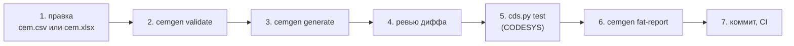

# Работа с матрицей: от правки до отчёта FAT

> **Внимание.** Код демонстрационный и не предназначен для систем безопасности. Реальная ПАЗ
> требует определения SIL, сертифицированных аппаратных и программных средств и валидации по
> ГОСТ Р МЭК 61511.

Как изменить матрицу причин и следствий, перегенерировать конфигурацию ПЛК и тесты, прогнать их и
прочитать отчёт FAT. Короткая версия — [README](../README.md#как-использовать-в-своём-проекте).
Нормативное описание формата — [DESIGN.md, раздел 9](DESIGN.md#9-формат-матрицы-cem1), устройство
генератора — [CEMGEN.md](CEMGEN.md), установка CODESYS и рантайма — [MANUAL_STEPS.md](MANUAL_STEPS.md).

Все команды — из корня репозитория; в cmd, PowerShell и Git Bash они пишутся одинаково.

- [1. Что правится руками, а что генерируется](#1-что-правится-руками-а-что-генерируется)
- [2. Цикл работы](#2-цикл-работы)
- [3. Пример: другая уставка и новая связь](#3-пример-другая-уставка-и-новая-связь)
- [4. Как читать отчёт FAT](#4-как-читать-отчёт-fat)
- [5. Формат матрицы: шпаргалка](#5-формат-матрицы-шпаргалка)
- [6. Частые ошибки проверки](#6-частые-ошибки-проверки)
- [7. Своя матрица вместо V-101](#7-своя-матрица-вместо-v-101)

## 1. Что правится руками, а что генерируется

| Файл | Кто пишет | Править вручную |
|---|---|---|
| `examples/separator/cem.csv` | инженер | да — единственный источник |
| `examples/separator/cem.xlsx` | `cemgen convert` из CSV | только как способ правки в Excel, затем конвертация обратно в CSV |
| `src/**/Generated/`, `tests/**/Generated/` | `cemgen generate` | нет: каталоги принадлежат генератору, лишние `*.st` в них удаляются |
| `docs/cause_effect_matrix.md`, `.html`, `docs/FAT_protocol.md`, `docs/truth_tables/VOTING.md` | `cemgen generate` | нет |
| `docs/SRS.md` | инженер; раздел 3 между `<!-- cemgen:sif:begin -->` и `<!-- cemgen:sif:end -->` — `cemgen generate` | да, кроме блока между маркерами |
| `docs/FAT_REPORT.md` | `cemgen fat-report` | нет (кроме раздела 8 в распечатке) |
| `src/POUs/Sis/`, `src/DUTs/Sis/`, `tests/POUs/Suites/` | инженер | общая логика ПАЗ и её граничные тесты — от матрицы не зависят |

Кто заметит ручную правку сгенерированного файла:

- **CI** — команда `python -m cemgen generate examples/separator/cem.csv --check` падает на любом
  расхождении и печатает «изменён / новый / лишний» по каждому файлу.
- **ПЛК** — только часть правок. Контрольная сумма `CEM_CFG.wMatrixCrc` охватывает число причин и
  следствий и маски «X» ([DESIGN.md, 6.8](DESIGN.md#68-конфигурация-и-crc)). Уставки, задержки,
  схемы голосования и обходы в `GVL_SisCfg` в неё не входят: их ручную правку ловит только
  `generate --check`.

## 2. Цикл работы



### Шаг 1. Правка матрицы

CSV — источник истины, XLSX — копия для работы в Excel. Два способа:

- **CSV в текстовом редакторе.** Кодировка UTF-8 (с BOM или без), разделитель `;`. После правки
  обновите копию XLSX, иначе pytest (`test_committed_xlsx_matches_csv`) и CI заметят расхождение:

  ```bash
  python -m cemgen convert examples/separator/cem.csv examples/separator/cem.xlsx
  ```

- **XLSX в Excel.** Откройте `examples/separator/cem.xlsx` (лист `CEM`, все ячейки — текст),
  сохраните как XLSX и верните правку в CSV:

  ```bash
  python -m cemgen convert examples/separator/cem.xlsx examples/separator/cem.csv
  ```

  Увидите: `cemgen: examples/separator/cem.xlsx → examples/separator/cem.csv`. Конвертация идёт
  строка в строку, комментарии `#` сохраняются. Команда «Сохранить как → CSV» в Excel не подходит:
  русский Excel пишет CSV в cp1251, такой файл отклоняется с `CEM-E001 кодировка не UTF-8`.

В `[header]` поднимите `revision` (и `date`): ревизия попадает в заголовок каждого
сгенерированного файла, в протокол FAT и в отчёт.

`convert` не создаёт каталоги: путь назначения должен существовать (`build/` в свежем клоне ещё
нет).

### Шаг 2. Проверка

```bash
python -m cemgen validate examples/separator/cem.csv --strict
```

Увидите для демо-матрицы:

```text
examples/separator/cem.csv: SIS-V101-CEM ревизия B — причин 10, следствий 7, CRC 16#CD40; ошибок 0, предупреждений 0
```

Ошибка — с номером строки и буквой колонки, как в Excel, и подсказкой; код выхода 1, `--strict`
делает ошибками и предупреждения:

```text
examples/separator/cem.csv:28:F: CEM-E016 vote «3oo3» не из списка. Как исправить: впишите 1oo1, 1oo2, 2oo2 или 2oo3.
examples/separator/cem.csv: матрица не принята — ошибок 1, предупреждений 0
```

`--json` выдаёт тот же результат для скриптов. Все правила (CEM-E001…E031, CEM-W001…W006) —
[DESIGN.md, 9.4](DESIGN.md#94-правила-проверки); самые частые — [раздел 6](#6-частые-ошибки-проверки).

### Шаг 3. Генерация

```bash
python -m cemgen generate examples/separator/cem.csv
```

Увидите список файлов и итог, например после смены ревизии:

```text
cemgen: файлов 277 — новых 0, изменено 277, удалено 0, без изменений 0; тестов по матрице 83
```

«Изменено 277» после любой правки — это нормально: в заголовке каждого сгенерированного файла
записаны ревизия и SHA-256 сетки матрицы. Генерация выполняется целиком или никак: при ошибке
матрицы файлы не пишутся (`матрица не принята … файлы не записаны`). Повторный запуск без правок
ничего не меняет: дат генерации и случайных значений в выходе нет, CSV и XLSX одной матрицы дают
одинаковые файлы.

### Шаг 4. Ревью диффа

Скрыть фрагменты, где поменялся только заголовок (ревизия, дата, SHA-256 сетки):

```bash
git diff --stat -I "SHA-256|[0-9]{4}-[0-9]{2}-[0-9]{2}|rev [A-Z]"
git diff -I "SHA-256|[0-9]{4}-[0-9]{2}-[0-9]{2}|rev [A-Z]" -- src/GVLs/Generated/GVL_SisCfg.gvl.st
```

Что смотреть: `GVL_SisCfg.gvl.st` — маски `wCauseMask`, уставки, задержки, CRC; стимулы и ожидания
сценарных тестов `tests/POUs/Generated/FB_CemGen*_Test/`; шаги `docs/FAT_protocol.md`; описание
функций в `docs/SRS.md`. Пример того, что меняется, — [раздел 3](#3-пример-другая-уставка-и-новая-связь).

### Шаг 5. Тесты в CODESYS

```bat
python tools\codesys\cds.py test
```

Нужны Windows, CODESYS 3.5.17.30, coUnit 1.2.0.0 и plc-process-lib
([README, «С CODESYS»](../README.md#с-codesys-сборка-и-тесты-в-программном-плк)). Команда импортирует
`src/` и `tests/` в проект, собирает его, загружает в CODESYS Control Win V3 и прогоняет все наборы
coUnit; для демо — 255 тестов, около 2 минут (импорт ~35 с, загрузка и прогон ~1 мин; дольше, если
рантайм занят другим проектом). Результаты — `build/test-results.json` и `build/junit.xml`, упавшие
тесты печатаются с сообщением ассерта. Без CODESYS этот шаг не выполнить: CI проверяет генерацию и
статанализ, но логику ПАЗ исполняет только CODESYS.

### Шаг 6. Отчёт FAT

```bash
python -m cemgen fat-report examples/separator/cem.csv --results build/test-results.json
```

Увидите: `cemgen: docs\FAT_REPORT.md — тестов 255, пройдено 255, упало 0` (на Linux — с `/`).
Код выхода 1, если есть упавшие тесты. Отчёт перезаписывается целиком; как его читать —
[раздел 4](#4-как-читать-отчёт-fat).

### Шаг 7. Коммит

В один коммит — матрица (CSV и XLSX), все сгенерированные файлы и `docs/FAT_REPORT.md`. CI
проверяет обе матрицы (`validate --strict` для CSV и XLSX), совпадение сгенерированного с матрицей
(`generate --check`), pytest, сборку ST, линтер и iec_checker.

## 3. Пример: другая уставка и новая связь

Оба примера выполнены на копии репозитория; цифры ниже — вывод команд.

**Уставка.** PSHH101 срабатывает не с 0,90, а с 0,95 МПа; ревизия B → C. В
`examples/separator/cem.csv` строка 28, колонка `setpoint` (I):

```diff
-revision;B
+revision;C
-1;PSHH101;Давление в V-101 аварийно высокое;ai;PT101A,PT101B,PT101C;2oo3;vote_trip;high;0.90;0.02;МПа;…
+1;PSHH101;Давление в V-101 аварийно высокое;ai;PT101A,PT101B,PT101C;2oo3;vote_trip;high;0.95;0.02;МПа;…
```

`validate` — `ревизия C … CRC 16#CD40; ошибок 0`, `generate` — `изменено 277`. Дифф без заголовков
(шаг 4) — 15 файлов:

| Файл | Что изменилось |
|---|---|
| `examples/separator/cem.csv` | ревизия и уставка |
| `src/GVLs/Generated/GVL_SisCfg.gvl.st` | `rTripLimit_eu := 0.9` → `0.95` в `VOTE_CFG[1]`; CRC осталась `16#CD40` |
| 9 файлов сценарных тестов с участием PSHH101 в `tests/POUs/Generated/FB_CemGen0*_Test/` | стимул требования `13.2` → `13.7` мА (0,92 → 0,97 МПа) |
| `docs/FAT_protocol.md` | шаг FAT-03-01: 13,70 мА, уставка ≥ 0,95 МПа |
| `docs/SRS.md` | функция SIF-01: уставка ≥ 0,95 МПа |
| `docs/cause_effect_matrix.md`, `.html` | уставка в таблицах |

В остальных 263 сгенерированных файлах — только заголовок (ревизия и SHA-256 сетки). Фрагмент
теста:

```text
-fbH001.stIo.rPT101A_mA := 13.2;   // 13,20 мА = 0,920 МПа
+fbH001.stIo.rPT101A_mA := 13.7;   // 13,70 мА = 0,970 МПа
```

**Новая связь.** PSHH101 закрывает ещё и BDV101 — «X» в колонке BDV101 строки 28. Меняются маска
следствия и CRC, а сценарные тесты PSHH101 теперь ожидают, что BDV101 обесточен:

```text
-wMatrixCrc := 16#CD40,
+wMatrixCrc := 16#C45F,
-(eSafeState := E_SafeState.Open, wCauseMask := 16#00C0),           // 2 BDV101: 7, 8
+(eSafeState := E_SafeState.Open, wCauseMask := 16#00C1),           // 2 BDV101: 1, 7, 8

-AssertTrue(Condition := fbH001.stIo.xQBDV101, Message := 'PSHH101: BDV101 must stay energized');
+AssertFalse(Condition := fbH001.stIo.xQBDV101, Message := 'PSHH101: BDV101 must be tripped');
```

Дальше — шаги 5–7: тесты в CODESYS, отчёт FAT, коммит.

## 4. Как читать отчёт FAT

[docs/FAT_REPORT.md](FAT_REPORT.md) — протокол [docs/FAT_protocol.md](FAT_protocol.md) с
заполненными графами «Результат» и «Отметка» по результатам `cds.py test`.

- **Шапка** — документ, ревизия и CRC матрицы, файл результатов и время прогона. Ревизия в отчёте
  должна совпадать с ревизией матрицы в коммите.
- **«Итог»** — сколько шагов в каждом состоянии. Приёмка демо — все шаги «соответствует».
- **Разделы 1–7** — шаги протокола: объект и конфигурация, предварительные проверки (старт ПЛК,
  CRC), каждая причина и её следствия, голосование и отказ каналов, байпасы и пусковые обходы,
  первопричина и сброс, логика ФБ по наборам граничных тестов.
- **«Автотест»** — имена или шаблоны тестов coUnit: `Matrix_PSHH101Demand_*` — все тесты с таким
  началом имени.
- **«Результат»**:

  | Значение | Когда |
  |---|---|
  | соответствует | по **каждому** шаблону шага есть результаты, и все они пройдены |
  | не соответствует | хотя бы один тест шага упал |
  | не выполнялся | по какому-то шаблону нет ни одного результата (набор не собран или тест переименован) |
  | — | у шага нет автотестов (раздел 1: сверка с документами и сборкой) |

- **«Отметка»** — `тестов N` для пройденного шага, имя и сообщение первого упавшего теста для
  «не соответствует», `нет результатов: <шаблон>` для «не выполнялся».
- **Раздел 8** (замечания и подписи) заполняется вручную в распечатке.

Фрагмент:

| Шаг | Проверка | Воздействие | Ожидаемый результат | Автотест | Результат | Отметка |
|---|---|---|---|---|---|---|
| FAT-03-01 | PSHH101 — Давление в V-101 аварийно высокое | PT101A, PT101B, PT101C: 13,20 мА (0,92 МПа; уставка ≥ 0,9 МПа) | через 2 с: ESDV101 — закрыт; H101 — отключён; UA110 — сигнал; BDV101, ESDV102, P101A, P101B — под напряжением; первопричина PSHH101 | `Matrix_PSHH101Demand_*`<br>`Matrix_PSHH101Delay_*` | соответствует | тестов 2 |
| FAT-07-03 | FB_CauseEffect: задержки, фиксация, обходы, сброс, события | набор тестов coUnit | все тесты пройдены | `Cem_*` | соответствует | тестов 42 |

**Что это за испытание.** Проверка в стиле FAT на программном ПЛК CODESYS Control Win V3 с
подменным временем (`PL.FB_FakeTime`): входы задаёт стенд `FB_SisHarness`, задержки проверяются
«ровно на пороге» за один цикл. Это не FAT шкафа с ПЛК210 и модулями ввода-вывода: проводка,
модули, реальное время цикла и реакция исполнительных механизмов здесь не проверяются. Бланк
`docs/FAT_protocol.md` с пустыми графами можно распечатать для испытаний на стенде.

## 5. Формат матрицы: шпаргалка

Сокращённо; полное описание с правилами — [DESIGN.md, раздел 9](DESIGN.md#9-формат-матрицы-cem1).

**Файл.** CSV: UTF-8, разделитель `;`, кавычки по RFC 4180; строка, начинающаяся с `#`, —
комментарий; пустые строки пропускаются. XLSX: лист `CEM`, та же сетка строка в строку. Числа — с
точкой или запятой, без единиц. Длительности — `500ms`, `2s`, `15m`, `8h` (число без единицы —
секунды). Логические — `yes`/`no`, `да`/`нет`, `1`/`0`, `true`/`false`.

**Раскладка.** Два раздела: `[header]`, затем `[matrix]`. В `[matrix]` ячейка `>>` в строке
заголовков причин задаёт колонку меток: левее — атрибуты причин, правее — следствия.

```text
[header]
format;cem/1
…
[matrix]
;…;effect_no;1;2;…                 ← атрибуты следствий: метка в колонке «>>», значения правее
;…;effect_tag;ESDV101;BDV101;…
;…;safe_state;closed;open;…
no;tag;description;…;notes;>>      ← строка заголовков причин
1;PSHH101;…;…;…;;X;;…              ← причина: атрибуты левее «>>», «X» правее
```

**`[header]`** (строки `ключ;значение`):

| Ключ | Обязателен | Что задаёт |
|---|---|---|
| `format` | да | `cem/1` |
| `object`, `object_name`, `title`, `document` | да | обозначения для документов и заголовков; `object` и `document` — ASCII |
| `revision`, `date`, `author` | да | ревизия (ASCII), дата `ГГГГ-ММ-ДД`, автор |
| `start_tripped` | нет, `yes` | после старта ПЛК все следствия в безопасном состоянии до сброса |
| `test_step` | нет, `100ms` | шаг сгенерированных тестов; все длительности матрицы кратны ему |
| `reset_tag`, `bypass_permit_tag`, `override_permit_tag` | нет | теги кнопки сброса и ключей разрешения байпасов и обходов |

**Следствия** — строки над строкой заголовков причин: `effect_no` (1..16 подряд), `effect_tag`,
`effect_description`, `actuator`, `safe_state` (`closed`, `open`, `stopped`, `off`, `alarm` или
по-русски), необязательный `effect_notes`.

**Причины** — колонки левее `>>`, порядок любой:

| Колонка | Что задаёт | PSHH101 в демо |
|---|---|---|
| `no`, `tag`, `description` | номер 1..16 по порядку, тег функции, описание | `1`, `PSHH101`, … |
| `signal` | вид входов: `ai` — 4–20 мА; `di` — дискретный с контролем линии; `ext` — внешний сигнал без голосования | `ai` |
| `source` | теги каналов через запятую, ровно N схемы (для `ext` — один) | `PT101A,PT101B,PT101C` |
| `vote` | схема `1oo1`, `1oo2`, `2oo2`, `2oo3` (для `ext` — `-`) | `2oo3` |
| `policy` | при отказе канала: `vote_trip` — недостоверный канал голосует «на останов» (2oo3 → 1oo2 → останов); `degrade_safe` — исключается, требуемое число голосов снижается (2oo3 → 1oo2 → 1oo1); `degrade_available` — исключается, схема держит число голосов, пока хватает каналов (2oo3 → 2oo2 → 1oo1) | `vote_trip` |
| `trip_on` | `ai`: `high`/`low`; `di`, `ext`: значение входа, означающее требование (`0` — срабатывание на обесточивание) | `high` |
| `setpoint`, `hyst`, `units` | уставка (включительно), гистерезис, единицы — только `ai` | `0.90`, `0.02`, `МПа` |
| `range_lo`, `range_hi`, `normal` | шкала 4–20 мА и нормальное значение — только `ai` | `0`, `1.6`, `0.60` |
| `discrepancy`, `discrepancy_delay` | порог и задержка сигнализации рассогласования каналов (на срабатывание не влияет) | `0.05`, `10s` |
| `delay` | задержка срабатывания | `2s` |
| `bypass_max`, `bypass_time` | сколько каналов можно байпасировать одновременно и на какой срок | `1`, `8h` |
| `override`, `override_time`, `override_clear` | пусковой обход: разрешён ли, срок, время подтверждения нормы для автоснятия (по умолчанию `30s`) | `no` |
| `enable`, `notes` | причина включена; примечание для документов | `yes`, … |

**Ячейки матрицы** правее `>>`: `X` (латиница или кириллица, любой регистр) — причина переводит
следствие в безопасное состояние; пусто — нет связи.

**Теги** — `^[A-Z][A-Z0-9]{0,23}$`: заглавные латинские буквы и цифры, без `-`, `_` и пробелов —
тег без преобразований входит в имена ST (`CAUSE_PSHH101`, `rPT101A_mA`, `xQESDV101`) и тестов.

**Пределы:** до 16 причин и 16 следствий (маски `WORD`), до 3 каналов в группе голосования.

## 6. Частые ошибки проверки

| Код | Когда | Что сделать |
|---|---|---|
| CEM-E001 | файл не UTF-8 (CSV, сохранённый Excel), расширение не `.csv`/`.xlsx` | править XLSX и выполнить `cemgen convert` в CSV; в редакторе — сохранить в UTF-8 |
| CEM-E016 | схема не из списка; число тегов в `source` не равно N схемы | `1oo1`, `1oo2`, `2oo2`, `2oo3`; для 2oo3 — три тега через запятую |
| CEM-E019 | уставка или `normal` вне шкалы; `normal` не на стороне нормы с учётом гистерезиса | проверить `range_lo`, `range_hi`, `setpoint`, `hyst`, `normal` |
| CEM-E021 | длительность не разбирается, не кратна `test_step` или больше предела (`delay` ≤ 10m, `override_time` ≤ 2h, `bypass_time` ≤ 12h) | исправить значение или `test_step` |
| CEM-E026, CEM-E027 | включённая причина без «X»; следствие без «X» включённых причин | добавить связь или выключить причину (`enable = no`) |
| CEM-E031 | `override_clear` не меньше `override_time` | подтверждение нормы должно быть короче срока обхода |
| CEM-W005 | байпасы или обходы разрешены, а ключа разрешения нет | задать `bypass_permit_tag` / `override_permit_tag` или осознанно оставить разрешение только командой HMI |
| CEM-W006 | `di` или `ext` срабатывает при `1` — обрыв цепи даёт «норму» | `trip_on = 0` (срабатывание на обесточивание) или обосновать в `notes` |

С `--strict` предупреждения тоже дают код 1 — так проверяет CI.

## 7. Своя матрица вместо V-101

Общий код (`src/POUs/Sis/`) об объекте ничего не знает: другой объект — другая матрица и
`cemgen generate`, без правок ST. Проверено на учебной матрице `pytests/fixtures/mini.csv`
(3 причины, 2 следствия): `generate` записал 155 файлов и 24 сценарных теста, удалил 170 файлов
V-101, `st_lint --strict` и RuSTy прошли без ошибок.

1. Сделайте копию или форк репозитория и замените содержимое `examples/separator/cem.csv` своей
   матрицей. Путь лучше оставить: его используют CI (`.github/workflows/ci.yml`, шаги `cemgen`) и
   pytest (`pytests/test_generate.py::test_repository_matches_matrix`, `pytests/test_srs.py`).
2. `python -m cemgen convert examples/separator/cem.csv examples/separator/cem.xlsx`, затем шаги 2–7.
3. Пересмотрите вручную то, что написано под V-101:
   - рукописные разделы `docs/SRS.md` (генератор заменяет только блок функций безопасности);
   - обоснования iec_checker `tools/check/iec_checker_allow.toml` — подобраны под код V-101: с
     учебной матрицей без ключей разрешения iec_checker нашёл 3 необоснованные неиспользуемые
     переменные в `F_SisIoKeys`;
   - демо-сценарий `tools_project/demo/` (теги PT101A/B/C) и тексты README и `docs/`.
4. Перенесите результат в приложение для ПЛК. Генератор строит образ ввода-вывода `GVL_SisIo.stIo`
   (токи в мА, дискретные входы, выходы-разрешения), но не привязку к модулям. Два пути:
   - рабочий проект `build/<имя>.project` из `cds.py build` (MainTask 20 мс → `PRG_Main` →
     `PRG_Sis`): устройство задаётся в `tools/codesys/config.json` (`device`, переменные
     `CDS_DEVICE_*`; для ПЛК210 — из таргет-файла ОВЕН), а дерево устройств, конфигурацию модулей и
     пересчёт сырых значений в образ делают в IDE — в `src/` они не экспортируются
     ([MANUAL_STEPS.md, раздел 6](MANUAL_STEPS.md#6-работа-в-ide-и-экспорт-перед-коммитом));
   - библиотека из форка: `python tools\codesys\cds.py library --install` собирает `src/` без
     `PRG_Main` (пространство имён `SIS`), её подключают к существующему проекту
     ([MANUAL_STEPS.md, 7.3](MANUAL_STEPS.md#73-проект-который-использует-библиотеку-портфолио)).
     Перед этим задайте свои компанию и название в разделе `library` файла `tools/codesys/config.json`
     ([MANUAL_STEPS.md, 7.1](MANUAL_STEPS.md#71-выпуск-релиза), шаг 2). Библиотека из релиза
     собрана с матрицей V-101 и под другую матрицу не подходит.

   С реальным вводом-выводом демо-заполнение входов в первом цикле не нужно: выключите
   `DEMO_IO_SIMULATION` в `src/GVLs/GVL_Const.gvl.st`. На контроллере ни один из путей не
   проверялся; в демо привязки к модулям нет.

Ограничения: одна матрица на репозиторий; до 16 причин, 16 следствий и 3 каналов в группе;
привязки к модулям ПЛК210, HMI и SCADA нет. Это демонстрация подхода, а не инструмент для
проектов ПАЗ с SIL — см. [SRS.md, раздел 9](SRS.md#9-что-нужно-для-реальной-srs).
